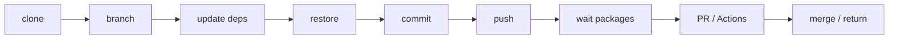
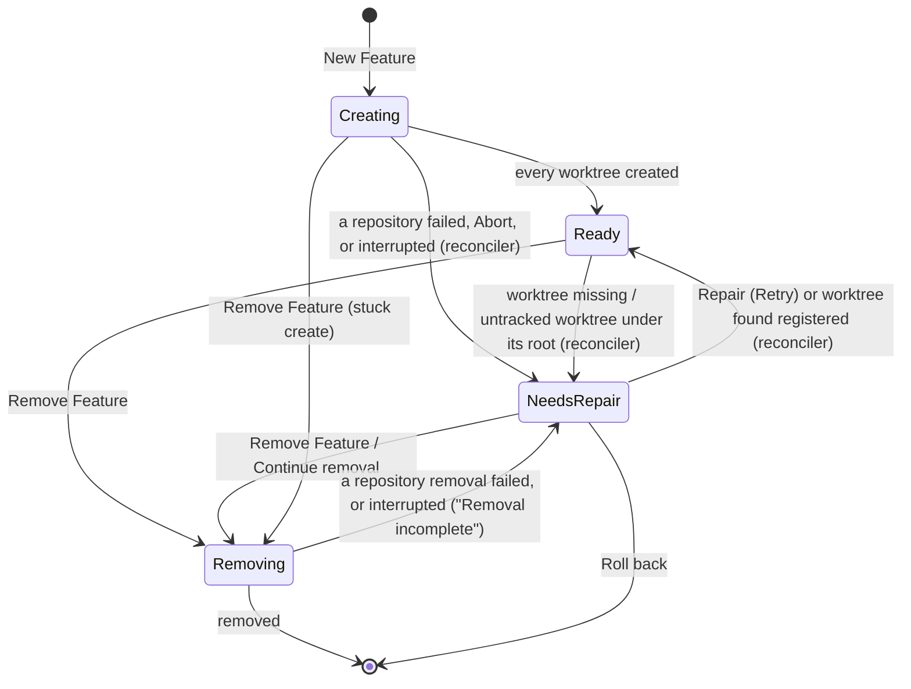
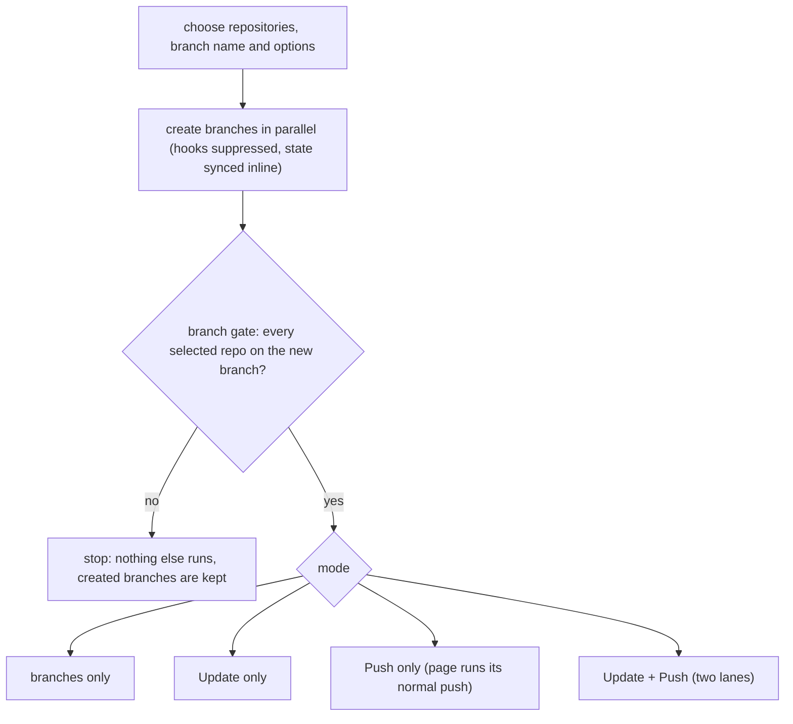
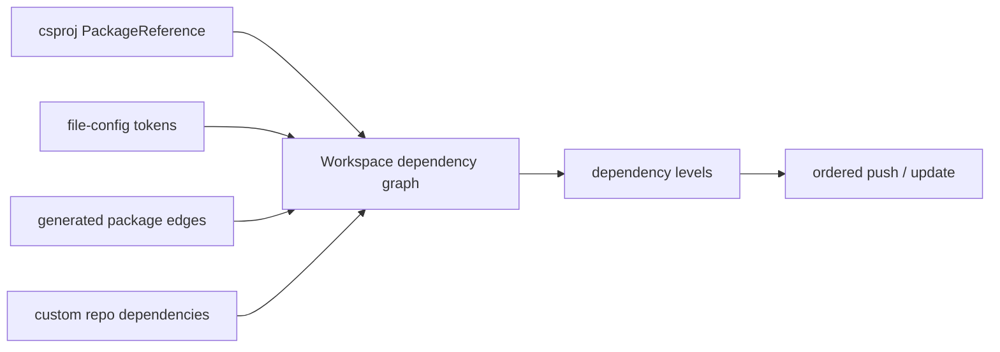

# 01 - Product Model and User Workflows

## 1. Purpose of GrayMoon

GrayMoon is designed for development environments where one logical product is distributed across many Git repositories.

A typical Workspace may contain:

```text
shared libraries
NuGet packages
microservices
executables
test projects
infrastructure repositories
version/configuration repositories
```

Without GrayMoon, a cross-repository change often requires a developer to repeat the same work manually:



GrayMoon treats the repository collection as one coordinated Workspace.

Its purpose is not to replace Git or GitHub. It orchestrates them with knowledge of the Workspace dependency graph and persists enough state to present a coherent multi-repository view.

---

## 2. Core terminology

### Workspace

A Workspace is a named collection of repositories that belong together for development.

It owns:

```text
repository membership
workspace root
workspace profile (type, versioning, CI)
custom dependency declarations
configured files
version-file patterns
workspace-level settings
optional Workspace repository
```

Every Workspace repository has one main physical checkout under the Workspace root. A Workspace can additionally have Features, each with its own worktree checkout of every member repository.

### Workspace profile

Every Workspace has a profile made of three independent, persisted settings (`Workspace.Type`, `VersioningMode`, `CiProvider`, enums in `GrayMoon.Abstractions/Workspaces/`):

```text
Type            Basic | DotNetDependency (".NET Dependency")
VersioningMode  None  | GitVersion       ("Calculate versions with GitVersion")
CiProvider      None  | GitHubActions    ("GitHub Actions")
```

- **Basic**: Git repositories, branches, Features, pull requests, Changes and Files. No `.csproj`/NuGet discovery, no dependency levels, no generated packages, no dependency badges, no restore.
- **.NET Dependency**: adds .NET project and NuGet package discovery, dependency levels, dependency-aware update, package-aware (synchronized) push and `dotnet restore`.
- The axes are independent: a Basic Workspace may still calculate versions with GitVersion, and GitHub Actions is independent of GitHub being the source-control host.

The Workspace modal shows a radio choice (".NET Dependency" / "Basic") and two checkboxes. Picking a type sets the checkbox defaults (`WorkspaceProfileDefaults.ForType`: .NET Dependency -> GitVersion + GitHub Actions; Basic -> neither); the user may then override either checkbox.

Behaviour never reads the persisted enums directly. `WorkspaceCapabilities` (derived, never persisted) turns the three values into flags such as `UsesRepositoryVersioning`, `DiscoversDotNetProjects`, `UsesDependencyGraph`, `UsesNuGetPackages`, `UsesDependencyAwareUpdate`, `UsesDependencyAwarePush`, `UsesPackageRestore` and `UsesCiIntegration`, and capabilities are resolved by Workspace id only. See 02 for the architecture.

Features inherit the profile of their Workspace; there is no per-Feature profile. Profile rules:

- Changing the type is refused while the Workspace has Features (same message as rename and root changes: "Rename and root changes are not possible while Features exist. Remove Features first."). Versioning and CI may change at any time.
- Basic -> .NET Dependency: discovery happens on the next Sync.
- .NET Dependency -> Basic: the .NET-derived state is cleared (`WorkspaceProfileTransition.ClearDotNetDerivedStateAsync`: projects, project dependencies, and the dependency level/dependencies/unmatched/repository-type fields on links and context states).
- Versioning off keeps persisted GitVersion values and `{@Repo}` version-file lines; they are treated as not applicable. CI off keeps persisted Actions rows.

### Feature

A Feature is a named, isolated working context inside a Workspace. Creating one runs `git worktree add` for every Workspace repository, on a new branch named after the Feature, starting from the commit the Workspace checkout is on. Worktrees live under `{Feature storage root}\{WorkspaceName}\features\{FeatureName}\{RepositoryName}`; when the Workspace has a Workspace repository, its worktree is the Feature root `{Feature storage root}\{WorkspaceName}\features\{FeatureName}` itself and the Source worktrees are nested in it.

A Feature lets a developer (or an AI agent) work on a cross-repository change without touching the main Workspace checkouts, and lets several such changes proceed side by side.

Feature lifecycle states (`WorkspaceFeatureLifecycleState`): `Creating`, `Ready`, `Removing`, `NeedsRepair`.



- A failed create writes Feature `LastError` "One or more worktrees failed to create." plus a per-repository error.
- `WorkspaceFeatureReconciler` runs when the Worker comes online (throttled): it marks a Feature stuck in `Creating`/`Removing` as NeedsRepair ("Interrupted while creating" / "Interrupted while removing"), marks rows whose worktree is gone ("Worktree is missing"), and returns rows to Ready when their worktree is registered. It never deletes worktrees or adopts untracked ones.
- A terminal checkout of another branch inside a Feature worktree is drift, shown as a warning; it never moves a Feature to NeedsRepair.

The context selector lists every Feature with a friendly label (`FeatureSelectorPresentation`): Ready (no label), "Setting up...", "Removing...", "Needs attention", "Removal incomplete". Only Ready and NeedsRepair Features are selectable. A NeedsRepair Feature opens read-only (Sync, Push and Update disabled) with the banner "This Feature needs attention. Use Repair to continue." and a Repair button (section 22A). A `Creating` Feature still offers Remove (escape hatch for a stuck create); a `Removing` one does not.

### Context

Every Workspace page shows one context at a time:

```text
Workspace   the special context backed by the main checkouts (one per Workspace)
Feature     a context backed by that Feature's worktrees
```

The context is selected in the selector at the top of each Workspace page and is carried in the URL as `?context=<id>`. Internally it is a `WorkspaceFeatureContextId`, and every context-scoped operation receives it explicitly.

### Repository

A Repository is a Git repository discovered from a configured source connector, normally GitHub.

The same underlying Repository entity may be linked into a Workspace through `WorkspaceRepositoryLink`.

### WorkspaceRepositoryLink

This is the current Workspace-to-Repository membership record and, in today's implementation, also the main persisted projection of the repository's current checkout state for the special Workspace (Feature contexts use per-context state rows, see 03).

It includes data such as:

```text
GitVersion
BranchName
CheckedOutTag
DefaultBranchName
OutgoingCommits
IncomingCommits
DefaultBranchAheadCommits
DefaultBranchBehindCommits
BranchHasUpstream
DependencyLevel
Dependencies
UnmatchedDeps
RepositoryType
```

The dependency fields are only produced for .NET Dependency Workspaces.

### Workspace repository

A Workspace can name one of its imported GitHub repositories as its **Workspace repository**. It is optional and chosen in the Workspace modal (field "Workspace repository", with a `None` choice). A Workspace has at most one. Sections 4A and 4B describe the user workflows.

- The Workspace repository's working tree is the Workspace root folder itself. Source repositories stay in nested folders inside it and are ignored through a GrayMoon-managed section of the root `.gitignore`.
- It carries the Workspace definition, `graymoon.json` (section 4B).
- The Repositories page lists it first, under a "Workspace" header, with a Workspace badge, whatever its dependency level; in a flat (Basic) grid a "Repositories" header then precedes the Sources. In a .NET Dependency Workspace it takes part in the dependency graph like a Source repository: its own `.csproj` files (discovery skips the Source folders listed in `graymoon.json`, nested repositories and Git-ignored folders), version files and custom dependencies make it depend on Source repositories. It is always the top dependency level, so update and push reach it last, and nothing may depend on it: an edge into it (a Source `.csproj` reference, a version-file token or a custom dependency) is dropped.
- Enabling, disabling or changing it is refused while the Workspace has Features ("Cannot enable a Workspace repository while Features exist. Remove Features first." / "Cannot disable ..."), and refused up front when the Worker is unavailable or version-mismatched (`IWorkerBridge.GetUnavailableReason()`). Disabling removes the link only; files and `.git` stay on disk.
- A Feature is created in two phases: the Workspace repository root worktree first (its path is the Feature root), then the Source worktrees inside it. Removal and rollback take the Sources first and the root last.

### Project

A Workspace Project is a discovered `.csproj` or a generated/virtual package project. Projects exist only in .NET Dependency Workspaces.

Projects provide package identity, framework, project type, and package references used by dependency analysis.

### Dependency level

In a .NET Dependency Workspace, GrayMoon transforms repository dependency relationships into dependency levels. A Basic Workspace has no levels (the grid is a flat list).

Repositories in the same level can generally be processed in parallel.

Operations that must respect dependency order process one level before the next.

### Prepare Workspace

`Prepare Workspace` is the coordinated branch workflow for the main Workspace checkouts (section 7).

It creates a branch across the selected Workspace repositories and, only if every branch was created, optionally updates dependencies and pushes.

It is not a worktree Feature: it works on the main Workspace checkouts and is only offered in the special Workspace context.

### Return to Default

`Return to Default` safely moves selected Workspace repositories back to their default branches and cleans up the previous working branches according to explicit safety rules.

The safety logic is headless and shared:

```text
AnalyzeReturnToDefaultAsync
-> ReturnToDefaultPlan
-> explicit ReturnToDefaultOptions
-> ExecuteReturnToDefaultAsync
```

The UI and unattended/REST path use the same analysis.

---

## 3. Main application navigation

At the global level GrayMoon provides:

```text
Home
Workspaces
Repositories   (all repositories known from connectors, /repositories)
Connectors
Worker         (/worker)
Settings
```

On Repositories (`/repositories`), the name in the Repository column opens that repository on GitHub, the same way a repository name does on a Workspace's Repositories page.

Inside a Workspace the main navigation is (with Home above it):

```text
Repositories   (/workspaces/{id})                         always
Changes        (red dot when the selected context has uncommitted work)  always
Projects                                                 .NET Dependency only
Packages                                                 .NET Dependency only
Files                                                    always
Deps                                                     .NET Dependency only
Actions                                                  only when CI is enabled (follows CiProvider, not type)
```

Page availability has a single policy, `WorkspacePageAccess` (resolved by Workspace id, so a Feature context gets its Workspace's answer). The navigation hides unavailable pages. Navigating directly to one does not redirect: the page renders `WorkspacePageGate` with "Projects are only available for .NET Dependency workspaces." (same for Packages, Dependencies) or "CI is not enabled for this workspace." and a "Back to Repositories" link, and never runs its data queries.

### Repositories

The operational control plane.

This page combines current Git state, version state, dependency information, pull-request state, and action status.

It is the primary place from which users initiate coordinated repository operations.

The grid follows the profile (`WorkspaceGridPresentation`): the Version column only when versioning is on; dependency badges and level grouping only for .NET Dependency (otherwise a flat list); Update, Push Updated, Level Only and Update & Push only with dependency-aware update; Restore only with package restore. Without dependency-aware update the header shows a standalone "Update Files" action while a version file is out of date, and bulk "Merge PRs..." moves to the header Branch/Feature menu (there are no level headers to host it).

### Changes

The multi-repository Git Changes experience.

It provides:

```text
changed-file tree
staged / unstaged state
multi-selection
diff view
stage / unstage
discard
one adaptive Commit button (Commit Staged / Commit All)
optional push after commit
AI-generated commit message (section 18A)
```

### Projects

Displays discovered projects across the Workspace (.NET Dependency only).

Typical columns include:

```text
Name
Type
Framework
File
```

### Packages

Displays package-producing projects and matched package registries (.NET Dependency only).

Used to understand which Workspace projects publish packages consumed by other Workspace repositories.

### Files

Displays user-configured repository files that GrayMoon should track or version-manage. Available in every profile.

Supports file discovery, viewing, version-pattern configuration, and version updates.

### Deps

Visualizes the repository dependency graph (.NET Dependency only).

Dependencies come from more than `.csproj` references. GrayMoon can combine:

```text
PackageReference relationships
configured version-file token references
generated package relationships
custom user-declared dependencies
```

A `PackageReference` with no `Version` uses central package management: its version is the `PackageVersion` entry in the
nearest `Directory.Packages.props` inside the repository. The Worker reads it from there, rewrites that entry when
dependency versions are updated, and stages the file with the project when the update is committed.

### Actions

Shows GitHub Actions workflows for the current repository branches across the Workspace. Available only when the Workspace's CI provider is GitHub Actions.

Supports filtering, rerun/start behavior, cancellation where available, progress refresh, and logs.

---

## 4. Workspace creation and import

A Workspace has a name, a root path and a profile (section 2).

Repositories are selected from configured connectors. The Workspace modal and the Restore Workspace dialog share one repository picker (`RepositoryPicker`): a single searchable input with keyboard navigation and an attached Fetch action that refreshes repositories from connectors.

GrayMoon supports existing local repository layouts as well as repository creation/cloning through the Worker.

The App stores the Workspace configuration; the Worker inspects and modifies the local filesystem.

Important behavior:

- Workspace root is per Workspace.
- The global root setting acts as a default, not as the permanent source of truth for every Workspace.
- Repository membership is explicit.
- Save/import flows may take time because the Worker validates local repositories and obtains Git state.
- When the chosen root folder already is a Git repository whose origin matches an imported repository, the modal pre-selects it as the Workspace repository, and nested repositories found on disk are offered for import.

### Deleting a Workspace

A Workspace without Features is deleted after a normal confirmation. A Workspace with Features can also be deleted, but only after ticking an acknowledgement: "Removing this workspace loses track of its Features. Folders on disk are left in place." Deletion drops GrayMoon's tracking only; no worktree, branch or folder is touched.

---

## 4A. Workspace repository workflows

From the user's view a Workspace repository makes the Workspace itself a Git repository that can be shared and restored on another computer.

**Enable / adopt** (Workspace modal, pick a repository for "Workspace repository"). The Worker attaches the root folder:

```text
root already has .git with the same origin  -> adopted as is
root has .git with a different origin       -> refused ("Root already has a different Git repository")
root is empty                               -> cloned into the root
root is non-empty without .git              -> git init, add origin, fetch, check out the default branch
                                               (an empty remote gives an unborn main)
```

After a fresh attach GrayMoon writes the managed `.gitignore` section and `graymoon.json`. An adopted repository's files are left untouched (rewriting would drop entries not yet imported), and adopting imports the definition's version files. GrayMoon never commits these files; they appear in Changes like any other edit.

**Restore** ("Restore from repository" on the Workspaces page, dialog "Restore Workspace"). The user picks a GitHub repository; a preflight reads `graymoon.json` from its default branch through the GitHub API and reports which repositories and connectors are missing on this computer. Restore clones the Workspace repository into an empty root, creates the Workspace with the profile from the definition, links the Source repositories it finds, merges the definition's version files into the database (file wins) and runs an initial Sync. A failure or cancellation before the Workspace is usable rolls everything back. A failed `.gitignore` or definition write afterwards is a warning on a successful restore, repaired later from the drift banner. Missing repositories are reported (as `owner/name`); import them before using "Write Workspace definition to disk", which would otherwise drop them.

**Drift.** After a Sync that includes the Workspace repository (and after Workspace-repository checkouts or hook syncs in the special context), GrayMoon compares `graymoon.json` with the database. On a difference the Repositories page shows "Workspace definition on disk differs from this Workspace." with **Write Workspace definition to disk** and **Dismiss**. A missing or unreadable file also counts as drift.

## 4B. graymoon.json from the user's view

`graymoon.json` (root of the Workspace repository) is the shareable Workspace definition. It holds:

```text
version             schema version (1)
workspace.profile   type / versioning / ci
connectors          GitHub connector URLs of the Source repositories
repositories        Source repositories by URL and connector, with an optional tag + commit pin
versionFiles        configured version files and their patterns (section 13)
codegraph           optional workspace-wide switch (section 22C)
ai                  optional, AI providers and models for commit/PR text (section 18A)
```

The Workspace name is the folder on this computer. It is not written to `graymoon.json`. A leftover `workspace.name` in an older file is ignored, and the next rewrite leaves it out.

- GrayMoon rewrites it when Source membership or the profile changes, and when the user writes it from the drift banner. Version-file changes on the Files page rewrite only `versionFiles`.
- `codegraph`, `ai` and tag pins are file-owned: rewrites keep them and drift ignores them. Drift compares only repositories, connectors and profile; it also ignores a leftover name and `versionFiles`.
- When the Workspace repository is synced in the special context, its `versionFiles` are imported into the database (file wins); entries of repositories not in this Workspace are skipped on import and preserved on write.
- When a Source repository is checked out on a tag in the special context, the tag and its commit are pinned in the file (not committed); leaving the tag through GrayMoon clears the pin. A fresh clone of a pinned Source is checked out at the pinned commit.
- Nothing machine-local (the Workspace name, paths, IDs, credentials, the pinned AI provider) is ever written.

The full schema and write rules are in 03.

---

## 5. Repository synchronization

Workspace synchronization refreshes GrayMoon's knowledge of each local repository.

A full repository sync may:

```text
ensure repository exists
clone if needed
configure Git safe-directory handling
fetch refs and tags
run GitVersion                     (only when versioning is on)
determine branch/default branch
calculate incoming/outgoing commits
calculate divergence from default
determine upstream state
discover projects                  (.NET Dependency only)
refresh branches/tags
install/update GrayMoon Git hooks
persist resulting state
```

The UI is persistence-first: pages normally render SQLite state instead of running Git synchronously during rendering.

A failed clone stays failed: the row shows "not cloned" (or "error" for a failed fetch of an existing clone) with a short sanitized reason, never in sync. When GitHub requires SAML SSO authorization for the token, the row explains it and offers an "Authorize SSO" link to the validated GitHub organization or enterprise SSO page; the user retries with the per-repository Sync.

---

## 6. Branch workflows

### New Branch

GrayMoon can create a branch across Workspace repositories.

The branch operation can use a selected base and coordinates state persistence after checkout.

### Switch Branch

GrayMoon can switch repositories to a common branch.

Common branch computation intentionally ignores incompatible states such as repositories pinned to tags.

Individual repositories can also be switched independently. Branch lists carry ownership badges: a branch checked out by a Feature or by another worktree cannot be checked out here.

### Tags

Repositories can be checked out at tags.

A tagged repository is considered pinned/read-only for many write operations.

GrayMoon records:

```text
CheckedOutTag
HasNewerTag
```

and blocks inappropriate push/update/commit workflows until the user returns to a branch.

### Update branch from default

GrayMoon can update a current working branch from the repository default branch.

The user sees divergence and conflict results per repository.

New Branch, Switch Branch to another branch and Return to Default are Workspace-only; inside a Feature the branch rules of section 22B apply.

---

## 7. Prepare Workspace workflow

Prepare Workspace is a coordinated multi-repository workflow on the main Workspace checkouts.



- **Branch gate.** A repository counts as failed when it reported an error, was never targeted, returned no result, or ends on an unknown or different branch. Any failure (or zero targeted repositories) stops the workflow with "Prepare Workspace stopped: branches could not be created in all selected repositories. No dependency updates or pushes were started." The branches already created stay; there is no rollback. An empty selection stops with "Prepare Workspace stopped: no repositories were selected."
- **Update + Push** runs as two lanes (`UpdateAndPushOrchestrator`): the update lane updates level by level and hands each finished level to the push lane, which pushes it (and waits for its packages) while the update continues with the higher levels. The overlay shows one combined progress. Registries are matched once before any level for package ids the plan already requires. An unmatched package whose producer is not in this run refuses the pipeline up front: the update runs and the push is handed back to the page's normal push. A package this run will publish is not a reason to refuse. After the level that publishes it is pushed, and before the next level starts, only the still-unmatched ids are matched again (`SyncRegistriesForPackageIdsAsync`). Ids that already have a registry are not looked up again. The Packages page Sync still scans every package.
- **Package wait is registry-based and CI-agnostic.** The push lane waits for a level's packages by asking the package registry whether each required package@version exists (WorkspacePushService, window PushWaitDependencyTimeoutMinutesPerDependency per package, never shortened below the time already left). A required package that still has no registry is part of that wait: each poll asks every active NuGet connector whether the package id exists, stores the first connector that has it, and from then on confirms the version on that connector only. When the wait ends and a missing package still has no registry, the level stops with "Synchronized push could not continue: N required package mapping(s) have no registry. Check the NuGet connector configuration and token." When every missing package has a registry but the version never appears, the timeout names the missing packages and asks the user to run Push Synchronized again. GrayMoon does not depend on GitHub Actions or any CI product: the package may be built and published by any tool. The CI terminal shown during a push is display only and never influences the wait.
- The last Update / Push failure per Workspace context is kept in WorkspaceOperationOutcomeStore (written by the operation facades) and shown on the Repositories page as a banner with Dismiss at the right, filling the banner's height, so a failure that happens after the user left or reloaded the page is still visible.
- The operation deliberately suppresses hook-driven races while it is making coordinated changes.

It is designed to turn a many-repository branch preparation into one intentional action.

---

## 8. Dependency discovery and graph

Dependency discovery runs only in .NET Dependency Workspaces. A Basic Workspace produces no projects, levels, generated packages or dependency badges.

GrayMoon discovers `.csproj` projects and package references through the Worker.

For each project it can persist:

```text
project name
project file path
project type
target framework
PackageId
PackageReference relationships
matched package connector
```

The graph is then mapped from projects to repositories.

Dependency sources include:

1. project package references;
2. configured file tokens;
3. generated/virtual package relationships;
4. custom repository dependencies.



The graph drives:

```text
repository ordering
dependency levels
update planning
push planning
package waiting
dependency mismatch badges
```

---

## 9. Dependency update workflow

GrayMoon compares dependency versions used by a repository with the current GitVersion of the referenced Workspace repositories.

When updates are required, GrayMoon can:

```text
refresh project state
calculate required package/version changes
update project references
update configured version-file lines
commit resulting changes
process repositories in dependency order
```

Update never runs `dotnet restore`; restore runs after each pushed level during synchronized push, or from the manual restore actions.

In a Workspace without dependency-aware update (Basic), Update only rewrites configured version files, in one group.

Repositories pinned to tags are protected from write operations.

The workflow is designed to make dependency/version synchronization deterministic across a multi-repository Workspace.

---

## 10. Push and synchronized push

A normal push operates on repositories with:

```text
outgoing commits
or
a branch without upstream
```

In a Basic Workspace push is plain Git: repositories are pushed in parallel with no levels, no package wait and no restore.

In a .NET Dependency Workspace synchronized push is the more important orchestration path.

Conceptually:

```text
Level 1
  push package-producing repositories
  wait for required package versions to appear

Level 2
  push dependent repositories
  wait as required

Level N
  continue
```

This prevents downstream builds from starting before the package versions they reference are actually available. The CI run watch during push is used only when the Workspace's CI provider is GitHub Actions.

Connector credentials are passed at runtime. GrayMoon does not persist credentials into repository Git configuration.

---

## 11. Pull and commit synchronization

GrayMoon tracks:

```text
IncomingCommits
OutgoingCommits
BranchHasUpstream
```

and uses that state to guide pull/sync/push decisions.

If incoming commits exist, the appropriate operation synchronizes the local branch before blindly pushing outgoing changes.

Operations can run across a repository or a dependency level.

---

## 12. Undo Push

GrayMoon can undo outgoing commits across applicable repositories.

The user chooses whether to keep the reverted changes in the working tree.

The operation is safety-sensitive and updates persisted repository state afterward.

---

## 13. Configured files and version patterns

Users can add arbitrary files from Workspace repositories to GrayMoon's file catalog. This works in every profile.

A configured file stores:

```text
repository
relative path
display file name
optional version pattern
```

Version patterns reference Workspace repositories through tokens:

```text
{@Repo}          the repository's GitVersion (requires versioning)
{@Repo:branch}   the repository's current branch
{@Repo:commit}   the repository's current commit
```

With versioning off, the Files dialog rejects a `{@Repo}` token ("requires repository versioning (GitVersion) to be enabled for this workspace") and existing `{@Repo}` lines are skipped.

GrayMoon can validate a file against the expected repository versions and update the file when needed.

The file system remains Worker-owned.

Configured-file references also contribute dependency relationships to the Workspace graph (.NET Dependency only). Interpreting a `.csproj` version file as a generated NuGet package is also .NET Dependency only.

When the Workspace has a Workspace repository, version files are stored in `graymoon.json` too (section 4B), so a restored Workspace gets them back.

---

## 14. Projects, packages, and generated packages

All three exist only in .NET Dependency Workspaces.

### Projects

Physical `.csproj` projects discovered from the checkout.

A project is classified as Executable (`Exe`/`WinExe`), Test (test SDK references), Service (`Microsoft.NET.Sdk.Web`), then Package or Library. It is a Package when its effective `IsPackable` is true, or when `IsPackable` is unset and it has a non-empty `PackageId`; `IsPackable=false` makes it a Library even with a `PackageId`. The values are read from the project and its nearest `Directory.Build.props`/`.targets` without MSBuild evaluation (details in 03).

### Packages

Projects with package identities that can be matched to configured package registries.

### Generated/virtual packages

GrayMoon can model packages that are produced by CI or configuration even when there is no normal physical package-producing `.csproj` in the checkout.

Generated package rows participate in dependency and push planning and are protected from deletion by normal physical project reconciliation.

---

## 15. Pull requests

GrayMoon persists PR state for the current branch of each Workspace repository.

It can:

```text
discover current PR
create PR
create PRs for multiple repositories
refresh mergeability/check state
merge
close
update title
generate PR title and description with AI (section 18A)
```

The repository grid displays PR state without requiring a fresh GitHub query for every render.

PR state is reconciled when branch state changes.

PR state comes from GitHub by head branch name, so a PR created or merged from any machine or tool is recognized. The PR's base branch is not compared with where the branch started.

In New Pull Request the default target is the Feature's parent branch (the branch the Workspace was on when the Feature was created) when it still exists remotely, otherwise the repository default branch, never the head branch (`NewPullRequestTargetBranch`). A plain branch in the special Workspace defaults to the default branch.

---

## 16. Merge workflow

The merge dialog combines remote GitHub state and local Workspace state.

It can show:

```text
GitHub checks
review state
mergeability / conflict status
allowed merge methods
changed files
local uncommitted changes
unpushed commits
incoming commits
```

The dialog may link to the Actions page with a repository filter.

After merge, users can optionally continue into Return to Default for the Workspace.

---

## 17. GitHub Actions

Available only when the Workspace's CI provider is GitHub Actions (section 2).

The Actions page retrieves and persists workflow state for the current repository branch.

Capabilities include:

```text
status filters
text/repository/workflow search
run workflow
rerun
rerun failed
abort/cancel where supported
bulk operations
view logs
adaptive polling
targeted refresh after repository synchronization
```

Workspace setting `ExcludeAiWorkflows` controls whether AI-driven workflows are included in the operational grid/status accounting.

---

## 18. Git Changes

Git Changes is a Workspace-wide source-control page.

It is designed to feel immediate while still being correct across many repositories.

Capabilities include:

```text
staged and unstaged groups
repository/file tree
multi-selection
search
change statistics
Monaco diff
stage/unstage
discard
adaptive Commit button
optional push after commit
AI commit message
copy path
keyboard shortcuts
```

There is one Commit button. It reads "Commit Staged" when any repository has staged content (commits only what is staged) and "Commit All" otherwise (stages everything, then commits) (`WorkspaceCommitModeHelper.ResolveOfferedMode`). The mode is captured when the button is rendered, never re-inferred at click time. The button is joined to an AI provider segment and a chevron menu; the menu's "On Commit" header holds "Generate commit message" (starts ticked, until you change it) and "Push committed" (starts unticked). Both are remembered per Workspace across a reload, F5 or Ctrl+F5, until GrayMoon restarts. Ctrl/Cmd+Enter triggers only the Commit button.

A nested, non-ignored Git repository shows as one "untracked folder" row with no diff and no stage or undo actions.

The page reads a persisted SQLite projection.

The Worker owns Git status scanning, diff generation, mutations, and filesystem watchers.

Today the projection stores every changed path for the selected context, and opening Changes loads that full inventory into the Blazor circuit before building a flattened Staged/Changed tree (default expanded). There is no tree virtualization or folder-lazy loading yet. Precise types, services and scale behavior are in `07-git-changes-projection-and-tree.md`.

---

## 18A. AI-generated commit messages and PR text

GrayMoon can write a commit message or a pull-request title and description with a local AI CLI: Claude (`claude`), Codex (`codex`) or Cursor Agent (`agent`). The Worker runs the CLI as the signed-in user; the App never runs git or an AI CLI.

- **Provider selection.** The AI segment shows the pinned provider. Choosing a provider in the menu only pins it for this Workspace on this machine (never written to `graymoon.json`) and never generates. Choosing the provider that is already pinned removes it until another is pinned. The menu lists only providers the Worker can run; a CLI that is not installed is omitted. Which CLIs are installed comes from the startup host check, so opening Changes or New Pull Request does not probe them. When none are available, the Changes menu opens on On Commit with no divider above that header. Providers and models may be listed in `graymoon.json` `ai.providers`; otherwise defaults apply.
- **Commit message (Changes).** Clicking the provider segment writes one shared commit message for exactly what the Commit button would commit, and only fills the message box. That write keeps going if you leave Changes, reload, or switch between a Feature and the Workspace, and both can be written at the same time. Each context keeps its own message, so the text written for a Feature is there when you come back to it. Cancel stops only the context on screen. With "Generate commit message" ticked, a provider pinned and the box empty, Commit first writes the message as the opening step of the commit job, then commits, then pushes if "Push committed" is ticked; the overlay terminal shows the AI step (never the prompt). If generation fails, nothing is committed. A typed message is always committed as typed.
- **PR text (New Pull Request).** The same selector sits on the dialog's tab bar. It writes one title and one Markdown description shared by every PR; each repository compares its head with the target selected in the Branch tab, never silently the default branch. The title and description are remembered per Workspace and Feature context, so closing the dialog, leaving Repositories or reloading (F5 / Ctrl+F5) keeps them, until every PR of a Create succeeds or both fields are emptied. Closing the dialog does not stop a write; its text, suggestion or error is there the next time the dialog opens for that context. Only Cancel stops it. Create and Push & Create are unchanged.
- **Apply policy** (`AiTextApplyPolicy`). Text goes straight into the field only if the field was empty at the click, was not edited meanwhile and the scope (changes, or the head/base pairs) did not move. Otherwise it is offered as a suggestion with Replace, Copy and Dismiss and the reason.
- **All or nothing.** If any repository cannot be compared (missing target ref, no merge base, no commits ahead, conflicts), nothing is generated and the message names the repositories.
- **Evidence.** Staged mode reads HEAD vs index only; All mode reads HEAD vs the working tree plus untracked files (respecting `.gitignore`). PR mode compares `merge-base..head` against `origin/<selected base>` without fetching and excludes uncommitted changes. PR mode also sends the branch history: the first line of every commit (merges left out), oldest first, with its size; fixups fold into their commit, a commit and its revert both drop out, and a workspace commit made in several repositories is one line naming them. Commit messages are written so that their first line summarizes the whole commit, which is what makes that history useful. Collection never mutates a repository; sensitive files are never read and secrets are redacted. One prompt under a fixed token budget, one provider call per click.
- A provider failure stays inside the AI control as one redacted line; Commit and Create keep working.

Architecture and provider command lines are in 02 and 04.

---

## 19. Hook-driven state updates

GrayMoon writes Git hooks into managed repositories so state can update even when Git is changed outside the GrayMoon UI.

Hooks include:

```text
post-commit
post-checkout
post-merge
pre-push
reference-transaction   (branches created or deleted outside GrayMoon; git 2.28+)
```

The hook calls the local Worker HTTP listener.

The Worker gathers the required repository state and sends a synchronization notification back to the App, which attributes it to the special Workspace or the Feature whose worktree it came from.

This is how an IDE or command-line Git operation can update GrayMoon without the user pressing Refresh.

---

## 20. Return to Default

Return to Default is a cleanup workflow for the main Workspace checkouts. It is hidden and refused in a Feature context ("Return to Default is a Workspace action."); a Feature is cleaned up with Remove Feature instead.

The shared preflight analyzes:

```text
current/default branch
tag state
commits ahead of default
upstream presence
pull request state
whether explicit destructive confirmation is required
```

The UI then asks for appropriate choices such as remote branch deletion or force deletion where the current policy permits it.

Execution is separate from analysis.

This pattern is important for automation because safety logic is not owned solely by the modal.

---

## 21. Typical end-to-end development flow

A common GrayMoon workflow (.NET Dependency Workspace) is:

```text
1. Open Workspace
2. Synchronize current repository state
3. Prepare Workspace on a coordinated branch
4. Make code changes in external tools
5. Observe Git Changes update through watchers/hooks
6. Update dependency/package versions
7. Commit (optionally with an AI-written message)
8. Push in dependency order
9. Wait for package publication
10. Create PRs
11. Monitor GitHub Actions
12. Merge
13. Return repositories to default branches
```

In a Basic Workspace steps 6 and 9 drop out and push is a plain parallel push.

GrayMoon's product value is the coordination between these steps, not any single Git command in isolation.

---

## 22. Feature workflow

A Feature runs the same flow in isolated worktrees:

```text
1. Open Workspace (special context), make sure it is on the commit to start from
2. "+" in the context selector -> New Feature -> name (also the branch name)
3. GrayMoon creates one worktree per repository and selects the new Feature
4. Open the Feature in an IDE or terminal (Desktop "Open in..." flyout, or the paths directly)
5. Work, commit, update dependencies, push from the Feature context as usual
6. Create PR (the target defaults to the branch the Workspace was on when the Feature was created)
7. Merge
8. Remove Feature ("-" in the selector or Feature menu -> Remove Feature)
```

**Create, from the user's view.** The name is validated on every keystroke (valid Git branch name and safe Windows folder name, see 05). On Create GrayMoon checks for a duplicate name (case-insensitive), finishes any leftover pending-delete folder of the same name, reads every repository's HEAD, and refuses with an "X of Y" list when the branch already exists in some repositories. It then records the Feature (Creating, one pending row per repository) in one transaction, creates the Workspace repository's root worktree first, then the Source worktrees in parallel, seeds the Feature's projections from the Workspace (versions arrive from each new worktree's first GitVersion run), marks the Feature Ready and selects it. Any repository failure, or Abort, leaves it in NeedsRepair. The overlay runs the whole create; see 04 for the pipeline.

**Versions from default inside a Feature.** When versioning is on and a repository's Feature PR is merged, Sync in the Feature replaces that repository's version with the GitVersion of its `origin/<default>` tip (no checkout), so Update Dependencies writes default-branch versions into higher levels. This is why a Feature needs no per-level Return to Default.

**Remove Feature.** The dialog analyzes every worktree live through the Worker and refreshes PRs once. It shows each authorization checkbox only when its risk exists, and Remove is enabled only when every shown box is ticked:

```text
"Permanently discard uncommitted changes in N repositories"         dirty, staged or conflicted worktrees
"Delete local Feature branches that have commits not in the
 default branch (N)"                                                branch ahead of default, no merged PR
"Unlock and remove N locked worktrees"                              locked worktrees
```

Plus "Delete local Feature branches" (on by default when any exists) and "Delete remote Feature branches" (on by default when any Feature branch was pushed; otherwise "No remote Feature branches to delete (this Feature was never pushed)."). A remote branch is deleted with a lease: it is refused if the remote tip moved since analysis. Remove is disabled while any repository's disk state is unknown (Worker not connected or inspection failed). Removal judges the Feature branch itself, so a drifted checkout's other branch is reported as kept.

After confirming, the user is returned to the special Workspace view and the removal runs in the background (`FeatureRemovalQueue`, up to 4 Features at once, others queued); the outcome arrives as a toast on whatever page is open, with a per-repository report. Sources are removed first, the root last. The main Workspace checkouts are refreshed but never switched or pulled. If some files are still in use, the Feature is removed anyway and its folder is marked pending deletion and cleaned up later in the background, without asking the user. GrayMoon never inspects or ends other programs that use the Feature (apart from CodeGraph's own processes, section 22C).

Constraints:

```text
Feature name must be a valid branch name not already present in any Workspace repository
Feature names are unique per Workspace, case-insensitive
every Workspace repository gets a worktree (no repository picker); the base is always the current Workspace
repositories on a tag get a detached worktree at that tag
uncommitted Workspace changes are not carried into the Feature
while Features exist: no rename or root change, no type change, no adding repositories or other
  membership change, no enabling/disabling the Workspace repository
a connector cannot be deleted while a Feature uses its repositories
a Workspace with Features can be deleted only after the acknowledgement in section 4
the Branch-menu actions Prepare Workspace, New Branch, Switch Branch and Return to Default are Workspace-only
```

### 22A. Feature recovery

A NeedsRepair Feature shows "This Feature needs attention. Use Repair to continue." and a Repair button that opens the Feature Status dialog (`FeatureStatusPanel`) with each repository's state and error:

- **Retry** (`RepairFeatureAsync`): re-runs worktree creation only for repositories that are Pending or NeedsRepair (creation is idempotent, Ready rows are kept), then seeds projections once all are Ready.
- **Roll back** (`RollbackFeatureAsync`): removes the worktrees and branches that were created, non-force; refused while a repository has uncommitted work. It never deletes the default branch or the branch of the primary checkout. Sources first, root last.
- **Continue removal**: shown instead when an earlier removal did not finish ("Removal incomplete"); repair is not offered then.

### 22B. Feature branch rules

A Feature keeps every repository on its Feature branch (the Feature name), or detached at its tag when the repository is tag-pinned. The rules are enforced service-side for the dialogs, REST and bulk paths (`FeatureBranchPolicy` / `IFeatureBranchGuard`):

- Creating a branch is refused ("A Feature keeps every repository on its Feature branch. To work on another branch, create another Feature or use the Workspace.").
- Switch Branch hides New Branch, blocks other local and remote branches, shows the own branch as "This Feature", and allows tag checkout only for tag-pinned repositories.
- Return to Default is refused. Fetch, branch delete, set upstream and Update Branch from Default stay available; delete warns that branches are shared by the Workspace and all Features.
- A repository moved off its Feature branch outside GrayMoon shows an "off feature branch" badge; clicking it opens Switch Branch with "Return to Feature branch". Drift is a warning only.

### 22C. Optional CodeGraph integration

`"codegraph"` in `graymoon.json` is the workspace-wide switch. When it is `true`, GrayMoon maintains `codegraph.json` in the Workspace repository (its `include` lists every Source folder, since they are Git-ignored there) and adds `/.codegraph/` to the managed `.gitignore` section. `false` turns that maintenance off and hides the New Feature checkbox. An absent property leaves the maintenance off.

Creating a Feature does not require that switch. When the CodeGraph CLI is installed, the New Feature dialog shows **Create CodeGraph index**, ticked by default, even when the Workspace has no Workspace repository and no `graymoon.json`. Unticking it skips the index for that Feature even when the switch is on. An explicit `"codegraph": false` hides the box.

- At the end of Create, when the box is ticked, and at the end of Repair when the switch is on, the Worker starts `codegraph init` in the Feature root in the background. The overlay shows its output with a Background button instead of Abort; Background stops only the watching, the build continues and the operation completes.
- At the start of Remove and Roll back, before any worktree goes, GrayMoon stops a running build, ends the CodeGraph processes recorded in the Feature's `.codegraph` folder (typically an AI tool's MCP daemon that keeps the database open), runs `codegraph uninit` and deletes `.codegraph` if that fails. This runs even when the switch is off, because a ticked box can leave an index behind, and a leftover index blocks removing the worktree.
- Every CodeGraph failure is only logged and never fails the Feature operation. CodeGraph is not a host prerequisite; the Worker page shows its version when installed.

### 22D. Known gaps

- A Feature can only be based on the current Workspace checkout; other bases are reserved in the model but refused.
- The bulk New/Switch Branch dialog has no worktree-occupancy awareness, so a bulk switch can fail for a branch held by a Feature.
- There are no Feature endpoints in the REST API; REST acts on the special Workspace only.
- The drift banner offers only Write and Dismiss; there is no diff review, and a drifted or Feature-proposed `graymoon.json` cannot be applied to the database.
- The Workspace repository must be an imported GitHub repository; there is no local-only Workspace repository.
