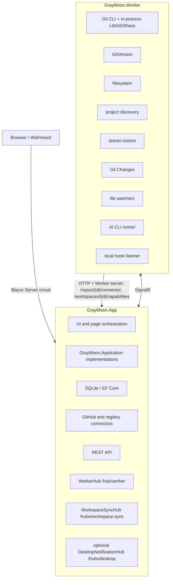
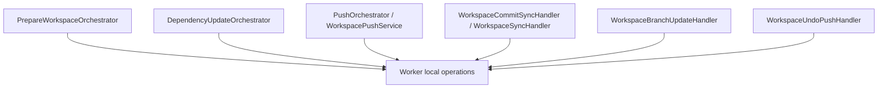

# 02 - System Architecture

## 1. High-level architecture

GrayMoon is a distributed local-development application with a strict App/Worker boundary.



This separation is foundational.

GrayMoon.App in Docker mode cannot assume access to the developer's local repository paths.
GrayMoon.App is deployed in one of two mutually exclusive modes. In Docker it runs as the web app only and is reached from a browser. With GrayMoon.Desktop, the App is always started by Desktop as a child process on loopback and runs alongside it; Desktop never connects to a Docker-hosted App.

GrayMoon.Worker (the Worker, packaged as `graymoon-worker`) runs on the developer host as the signed-in user and performs operations against the real working copies. In Docker mode it is the only GrayMoon process on the host, so everything that needs host tools (git, GitVersion, `dotnet`, AI CLIs, `codegraph`) runs there.

The App and the Worker are a version-locked pair (section 9A).

---

## 2. Solution projects

`GrayMoon.slnx` contains eight projects, all under `src/`:

```text
GrayMoon.App             Blazor Server web app (ASP.NET Core)
GrayMoon.Worker          host-side worker (.NET tool / Windows Service / systemd)
GrayMoon.Application     application-facing operation contracts
GrayMoon.Abstractions    App-Worker wire contracts, hub method constants, profile enums
GrayMoon.Common          shared helpers used by App and Worker
GrayMoon.App.Tests
GrayMoon.Worker.Tests
GrayMoon.Common.Tests
```

### GrayMoon.App

`src/GrayMoon.App`

Responsibilities:

```text
Blazor Server UI
application-service implementations
orchestration
SQLite persistence
GitHub API interaction
connector management and token protection
Workspace capabilities (profiles) and CI provider seam
AI generation orchestration (never runs an AI CLI itself)
background jobs
browser notifications
REST endpoints
Worker command coordination and version lock
Desktop-mode integration
```

The App must not run local Git directly. In `Services/Features` it must not touch the disk either: `GrayMoon.App.Tests/FeaturesDiskAccessArchitectureTests` fails on `Directory.`, `File.` or `Path.Exists(` in any file there except `WorkspaceContextPathResolver.cs`.

### GrayMoon.Worker

`src/GrayMoon.Worker`

Responsibilities:

```text
host-side Git (CLI processes and in-process LibGit2Sharp reads)
GitVersion
filesystem reads/writes
project discovery and packaging resolution
restore
Git Changes status/diff/mutations and file watchers
Git hooks and the local hook listener
worktree create/inspect/remove and Feature folder cleanup
CodeGraph init/watch/uninit (codegraph CLI)
Git evidence collection and AI CLI execution
Worker command execution
```

It is packaged as a .NET tool/service and supports console/service hosting. At start it refreshes `PATH` from the user environment (`Platform/Windows/HostEnvironmentPath.RefreshProcessPath`) so tools installed after the service was registered are found.

CLI verbs (`Cli/Handlers`):

```text
run
install
uninstall
start
stop
```

Worker commands are registered in `Cli/Handlers/RunCommandHandler.cs`; their names are constants in `GrayMoon.Abstractions/Worker/WorkerHubMethods`. Besides the sync, branch, push, file, version, restore and Git Changes commands, the set includes worktree commands (`ListGitWorktrees`, `CreateGitWorktree`, `RemoveGitWorktree`, `InspectWorktree`), Feature folder cleanup (`CleanupFeatureFolder`, `SweepPendingFeatureFolders`), `GetGitVersionAtDefaultTip`, Workspace repository commands (`AttachWorkspaceRepository`, `DiscardWorkspaceRoot`, `WriteRepositoryFile`), CodeGraph (`InitCodeGraph`, `WatchCodeGraphInit`, `UninitCodeGraph`), AI (`CollectGitEvidence`, `GetAiProviders`, `GenerateAiText`), `SelfUpdate` and `GetHostInfo`. Internal service structure is in sections 10A to 10C.

Worker path contract: a Workspace command names the Workspace repository with `WorkspaceCommandRequest.WorkspaceRepositoryName`, and `WorkerRepositoryPaths.Resolve` maps that name to the Workspace root instead of `{root}\{name}`. The App builds these payloads through `WorkerWorkspaceArgs(WorkspaceRoot, WorkspaceFolderName, WorkspaceRepositoryName)`; `WorkerSendSiteGuardTests` fails any anonymous App payload that carries `workspaceRoot` and `repositoryName` without `workspaceRepositoryName`. `WriteRepositoryFile` writes through a temp file plus move, rejects absolute, `..` and `.git` paths, and supports `onlyIfChanged`.

### GrayMoon.Application

`src/GrayMoon.Application`

This is the application-facing contract assembly.

It contains:

```text
IWorkspace*Operations
OperationProgress
OperationResult
operation DTOs
automation-friendly contracts
Workspaces/WorkspaceCapabilities + IWorkspaceCapabilitiesResolver
Ai/IWorkspaceAiGenerationOperations
```

`GrayMoon.Application/Features` holds the Feature context contracts:

```text
WorkspaceFeatureContextId            execution identity (readonly record struct)
IWorkspaceFeatureOperations          create / repair / analyze remove / remove Feature
IWorkspaceFeatureContextResolver     special Workspace context, context info
IWorkspaceContextPathResolver        repository path for a context (main checkout or worktree)
IWorkspaceHookContextAttributor      repository path -> context for hook and watcher notifications
IWorkspaceSelectedFeatureContextService   last selected context (navigation only)
IWorkspaceExternalWorktreeOperations  clean up non-Feature worktrees
IWorkspaceOperationLock              hierarchical structural/context lock
```

Most `IWorkspace*Operations` methods take an explicit `WorkspaceFeatureContextId`.

Blazor pages and REST endpoints should use this boundary instead of reaching directly into orchestration internals where a suitable application operation exists.

This layer is also the intended future seam for automation such as MCP.

### GrayMoon.Abstractions

`src/GrayMoon.Abstractions`

Shared App-Worker contracts: request/response DTOs, `WorkerHubMethods`, `WorkspaceCommandRequest`, `RepositoryOperationCapabilities`, and the profile enums (`WorkspaceType`, `WorkspaceVersioningMode`, `WorkspaceCiProvider`).

### GrayMoon.Common

`src/GrayMoon.Common`

Shared utilities and domain helpers, including:

```text
process/command-line helpers (CommandLineService, BoundedProcessRunner)
Git change models
filter/search expression parsing
common Git models and URL identity (RepositoryUrlIdentity)
graymoon.json manifest model (Manifest/WorkspaceManifest)
AI prompt building and answer parsing (Ai/AiPromptBuilder, AiGeneratedTextParser, evidence redaction)
log redaction (LogSafe)
```

### Test projects

There is one test project per production assembly that holds logic: Common, Worker and App.

The standard development contract is:

```text
dotnet build GrayMoon.slnx
dotnet test src/GrayMoon.Common.Tests/GrayMoon.Common.Tests.csproj
dotnet test src/GrayMoon.Worker.Tests/GrayMoon.Worker.Tests.csproj
dotnet test src/GrayMoon.App.Tests/GrayMoon.App.Tests.csproj
```

---

## 3. UI architecture

GrayMoon uses interactive Blazor Server components.

Workspace pages are split into Razor markup and partial code-behind files to keep large workflows manageable.

Shared patterns include:

```text
modal components
page partials by workflow
FilterSearchInput
virtualized/paged query services
ToastService
BackgroundJobService
loading overlays
SignalR hub connections for refresh events
```

The UI is persistence-first.

Pages generally read fast SQLite projections, then schedule or react to background refreshes.

They should not synchronously execute Git just to paint a cell.

Workspace pages are gated by the Workspace profile (`WorkspacePageAccess`): Repositories, Changes and Files are always available; Projects, Packages and Dependencies only for a .NET Dependency Workspace; Actions only when a CI provider is set. Direct navigation to an unavailable page renders `WorkspacePageGate` instead of redirecting.

---

## 4. Application-service boundary

The preferred direction for mutations is:

```text
Page / Modal / REST endpoint
        |
        v
IWorkspace*Operations
        |
        v
GrayMoon.App implementation
        |
        v
orchestrator / repository / Worker bridge
```

Examples:

```text
IWorkspaceSyncOperations
IWorkspacePushOperations
IWorkspaceUpdateOperations
IWorkspaceBranchOperations
IWorkspacePullRequestOperations
IWorkspaceGitChangesOperations
IWorkspaceFileOperations
IWorkspacePreparationOperations
IWorkspaceCatalogOperations
IWorkspaceRepositoryOperations
IWorkspaceFeatureOperations
IWorkspaceExternalWorktreeOperations
IWorkspaceAiGenerationOperations
```

This matters because domain behavior should not be encoded only in a Razor page.

Return to Default is a good example of the desired shape:

```text
AnalyzeReturnToDefaultAsync
-> structured plan
-> UI/REST policy
-> ExecuteReturnToDefaultAsync
```

`IWorkspaceAiGenerationOperations` (implementation `Services/Ai/WorkspaceAiGenerationOperations`, scoped) is the AI entry point: `GetProvidersAsync(workspaceId, refresh)`, `PinProviderAsync`, `GenerateCommitMessageAsync(AiCommitScope, providerId, IProgress)` and `GeneratePullRequestTextAsync(AiPullRequestScope, providerId)`. Its `AiGenerationResult<T>` is never partial: if any repository in scope cannot be compared, nothing is generated. Worker side is section 10C.

---

## 5. Query layer

Large Workspace pages use dedicated query services instead of loading entire EF graphs into the circuit.

Examples include:

```text
IWorkspaceRepositoryLinkListQueryService
IWorkspaceProjectListQueryService
```

These provide:

```text
count
index
paged/virtualized results
targeted hydration
header summaries
snapshot queries
```

This is important for large Workspaces.

New read-heavy features should prefer the same pattern over loading a full Workspace aggregate and filtering it in memory.

---

## 6. Connector architecture

Connectors represent external systems.

Current connector types support source control and package registries, including GitHub and NuGet scenarios.

Connector responsibilities include:

```text
repository discovery
GitHub API access
authentication
package registry access
health checking
```

### Token protection at rest

Connector tokens are encrypted with AES-256-GCM (`Services/Security/AesGcmTokenProtector`, format `v2:KEYID:BASE64(IV||CIPHERTEXT||TAG)`). `TokenEncryptionKeyProvider` picks the current key:

1. a configured `TokenKey` (key id `TokenKeyId`, else `configured`) always wins;
2. otherwise a per-install random key file `graymoon.key` next to the database (key id `install`), created on first start; DPAPI CurrentUser on Windows, raw bytes with file mode 600 elsewhere;
3. if the key file cannot be read or created, startup does not fail: the legacy key is used and an error is logged.

The legacy source-derived key (key id `default`) is decrypt-only and never encrypts new values. At startup, after migrations, `TokenReencryptionService.ReencryptLegacyTokensAsync` re-encrypts legacy tokens with the current key and never throws. A token that cannot be decrypted surfaces as connector health "Token needs to be re-entered." Details of the stored columns are in 03.

### How tokens reach Git

The App never sends a token in a Worker command payload. The Worker asks for it when a remote operation needs it: `WorkerTokenProvider` calls App `GET /repos/{id}/connector` with the Worker secret header and caches the token per connector (`InvalidateByConnectorId`). Worker secret and request security are in 05 section 33.

Git remote authentication is injected per process by `Worker/Services/GitRemoteAuth`, never written into repository config:

- git 2.31 or newer: `GIT_CONFIG_COUNT` / `GIT_CONFIG_KEY_n` / `GIT_CONFIG_VALUE_n` environment entries (`http.extraHeader`, empty `credential.helper`, `core.askpass`), appended after any `GIT_CONFIG_COUNT` already in the environment, so the secret stays off the command line;
- older git: the same settings as `-c` options before the subcommand.

`GitProcessRunner` resolves which transport the machine's git supports. `LogSafe` redacts `http.extraHeader` values in logs and in streamed command output.

---

## 7. Workspace service layer

Major Workspace service responsibilities include:

### WorkspaceService

Workspace CRUD and root-path resolution.

The per-Workspace `RootPath` is the source of truth when present.

Global settings provide defaults for new Workspaces.

### WorkspaceGitService

The main App-side facade for many Git-oriented Workspace operations.

It coordinates Worker requests for:

```text
sync
fetch
project refresh
branch operations
commit synchronization
return to default
restore
other repository operations
```

### WorkspaceRepositoryStateWriter

Central persistence seam for mutable repository checkout state.

It accepts a `RepositoryStateSnapshot` plus write options and only rewrites the state groups that were actually probed.

That "probed groups only" rule prevents partial Worker responses from blanking unrelated fields. It also drops project rows unless the Workspace `DiscoversDotNetProjects` (section 7A).

### RepositoryBranchWriter

`Services/Workspaces/RepositoryBranchWriter` is the single owner of branch row changes (full refresh, add, remove, prune, `origin/<name>` normalization). Details in 03.

### WorkspaceProjectRepository

Owns persisted Workspace projects and project dependency relationships.

It also computes repository-level dependency information used by orchestration.

Project snapshots enter through `ReconcileProjectSnapshotAsync`: projects are keyed by repository-relative path, packages resolve only by an unambiguous PackageId, and a failed scan never changes rows. The Worker's `RefreshRepositoryProjects` returns no project list when the repository folder is missing, which is a failed scan, not an empty one. Details in 03. Known gap: the batched sync merges projects in `WorkspaceRepositoryStateWriter` and edges in `PersistVersionsAsync` as two commits.

### WorkspaceFileVersionService

Owns configured-file version validation and update planning.

### WorkspacePullRequestService

Owns persisted current-branch PR refresh and reconciliation.

### WorkspaceActionService / repositories

Own GitHub Actions persistence and refresh logic.

### Feature services

`src/GrayMoon.App/Services/Features`:

```text
WorkspaceFeatureOperations          Create / Repair / Remove Feature orchestration, initial context seeding
WorkspaceFeatureContextResolver     special Workspace context lookup/creation, context info
WorkspaceContextPathResolver        per-context repository paths
WorkspaceHookContextAttributor      maps reported repository paths to contexts
WorkspaceSelectedFeatureContextService / WorkspaceContextNavigationService   ?context=<id> and the remembered selection
WorkspaceBranchOccupancyService     which branches are checked out by a Feature or other worktree
WorkspaceExternalWorktreeOperations cleanup of external (non-Feature) worktrees
WorkspaceNativeLaunchService        paths for the Desktop "Open in..." flyout
WorkspaceFeatureReconciler          singleton + hosted service; runs when the Worker goes Online, 60 s throttle,
                                    single-flight, 4 parallel Worker calls, skips structurally busy Workspaces,
                                    never deletes worktrees
FeatureBranchPolicy / FeatureBranchGuard   pure rules and messages / service-side enforcement that keeps every
                                    repository of a Feature on its Feature branch
FeatureRemovalQueue / FeatureRemovalDeparture   background Remove Feature (bounded concurrency, FIFO) and the
                                    dialog-confirm departure to the special Workspace
FeatureFinalizationCoordinator      barrier between seed and deferred hook syncs after create (15 min max wait)
FeatureFolderCleanupService         pending-delete Feature folder sweeps through the Worker
FeatureCodeGraphService             per-Feature CodeGraph index
FeatureOperationLog                 Feature operation logging
WorkspaceCheckoutRefresh            checkout refresh after Feature transitions
WorkerPath                          Worker-host path joining (below)
InspectWorktreeWorkerResponse / WorktreeDiskStatus   App view of Worker InspectWorktree
```

Feature worktree paths (`{ManagedFeatureStorageRoot}\{FeatureName}\{RepositoryName}`) are composed in the App with `WorkerPath`, never `System.IO.Path`, because they must match the path the Worker sees. `WorkerPath` follows the Worker's path style: it infers the separator from the path text itself (POSIX when it starts with `/`, otherwise Windows `\`), so a path the Worker handed back keeps its own shape and a Linux Worker works the same way. The default storage root is derived from the Worker's `UserProfilePath` (`{profile}\.graymoon` or `{profile}/.graymoon`).

---

## 7A. Workspace capabilities (profiles)

A Workspace has three independent persisted profile axes (`Type`, `VersioningMode`, `CiProvider`; enums in `GrayMoon.Abstractions/Workspaces`). Behavior never branches on them directly.

`WorkspaceCapabilities` (`GrayMoon.Application/Workspaces/WorkspaceCapabilities.cs`) is the single place where profile configuration becomes behavior. It is derived and never persisted:

```text
UsesRepositoryVersioning          VersioningMode != None
UsesGitVersion                    VersioningMode == GitVersion
DiscoversDotNetProjects           Type == DotNetDependency
UsesDependencyGraph               "
UsesNuGetPackages                 "
UsesDependencyAwareUpdate         "
UsesDependencyAwarePush           "
UsesPackageRestore                "
UsesGeneratedPackagesFromVersionFiles   "
UsesCiIntegration                 CiProvider != None
UsesGitHubActions                 CiProvider == GitHubActions
Legacy                            .NET Dependency + GitVersion + GitHub Actions
ToRepositoryOperationCapabilities()   Worker wire subset (versioning, .NET discovery)
```

Rules:

- `IWorkspaceCapabilitiesResolver` (`Services/Workspaces/WorkspaceCapabilitiesResolver`) resolves by WorkspaceId only, never by context id; Features inherit the profile.
- Decisions belong at orchestration and UI boundaries. Low-level Git code does not know the profile.
- Dependency state is gated at producers, not inside `WorkspaceProjectRepository`: `WorkspaceStateRecomputeScope.RecomputeDependencyStatsAsync` is the only sanctioned recompute entry, and `WorkspaceRepositoryStateWriter` drops project rows when `DiscoversDotNetProjects` is false.
- Push: `WorkspacePushStrategySelector` picks `BasicGitPushStrategy` (parallel, no levels, no registry wait, no restore) or `DotNetDependencyPushStrategy` (level-ordered, package-aware). Update without `UsesDependencyAwareUpdate` updates version files only, as one group. Restore entry points do nothing unless `UsesPackageRestore`.
- Host prerequisites: `HostPrerequisiteRequirements.For(capabilities)` - Git always; GitVersion if `UsesGitVersion`; .NET SDK if `UsesGitVersion`, `UsesPackageRestore` or `UsesDependencyAwareUpdate`; the union over all Workspaces (Git only when there are none).

CI provider seam (`Services/Ci`): `IWorkspaceCiProviderResolver` -> `IWorkspaceCiProvider` (`NoCiProvider`, `GitHubActionsCiProvider`) -> `IPushCiRunWatch` (`NoOpPushCiRunWatch`, `GitHubActionsPushRunWatch`). Its only consumers are the Actions page and synchronized push. Source control features (for example PR check runs in the merge dialog) never consult the CI provider.

Worker side: App-initiated commands carry `RepositoryOperationCapabilities` on `WorkspaceCommandRequest`, and the Worker chooses its `IRepositoryVersionProvider` (GitVersion or no-op) from them, so a Basic Workspace without versioning runs neither GitVersion nor `dotnet tool restore`. Hook-driven syncs have no App request: the Worker `IWorkspaceCapabilityProvider` uses a per-Workspace cache warmed by inbound commands, then calls App `GET /workspaces/{workspaceId}/capabilities` (Worker secret required), and otherwise falls back to full enrichment (not cached; a hook sync never fails for this). Hook scripts stay profile-agnostic. Saving a profile does not invalidate the Worker cache; the next App command re-warms it. Runtime detail is in 04.

---

## 8. Orchestration layer

GrayMoon has workflows that span many repositories and therefore cannot be expressed as one Worker command.

Examples:



Orchestrators own:

```text
batch planning
dependency ordering
parallelism boundaries
progress reporting
error aggregation
batch-end recomputation
```

The Worker remains responsible for concrete local operations.

---

## 9. App-Worker bridge

`WorkerBridge` sends commands over `WorkerHub` (`/hub/worker`; `/hub/agent` is kept as an alias).

The App generates a request ID and waits through a response-delivery mechanism.

Conceptually:

```text
App
  RequestCommand(requestId, commandName, payload)
        |
        v
Worker
  enqueue by command category
  execute handler
        |
        v
App
  ResponseCommand(requestId, payload)
```

Command output can also stream back for the terminal/loading overlay.

The App uses generous SignalR message sizing because repository sync responses can include branch lists and project/package graphs.

The reverse direction is plain HTTP from the Worker to the App, authenticated with the Worker secret: `GET /repos/{id}/connector` (token for a remote operation, section 6) and `GET /workspaces/{id}/capabilities` (profile for hook syncs, section 7A).

---

## 9A. App/Worker version lock

The App and the Worker are a matched pair. `WorkerConnectionTracker` states are `Offline`, `Connecting`, `Online` and `VersionMismatch`.

- `Services/Worker/WorkerVersionPolicy` is the one definition of "same version": trim, drop a leading `v`, drop SemVer build metadata after `+`, compare ignoring case. The pre-release label counts, so two CI builds from different commits are different versions.
- On a mismatch, `WorkerBridge.SendCommandAsync` refuses every command except `SelfUpdate` and `GetHostInfo`. The `SelfUpdate` request shape (`installUrl`) must never change, so any older Worker can still be updated.
- `IWorkerBridge.GetUnavailableReason()` lets an operation refuse before it mutates anything (Restore, Enable Workspace repository, AI provider probe, `FeatureFolderCleanupService`).
- The self-update ends only when a Worker reports the same product version. While it runs, `WorkerConnectionTracker.IsSelfUpdateInProgress` is set, so the expected disconnect is not reported as an unexpected offline.
- There are no per-feature Worker capability flags. A new command ships with the matching App.
- Known window: a Worker counts as Online until it reports its version, a moment after connecting.

---

## 10. Worker command pipeline

The Worker has three bounded command pools:

```text
main command pool
Git Changes status/read pool
Git diff pool
```

This prevents expensive or long-running mutations from making Git Changes status and diff feel unresponsive. The read pool takes `GetGitChangeStatus`, `ListGitWorktrees` and `InspectWorktree`; the AI commands run in the main pool. Pool sizes and routing are in 04.

Core hosted services include:

```text
SignalRConnectionHostedService
HookListenerHostedService
MainJobBackgroundService
ReadJobBackgroundService
DiffJobBackgroundService
GitChangesSnapshotPublisher
```

Commands are routed by command name to the appropriate pool.

---

## 10A. Worker Git services

All are singletons registered in `Cli/Handlers/RunCommandHandler.cs`. The split is deliberate: never merge them back into one service, never split them into per-noun interfaces, and never expose LibGit2Sharp types outside these Worker services.

```text
IGitRepositoryReader -> GitCliRepositoryReader
    local read-only inspection (ref snapshot, commit counts, branches, tags, checked-out tag,
    default origin ref, origin URL, HEAD); always the read lane, --no-optional-locks
IGitService -> GitService
    clone, fetch, pull, push, checkout, branch, tag, commit, merge, reset, init, remotes,
    origin HEAD repair, divergence base, safe.directory, sync hooks, stage+commit, GitVersion
IGitWorktreeService -> GitWorktreeService
    list / create / remove / inspect worktrees (native git only)
ILocalGitSnapshotReader -> LibGit2SharpLocalGitSnapshotReader
    in-process ref/count snapshot, used by SyncRepositoryCommand only
IGitIgnoreService -> LibGit2SharpGitIgnoreService
IRepositoryConfigurationInitializer -> RepositoryConfigurationInitializer   (writes local core.longpaths)
GitVersionResultCache, GitHooksLocationCache
IRepositoryGitChangesService -> GitCliRepositoryGitChangesService   (Git Changes feature contract)
IRepositoryAccess -> RepositoryAccess                                (section 10B)
```

Git CLI versus LibGit2Sharp: mutations, remote operations, worktrees and GitVersion run as git processes through `GitProcessRunner`. In-process LibGit2Sharp is used for the sync snapshot, `.gitignore` evaluation, raw config reads (`LibGit2SharpConfigReader`), the GitVersion input fingerprint and the `core.longpaths` write. LibGit2Sharp is referenced only by the Worker and pinned to an exact version (native dependency). Fallback rules and the sync pipeline are in 04.

---

## 10B. Repository access broker

`IRepositoryAccess` / `RepositoryAccess` (`Worker/Abstractions/IRepositoryAccess.cs`) is the single Worker owner of "who may touch this folder".

- Every git process, LibGit2Sharp repository open and file walk holds a shared lease (`TryAcquireShared(path, ReadOnly|Mutating, ...)`). A path at or beneath an exclusive claim gets no lease and the caller throws `PathUnderRemovalException`.
- Exclusive claims (`AcquireExclusiveAsync`) are taken by worktree removal and Feature folder cleanup. They release registered `IReleasable` handles (file watchers), cancel ReadOnly holders at once, give Mutating holders a short grace period, wait for zero leases, and as a last resort terminate only processes the Worker itself started.
- Choke points: `ICommandLineService` is `RepositoryAccessCommandLineService` and `IBoundedProcessRunner` is `RepositoryAccessBoundedProcessRunner`, both wrapping the plain runners with the same lease guard. `GitAccessClassifier` maps known read-only git subcommands to ReadOnly and anything else to Mutating.
- App side, `PathUnderRemoval` from `GetGitChangeStatus` is an expected result, not an error.

Rule: new Worker code that starts a process goes through `ICommandLineService` or `IBoundedProcessRunner`; a new LibGit2Sharp open or long-lived handle takes a lease or registers `IReleasable`. Timings and the removal sequence are in 04.

---

## 10C. Worker AI services

The App never runs git or an AI CLI. One click of an AI control is:

```text
App: resolve provider + model (graymoon.json ai.providers, else default) and check availability
Worker CollectGitEvidence   one request for all repositories (GitEvidenceCollector, bounded fan-out)
App: AiPromptBuilder (Common) builds one prompt under a hard token budget
Worker GenerateAiText       exactly one CLI process (AiCliRunner)
App: AiGeneratedTextParser validates the JSON answer strictly
```

- Commands `CollectGitEvidence`, `GetAiProviders`, `GenerateAiText` run in the main pool; there is no separate queue. The App reads CLI availability from `GetHostInfo` and does not call `GetAiProviders`.
- `Common/BoundedProcessRunner` runs from an argument list, stops a process at its stdout cap and logs only the executable, timing and sizes, never arguments or prompts. In the Worker it is behind the repository access lease (10B).
- `AiCliRunner`: availability probe `<exe> --version` (15 s timeout, cached 5 min in the Worker). The App takes the probe from the startup `GetHostInfo` (`HostInfoCache`) and does not probe again when a menu opens. Answer cap 256 KiB, stderr cap 16 KiB; each run gets an empty `%TEMP%\graymoon-ai\<guid>` folder, deleted afterwards. Generation timeout `AiGeneration:TimeoutSeconds` (default 120).
- Provider adapters (`Worker/Services/Ai/AiCliAdapters.cs`, `IAiCliAdapter`): `ClaudeCliAdapter` (`claude -p`, JSON schema output, tools disabled), `CodexCliAdapter` (`codex exec`, read-only sandbox, tools and user config disabled), `CursorCliAdapter` (`agent`, then `cursor-agent`; ask mode, cannot remove its read tools). Model names are validated by `AiProviderConfiguration.IsValidModel` and no argument spans lines.
- Errors are classified (`AiGenerationErrorKind`: not signed in, unsupported model, unsupported CLI options, timeout, invalid output) and shown as one redacted line inside the AI control; Commit and Create keep working.

The pinned provider per Workspace is local state (`Workspaces.PinnedAiProviderId`, `WorkspaceAiProviderPins`), never written to `graymoon.json`. User behavior is in 01 and 05.

---

## 11. Local hook listener

The Worker exposes a local loopback HTTP listener, normally on:

```text
127.0.0.1:9191
```

Managed Git hooks POST notifications to this listener.

The hook listener turns them into Worker notification jobs, which collect repository state and push it back to the App over SignalR.

Hook failure must not block the developer's normal Git command.

---

## 12. Browser synchronization

A separate Workspace synchronization hub (`/hubs/workspace-sync`) broadcasts server-side state changes to connected browser circuits.

Typical concepts include:

```text
ContextSynced / ContextRepositorySynced / ContextGitChangesUpdated   (carry a contextId)
WorkspaceSynced / RepositorySynced / GitChangesUpdated               (legacy, Workspace-level)
RepositoryError
```

See `04-runtime-communication-and-concurrency.md` section 17 for which events are sent per context.

Pages debounce refreshes and often reload only the affected rows.

Browser broadcasts are notifications to re-read persisted state, not authoritative state payloads.

---

## 13. Background jobs and page lifetime

Long-running Workspace operations must survive page navigation correctly.

The process-wide `WorkspaceOperationRunner` owns mutation exclusivity. It is hierarchical: structural operations lock the whole Workspace, ordinary operations lock one Feature context (see `04-runtime-communication-and-concurrency.md` section 3).

`BackgroundJobService` provides circuit/page overlay handles over those operations.

Important design rule:

- the operation belongs to the process/application, not to a disposed Razor component;
- page components must not keep background work dependent on page-owned disposable state;
- navigating to another page should not make an unrelated job appear to have moved there.

---

## 14. Desktop mode

GrayMoon can run through a separate native desktop wrapper (GrayMoon.Desktop, WPF + WebView2), which starts the App as a child process with `--desktop <pipe-name>`.

Desktop integration provides native host behaviors such as:

```text
window context/title
open local repository folder
Explorer/native shell actions
clipboard/external URL integration
open a context or repository in Cursor, VS Code, Visual Studio, Claude CLI, Codex CLI, Terminal
install host prerequisites and the Worker (elevated helper)
startup Worker upgrade prompt
```

Desktop-mode hosting (`src/GrayMoon.App/Desktop/DesktopHostingExtensions.cs`):

- Kestrel listens only on the fixed loopback address `http://127.0.0.1:8384` (`DesktopPort`). The port is fixed because an installed Worker Windows Service has its `--hub-url` baked into the service command line at install time; it is the same port as Docker/dev hosting.
- If the address is in use, the App exits with code 62 (`AddressInUseExitCode`); Desktop's `AppProcessManager` maps that code to a "port 8384 is already in use" message. Keep the two values in sync.
- The startup named pipe reports the bound URL, PID and version to Desktop as the readiness signal, not as port discovery.

Desktop mode maps an extra hub, `DesktopNotificationHub` at `/hubs/desktop` (only when `isDesktopMode`). Messages:

```text
server -> Desktop   Notify, WorkspaceChanged, TopBarVisibleChanged,
                    WorkerUpgradeRequired (WorkerUpgradePrompt.ClientEventName)
Desktop -> server   SetTopBarVisible(bool), UpgradeWorker() (WorkerUpgradePrompt.UpgradeMethodName)
```

On every connect the hub replays the current `WorkspaceChanged`, `TopBarVisibleChanged` and any pending `WorkerUpgradeRequired`. `UpgradeWorker` sends the Worker `SelfUpdate` with an `installUrl` of `{scheme}://{host}/api/worker/install`; a failed round trip while `IsSelfUpdateInProgress` is set means the install script already stopped the Worker and is treated as success. Concurrent installs (Desktop elevated install and Worker self-update) are serialized by the machine-wide mutex `Global\GrayMoonWorkerInstall` in the App-served `install-worker.ps1`, not by Desktop.

GrayMoon.App remains the core application.

Native OS process behavior belongs at the Desktop boundary, not in the normal web/container App.

---

## 15. REST API

GrayMoon exposes thin Workspace operation endpoints.

Examples include:

```text
list/get Workspaces
list repository snapshots
update dependencies
push
Prepare Workspace
sync
Return to Default
pull
Undo Push
restore packages
create/merge PRs
Git Changes read/stage/unstage/commit
update file versions
```

Every `WorkspaceOperationsEndpoints` handler resolves and acts on the special Workspace context (`GetOrCreateSpecialWorkspaceContextIdAsync`). No endpoint maps `IWorkspaceFeatureOperations`: Features cannot be created, listed, repaired or removed through REST.

Request security (Origin/host checks in `RequestSecurityMiddleware`, Worker secret on Worker-only endpoints) is described in 05 section 33.

The REST layer should delegate to the same Application operations used by the UI.

It should not become an independent second implementation of Workspace rules.

---

## 16. Architectural constraints for future work

When adding functionality:

1. keep local Git/filesystem work in the Worker, and keep the App's `Services/Features` free of disk access;
2. keep orchestration in the App;
3. persist expensive remote/local observations and render from SQLite;
4. use Application contracts for reusable mutations;
5. use query services for large read surfaces;
6. preserve batch recomputation boundaries;
7. keep remote credentials transient: the Worker fetches tokens on demand and injects them per process;
8. avoid page-owned business rules when a headless operation can own them;
9. ask `WorkspaceCapabilities`, never compare `Workspace.Type` directly, and gate producers rather than readers;
10. compose Worker-host paths with `WorkerPath`, never `System.IO.Path`;
11. route every Worker process through the repository access broker;
12. ship new Worker commands with the matching App; no Worker capability flags.

---

## 17. Known gaps

- The special Workspace still writes both the legacy Workspace-level state tables and the context tables.
- The Worker capability cache is not invalidated on profile save; hook syncs in that window may use the previous profile.
- `IGitVersionService` has not been split out of `GitService`; only `SyncRepositoryCommand` uses the in-process snapshot reader.
- Neither App nor Desktop blocks a second Worker install request; the install script mutex is the only guard.
