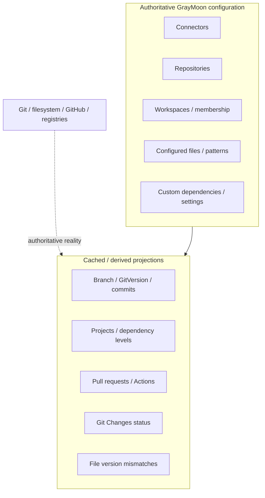
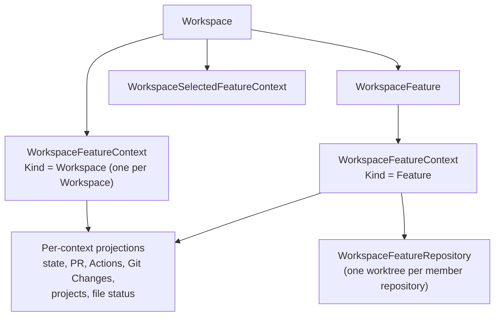

# 03 - Data Model and Persistence

## 1. Persistence model

GrayMoon.App persists application state in SQLite through EF Core.

The database is more than configuration storage. It also contains durable projections of external/local state so the UI can render quickly without running Git or GitHub requests during every page render.

This means the database contains two categories:



### Authoritative GrayMoon configuration

Examples:

```text
Connectors
Repositories
Workspaces
Workspace repository membership
configured files
version patterns
custom dependencies
settings
```

### Cached / derived projections

Examples:

```text
current branch/version state
commit counts
project discovery
dependency levels
pull request state
Actions state
Git Changes state
configured-file mismatch state
```

Git, the filesystem, GitHub, and registries remain authoritative for the external reality behind these projections.

---

## 2. Database creation and migrations

There are no EF Core generated migrations (`src/GrayMoon.App/Data/Migrations/` holds only a README). The schema has two sources that must always agree:

```text
EF model          AppDbContext.cs / AppDbContext.Features.cs  -> EnsureCreated() builds a brand-new database
Startup patches   Migrations.cs / Migrations.Features.cs      -> Migrations.RunAllAsync patches an existing one
```

### Startup order (`Program.cs`)

```text
dbContext.Database.EnsureCreated()                        creates the file from the model only if it does not exist
Migrations.RunAllAsync(dbContext, logger)                 versioned patches (below)
TokenReencryptionService.ReencryptLegacyTokensAsync(...)  section 18; never throws
WorkerSecretService.InitializeAsync()                     graymoon-worker.secret next to the database
PRAGMA journal_mode=WAL / busy_timeout=5000 / synchronous=NORMAL
```

A `DatabaseMigrationException` is caught at the top of `Program.cs`, logged as fatal, and the App exits with code 1. Every other startup exception is logged the same way.

### Versioning with `PRAGMA user_version`

`Migrations.RunAllAsync` reads `PRAGMA user_version` and runs what is pending, in two modes:

| Version | What runs | Failure handling |
|---|---|---|
| 1 (`LegacyBaselineVersion`) | `RunLegacyBaselineAsync`: every patch written before versioning existed (`SeedDefaultWorkspaceRootPathAsync`, `HasSelfFileVersionToken`, `IsGenerated`, drop `GitHubApiUsageHourly`, `ExcludeAiWorkflows`, Git status line stats, repository `Role`, `MigrateWorkspaceFeatureContextSchemaAsync` incl. the one-time special Workspace context backfill) | Tolerant: each patch logs its own error and startup continues. `user_version` is then set to 1. |
| 2 and later (`Migrations.StrictSteps`) | One entry per schema change, run in version order | Strict: each step runs in its own transaction, together with `PRAGMA user_version = N`. Any exception rolls the step back and throws `DatabaseMigrationException(version, name, backupPath, inner)`, which stops startup. |

Current strict steps:

```text
2   B2 orphan cleanup and WorkspaceProjects foreign key   (delete ProjectDependencies / WorkspaceProjects / WorkspaceFileLineStatuses rows whose
                                                           context no longer exists; rebuild WorkspaceProjects with the context FK ON DELETE CASCADE)
3   E1 case-insensitive Feature name index                 (recreate IX_WorkspaceFeatures_WorkspaceId_Name with Name COLLATE NOCASE;
                                                           skipped with a warning when a case-only duplicate already exists)
4   Workspace profile columns                              (Type, VersioningMode, CiProvider; backfill, see section 4)
5   Workspace repository role                              (WorkspaceRepositories.Role + filtered unique index)
6   Workspace manifest drift column                        (Workspaces.ManifestDriftDetectedAt)
7   Workspace recent Open-in tools                         (WorkspaceOpenInRecentTools table)
8   Feature context state GitVersionPending                (WorkspaceRepositoryContextStates.GitVersionPending)
9   SQLite read indexes                                    (IX_WorkspaceFeatureContexts_WorkspaceId,
                                                           IX_WorkspaceFileLineStatuses_Workspace_Context_Repo,
                                                           IX_WorkspaceFeatureRepositories_WorkspaceRepositoryId)
10  Workspace pinned AI provider column                    (Workspaces.PinnedAiProviderId)
11  WorkspaceProjects identity key                         (ProjectIdentityKey column + backfill from path / package id; unique (context, repo, name) index becomes
                                                           non-unique, unique IX_WorkspaceProjects_Context_Repo_Identity added; no rows deleted)
```

A brand-new database also starts at `user_version` 0, so it runs the baseline and every strict step right after `EnsureCreated()`. Every step must therefore be a no-op against the current model's shape (guard with `pragma_table_info(...)`, `sqlite_master`, `CREATE ... IF NOT EXISTS`), and a backfill must run only on the branch that actually created the column (see `AddWorkspaceProfileColumnIfMissingAsync`).

### Pre-migration backup

Before any pending step (baseline or strict), `BackupDatabaseAsync` writes `VACUUM INTO '<db>.bak-yyyyMMdd-HHmmss'` (UTC) next to the database file (a plain copy of an open WAL database can be corrupt), runs `PRAGMA integrity_check` on the copy (a failed check is logged as an error, not fatal), and keeps the 3 newest `<db>.bak-*` files. The backup is skipped for non-file databases (`:memory:` tests). Its path travels in `DatabaseMigrationException` so the fatal log names the way back.

### Adding a schema change

1. Change the entity and its `modelBuilder.Entity<T>(...)` configuration (`AppDbContext.cs`, or `AppDbContext.Features.cs` for Feature context tables). This is what fresh databases get.
2. Write a `public static async Task MigrateXxxAsync(AppDbContext dbContext, ILogger? logger = null)` in `Migrations.cs` (Feature tables: `Migrations.Features.cs`). Guard every statement so it is idempotent and matches the fresh-database shape exactly (same column type, nullability, default, index name, collation and foreign keys). Use the helpers `AddNullableTextColumnIfMissingAsync` / `AddNullableIntegerColumnIfMissingAsync` where they fit.
3. No try/catch inside the method: an exception must reach `RunStrictStepAsync` so the step rolls back and startup stops. Do not open your own transaction; the step's transaction is already active on the connection. A step that must not block startup on legitimate existing data (like step 3) checks for it and returns with a warning instead.
4. Append `(nextVersion, "Name", dbContext => MigrateXxxAsync(dbContext))` to `Migrations.StrictSteps`. Never renumber, reorder, edit or delete a shipped entry or its method; never add to `RunLegacyBaselineAsync`.
5. New columns must be nullable or have a default.
6. Tests: a migration test for the step (pattern: `WorkspaceManifestDriftMigrationTests`, `WorkspaceProfileMigrationTests`, `FeatureNameIndexCollationMigrationTests`), runner behaviour in `MigrationsRunnerTests`, and the golden upgrade `UpgradeFrom010Tests` (`Fixtures/graymoon-0.1.0.db` upgraded to the current schema) must stay green.

### SQLite connection setup

```text
Connection string (Program.cs, EnsureConnectionSetting adds each only when absent):
  Data Source=db/graymoon.db      default when ConnectionStrings:DefaultConnection is unset
  Cache=Shared
  Default Timeout=5               command timeout, seconds
  Foreign Keys=True

Per connection (SqliteConnectionPragmasInterceptor, on every open, sync and async):
  PRAGMA busy_timeout=5000
  PRAGMA foreign_keys=ON

Once at startup (persisted in the file or harmless to repeat):
  PRAGMA journal_mode=WAL
  PRAGMA busy_timeout=5000
  PRAGMA synchronous=NORMAL
```

`busy_timeout` and `foreign_keys` are per connection, so a startup PRAGMA alone would not cover later pooled or factory connections; the interceptor is registered on the `AddDbContextFactory<AppDbContext>` options, so every scoped and factory context gets it. The scoped `AppDbContext` is created from that factory (registering both `AddDbContext` and `AddDbContextFactory` fails on EF Core 10).

### Write discipline (SQLITE_BUSY)

SQLite allows one writer at a time; `busy_timeout` only waits. GrayMoon keeps concurrent writers few and short:

- Keep Worker, git and HTTP work parallel, but give each parallel task its own factory context, or collect results and persist once. Never share an `AppDbContext` across tasks, and never capture a circuit `AppDbContext` in `Task.Run`, `WorkspaceOperationRunner` or `BackgroundJobService` closures.
- Batch: mutate, then one `SaveChanges`; never `SaveChanges` in a loop.
- Serialized write paths: `WorkspaceGitChangesWriteQueue` and `WorkerSyncNotificationQueue` are single-reader channels; `SyncRecomputeCoalescer` runs one recompute per (workspaceId, contextId) burst; `SyncBackgroundService.DefaultMaxConcurrency` = 4 (`Sync:MaxConcurrency` overrides it).
- Short-lived per-call contexts in background services (`TokenHealthBackgroundService` checks connectors in parallel and persists once in its own scope; `WorkspaceActionRepository` uses a factory context per call; `WorkspaceAiProviderPins` uses the factory).

Runtime concurrency rules are in 04 section 20. `GrayMoon.App.Tests/SqlitePerformanceTests.cs` covers the SQLite setup and contention paths.

---

## 3. Repository identity

### Repository

Represents a source repository known from a connector.

Important fields include:

```text
ConnectorId
RepositoryName
OrgName
CloneUrl
GitHubRepositoryId / provider identity
visibility/archive metadata
```

The database uses provider identity where available and does not rely solely on repository name.

### WorkspaceRepositoryLink

Table: `WorkspaceRepositories`

Unique:

```text
WorkspaceId + RepositoryId
```

This represents membership of a Repository in a Workspace.

Today it also stores most of the current checkout projection:

```text
Role
GitVersion
BranchName
CheckedOutTag
HasNewerTag
DefaultBranchName
Projects
OutgoingCommits
IncomingCommits
DefaultBranchBehindCommits
DefaultBranchAheadCommits
BranchHasUpstream
SyncStatus
DependencyLevel
Dependencies
UnmatchedDeps
OutOfDateFileLines
OutOfDateFileRepos
TotalFileConfigRepos
HasSelfFileVersionToken
TotalFileLines
RepositoryType
```

It also owns one-to-one or one-to-many current projections such as PR, Actions, Git status, and Git change entries.

This "membership plus current checkout state" combination is a key assumption for the special Workspace context.

Worktree-backed Features do not write these columns. Each Feature context stores the same checkout projection in `WorkspaceRepositoryContextStates` (section 22). The special Workspace context dual-writes: the link columns stay authoritative for legacy readers and a context state row is kept in step.

`WorkspaceRepositoryLink` also has `[NotMapped]` overlay fields (`HeadCommit`, `FeatureBaseCommitSha`, `ParentBranchName`, `FeaturePinnedTag`, `GitVersionPending`, `UncommittedChangedFileCount`) and `WithBranchOverride(...)`, which context-aware readers use to project a Feature's state onto a link-shaped object without persisting it.

### Workspace repository role and definition drift

`WorkspaceRepositoryLink.Role` (`WorkspaceRepositoryRole`, stored as an integer in `WorkspaceRepositories.Role`, default `Source`) marks the one repository that is the Workspace repository (`Workspace`).

A filtered unique index, `IX_WorkspaceRepositories_WorkspaceId_WorkspaceRole` (`WorkspaceId` where `Role = 1`), allows at most one Workspace-role link per Workspace. Strict migration step 5 adds the column and the index.

`Workspaces.ManifestDriftDetectedAt` (nullable `DateTime`, strict migration step 6) is set when a check after a Sync finds `graymoon.json` different from the database, and cleared when they agree, on Dismiss, or when the Workspace repository is disabled. It is reconciliation state, not Git state.

`graymoon.json` itself is not persisted in the database. Its DB-owned parts (Workspace profile, Source repositories, their connectors, `versionFiles`) are built from the database and written to the Workspace repository root; its file-owned parts (`codegraph`, `ai`, per-repository tag pins) exist only in the file. The Workspace name is the folder on this computer and is not stored in the file. Schema, ownership, write, import and drift rules are in section 4A. Feature contexts never run drift detection.

---

## 4. Workspace

`Models/Workspace.cs`, table `Workspaces`:

```text
WorkspaceId
Name                       required, max 200
IsDefault
RootPath                   max 500
LastSyncedAt
IsInSync
ExcludeAiWorkflows         default true
Type                       WorkspaceType: Basic (0) | DotNetDependency (1)
VersioningMode             WorkspaceVersioningMode: None (0) | GitVersion (1)
CiProvider                 WorkspaceCiProvider: None (0) | GitHubActions (1)
ManagedFeatureStorageRoot  max 1000
ManifestDriftDetectedAt    nullable DateTime (TEXT)
PinnedAiProviderId         nullable, max 32 (claude | codex | cursor)
Repositories               navigation to WorkspaceRepositoryLink
```

`RootPath` is per Workspace.

`Type`, `VersioningMode` and `CiProvider` are the three independent profile axes (enums in `GrayMoon.Abstractions.Workspaces`). The model defaults are Basic / None / None, so a Workspace in a brand-new database starts as a plain Git Workspace. Strict step 4 (`MigrateWorkspaceProfileColumnsAsync`) adds the three columns as `INTEGER NOT NULL DEFAULT 0` and, only on the run that actually created them, backfills every existing row to `Type=1, VersioningMode=1, CiProvider=1` (DotNetDependency / GitVersion / GitHubActions), so pre-profile Workspaces keep their behaviour. The type is never inferred from whether projects exist. Profile values are never read directly for behaviour: `WorkspaceCapabilities` (derived, never persisted, resolved by WorkspaceId) turns them into flags (02, 06).

`ManagedFeatureStorageRoot` is set the first time a Feature is created (`WorkerPath.Combine(FeatureStorageRootPath, WorkspaceName, "features")`) and is not relocated afterwards, so existing worktrees keep their paths when the Settings value or the Workspace name changes.

`ManifestDriftDetectedAt` is definition reconciliation state (section 3 and 4A).

`PinnedAiProviderId` is the one AI provider pinned for this Workspace on this machine (strict step 10). It is local state only and never written to `graymoon.json`; `WorkspaceAiProviderPins` reads and writes it through the context factory.

`LastSyncedAt` and `IsInSync` describe the special Workspace context's persisted synchronization state (Feature contexts have their own on `WorkspaceFeatureContexts`).

---

## 4A. Workspace definition file (`graymoon.json`)

When a Workspace has a Workspace-role repository, its root holds `graymoon.json`, the shareable definition of the Workspace. Only `IWorkspaceManifestFile` (`GrayMoon.Common/Manifest/WorkspaceManifestFile`, singleton in App and Worker) names, serializes or parses the file; the App's `WorkspaceManifestService` reads and writes it through the Worker (`WorkspaceRepositoryFileAccess`, Worker `WriteRepositoryFile`: temp file + move, `onlyIfChanged`, rejects absolute, `..` and `.git` paths). It is never committed by GrayMoon; changes appear in Git Changes.

### Schema (`WorkspaceManifest`, `version` 1)

```text
version            int, key "version" (WorkspaceManifestFile.SchemaVersion = 1); a value > 1 is rejected:
                   "Workspace definition schema N is newer than this GrayMoon"
workspace          required object. The local Workspace name is not stored. A leftover name is ignored
                   and omitted the next time the file is written.
workspace.profile  { type: basic|dotNetDependency, versioning: none|gitVersion, ci: none|githubActions }
                   missing -> basic / none / none
connectors[]       { type: "github", url: normalized web root } - GitHub connectors of Source repositories only; NuGet never written
repositories[]     { name, repositoryUrl (CloneUrl as stored), connectorUrl, tag?, commit? }
                   Source role only, never the Workspace repository itself
codegraph          bool?, lenient (true/false or "true"/"false"), omitted when null
versionFiles[]     { repository (folder name of a Source or the Workspace repo), path ("/" separators), pattern [lines] }
                   omitted when empty
ai                 { providers: [ { provider: claude|codex|cursor|<unknown kept>, model? } ] }, omitted when null
```

### Ownership

```text
DB-owned    workspace.profile, connectors, repositories (name/url/connector), versionFiles
File-owned  codegraph, ai, repositories[].tag / commit pins   (no DB copy; kept on every rewrite; ignored by drift)
Never       anything local: the Workspace name (folder), pinned AI provider, credentials, paths, local ids
```

### Serialization and parsing

- `Serialize`: System.Text.Json, camelCase, indented; connectors sorted by `url`, repositories by `name`, versionFiles by `repository` then `path` (all ordinal ignore-case); LF line endings plus a trailing newline. Optional sections are omitted when null.
- `TryParse` (case-insensitive) fails on: empty content, invalid JSON, newer schema, a missing `workspace` object, an invalid tag pin, a versionFile without `repository` or `path`, an `ai` provider entry without `provider` or `providers` that is not a list. A leftover `workspace.name` is ignored.
- `ai`: unknown and duplicate providers are kept in the file and checked when used (a duplicate or an unsafe model disables that provider with a message; an unknown id shows a notice). Feature contexts read `ai` from the special Workspace's file.
- URL identity (`GrayMoon.Common/Git/RepositoryUrlIdentity`): `NormalizeConnectorUrl` lowercases scheme and host, drops the default port, a trailing slash and `/api/v3`; `NormalizeRepositoryUrl` turns https, http, ssh and scp forms into `https://host/owner/repo` (lower host, no `.git`). The connector URL is `RepositoryUrlHelper.GetWebRootFromConnectorApiBase(ApiBaseUrl)`.

### Tag pins

`WorkspaceDefinitionTagPin`: `tag` plus the full 40 or 64 hex `commit`, both or neither. Recorded in the file only when a Source repository in the special context is checked out on a tag through GrayMoon or a Sync finds it on a tag (`WorkspaceBranchOperations.SetRepositoryTagPinAsync`, `WorkspaceGitService.RecordCheckedOutTagPinsAsync`); cleared when the user leaves the tag through GrayMoon. The Worker's `SyncRepositoryCommand.CheckoutPinnedCommitAsync` checks a freshly cloned Source out at the pinned commit read from the root's `graymoon.json`; an invalid pin or missing commit fails the sync and removes the clone.

### Writing

- `BuildFromDatabaseAsync` produces the DB-owned parts, including `versionFiles`.
- `WriteAuthoritativeManifestAsync` (special context only; no-op message when there is no Workspace repository): build from the database, then, when the existing file parses, copy its tag pins (`WorkspaceRepositoryTagPins.CopyOnto`), `codegraph` and `ai` onto the result and keep `versionFiles` entries of repositories not linked here (`WithUnlinkedEntriesAsync`). An existing file that does not parse is replaced from the database alone. A read error fails the write.
- `WriteVersionFilesAsync` replaces only `versionFiles`; the Files page calls it after a configuration save, a configured file's removal and Update.
- `SyncDefinitionToDiskAsync` order: managed `.gitignore` section (`WriteManagedGitIgnoreAsync`), then `WriteAuthoritativeManifestAsync`, then `codegraph.json` only when `codegraph` is true. Called on Source membership change (Repositories modal), profile change (Workspaces page), and the drift banner's "Write Workspace definition to disk".
- Managed `.gitignore` (`ManagedGitIgnoreSection`): between `# <graymoon-repositories>` and `# </graymoon-repositories>`, one `/<Name>/` per Source (sorted) plus `/.codegraph/` when CodeGraph is on; lines outside the markers are preserved byte for byte; CRLF is kept when the file already uses it, else LF; a start marker with no end marker gets a new section appended.
- `codegraph.json` (`CodeGraphConfigFile`): GrayMoon owns only `include` (`Name/` per Source); other properties are kept; a file whose root is not a JSON object is never overwritten.
- Adopting an existing root that already is this repository leaves `.gitignore` and `graymoon.json` untouched (a rewrite would drop entries not yet imported).

### Reading into the database

- Sync that includes the Workspace repository in the special context imports `versionFiles` (`ImportVersionFilesFromDefinitionAsync` -> `MergeVersionFilesFromDefinitionAsync`, file wins). Entries of repositories not linked here are skipped on import and preserved on write.
- Restore creates the Workspace row as Basic / None / None, applies the file's profile through `WorkspaceProfileTransition`, merges `versionFiles` (`MergeVersionFilesIntoDatabaseAsync`, file wins), and skips the definition rewrite when any repository, connector or version file is missing locally. A leftover `workspace.name` is not a reason to rewrite; the Workspace repository listed as its own Source is ignored. The name chosen in Restore is the folder on this computer.

### Drift

`DetectDriftAsync` (special context only; throws for a Feature context) compares the parsed file with the database:

```text
compared   repositories by normalized URL (added / removed names), connectors by normalized URL, profile type / versioning / ci
ignored    a leftover workspace.name, versionFiles, codegraph, ai, tag pins
drift      a missing or unparsable file counts as drift, with the reason
```

Triggers: a full or single Sync that includes the Workspace repository, a Workspace-repository branch or tag checkout in the special context, and a non-refs-only hook sync of the Workspace-role repository. Detection runs fire-and-forget in its own DI scope and sets or clears `Workspaces.ManifestDriftDetectedAt`.

---

## 5. Branch and tag inventory

`RepositoryBranches` stores branch/tag inventory per `WorkspaceRepositoryLink`.

Fields include:

```text
BranchName
IsRemote
IsDefault
IsTag
SortIndex
LastSeenAt
```

This table is the persisted ref inventory. Remote rows are stored as `origin/<name>`.

Unique: `WorkspaceRepositoryId + BranchName + IsRemote` (plus the non-unique `IX_RepositoryBranches_WorkspaceRepositoryId`). A workspace checkout runs every repository at once, and each checkout's hook sync can insert the same ref this checkout is inserting. The later insert loses the unique index, keeps the row already stored, and still writes its other branch changes, so that repository does not show a checkout failure. The checkouts stay parallel. The handling is in `AppDbContext.SaveChangesAsync` (`AppDbContext.BranchRows.cs`), not in each writer: every save of any context drops an added branch row whose key is already stored and writes the rest, so the push completion, the state writer (`ApplyAsync` / `ApplyBatchAsync`, including the project-merge save), the hook sync and fetch all survive a lost race, and a new writer is covered by default. It retries at most 3 times and rethrows a violation with no stored row behind it. Without it, a first push of a new branch could fail after one level when the hook sync stored `origin/<branch>` while the push waited on the Worker, ending Push Updated early. `BranchRowSaveRaceTests` covers each path.

`Services/Workspaces/RepositoryBranchWriter` is the single owner of branch row changes. `PersistAsync` is the authoritative full refresh; `AddLocalBranchesAsync`, `AddRemoteBranchAsync`, `RemoveBranchAsync`, `PruneRemoteBranchesAsync` and `ToRemoteBranchName` (the one place the `origin/` normalization happens) handle incremental changes and never touch tag rows. `WorkspaceGitService`, `WorkspaceBranchOperations` (create, set-upstream, delete) and Return to default delegate to it. `WorkspaceFeatureOperations` records the Feature branch after Create and Repair, and removes rows only after git confirms the delete (Remove local, Remove remote, roll back); Kept, KeptUnmerged and Failed leave the row. Each Feature write uses its own DI scope, and a failed row write is logged and reconciled by the next branch refresh, so it never fails an operation whose git work already succeeded.

Quick Fetch (`PersistBranchesAsync` with null branch lists) refreshes only tags and leaves branch rows alone. Branches created or deleted outside GrayMoon arrive through the `reference-transaction` hook as a branch-lists-only snapshot. Remaining exceptions to the single-owner rule: `WorkspacePushService` still adds remote rows inline, and `BuildSnapshot` injects the expected Feature branch at display time only. Test anchor: `FeatureBranchPersistenceTests`.

Never drop, cap or delay tags to speed up sync.

Current checkout identity is stored separately on the Workspace repository link through `BranchName` / `CheckedOutTag`.

Synthetic detached-head placeholders are explicitly filtered out and must never be persisted as real branch names.

Known gap: the unique index does not include `IsTag`, so a tag and a local branch with the same name collide on insert in `RepositoryBranchWriter.PersistAsync`.

---

## 6. Project persistence

`WorkspaceProjects` stores projects discovered in Workspace repositories, per Feature context.

Current uniqueness (`IX_WorkspaceProjects_Context_Repo_Identity`, partial: non-null key and context):

```text
WorkspaceFeatureContextId + RepositoryId + IsGenerated + ProjectIdentityKey
```

`ProjectIdentityKey` is the case-folded normalized `ProjectFilePath` for a physical project (`ProjectIdentity.PhysicalKey`) and the case-folded `PackageId` for a generated row (`GeneratedKey`); `WorkspaceProject.RefreshIdentityKey()` maintains it. Project names are not unique. `WorkspaceFeatureContextId + RepositoryId + ProjectName` and `WorkspaceId + RepositoryId + ProjectName` remain as non-unique indexes (`IX_WorkspaceProjects_Context_Repo_Name`, `IX_WorkspaceProjects_Workspace_Repo_Name`). Each Feature gets its own copy of the physical project rows and their `ProjectDependencies` edges when it is created; generated projects stay on the special Workspace context.

Project fields include:

```text
ProjectName
ProjectType
ProjectFilePath
TargetFramework
PackageId
IsGenerated
MatchedConnectorId
```

### Project classification and packaging

The Worker classifies each `.csproj` (`CsProjFileParser`), in this order:

```text
OutputType Exe / WinExe                                                     -> Executable
test SDK reference (Microsoft.NET.Test.Sdk, xunit, NUnit, MSTest.TestFramework) -> Test
Sdk="Microsoft.NET.Sdk.Web"                                                 -> Service
otherwise package vs library (IsPackagedAsNuGet):
  effective IsPackable = false   -> Library, even with a PackageId
  effective IsPackable = true    -> Package, even without a PackageId (stored PackageId = effective PackageId or project name)
  IsPackable unset               -> Package only when the effective PackageId is non-empty
```

The SDK default "class libraries are packable" is deliberately not adopted, and `GeneratePackageOnBuild` is not consulted.

Effective `IsPackable` / `PackageId` come from `ProjectPackagingResolver` (Worker, no MSBuild evaluation). Layers, later unconditional values winning:

```text
1. nearest Directory.Build.props (walking up to the repository root only),
   plus parents it imports through GetPathOfFileAbove('Directory.Build.props', '$(MSBuildThisFileDirectory)../') (parent first)
2. the .csproj in document order, including literal relative unconditional imports inside the repository
   and property groups that are direct children of an unconditional Target
3. nearest Directory.Build.targets (same GetPathOfFileAbove parent chain)
```

`ImportDirectoryBuildProps` / `ImportDirectoryBuildTargets = false` in the project are honoured. Imports are followed to `MaxImportDepth = 16`, cycle-safe. Not evaluated (by design, documented on the class): conditions (a conditional property group, property or Target is skipped), wildcard imports, other property functions, `Choose`/`When`, SDK and NuGet props/targets, files outside the repository root, and disables through environment or global properties. A value that still contains `$(...)` does not change the effective value.

Generated projects represent virtual/package-producing entities inferred from GrayMoon configuration or CI behavior.

They are intentionally protected from deletion by normal physical project reconciliation.

---

## 7. Project dependencies

`ProjectDependencies` stores internal project relationships.

Each row connects:

```text
DependentProjectId
ReferencedProjectId
Version
```

Only Workspace-internal package relationships become persisted project dependency edges. The package-target index (`PackageTargetIndex` in `WorkspaceProjectRepository.Merge.cs`) is keyed by non-empty effective `PackageId` only, with no `ProjectName` fallback, so a project that is not a package (section 6) is never a dependency target. A physical producer wins over a generated row of the same id; more than one producer is ambiguous, creates no edge and logs a warning naming the producers. The referencing projects are stored in `AmbiguousPackageReferences` (dependent project, package id, version) so the Packages page can list them. That list is replaced when the consumer is scanned, deleted with the consumer project, and deleted when the context no longer has any project with that package id. It is not a graph edge: dependency levels and synchronized push still ignore an ambiguous package. The next scan of the consumer after a single producer remains writes the normal edge and removes the usage row. Dependents are matched to rows by physical path. Edges whose referenced project stopped being a unique producer are dropped (and logged as needing a consumer rescan) and levels recomputed. Generated package rows keep a `PackageId` and take part.

Project snapshots reach the database through one entry point, `WorkspaceProjectRepository.ReconcileProjectSnapshotAsync` (`WorkspaceProjectRepository.Reconcile.cs`), used by the manual refresh (all repositories and a single repository), the sync state writer (single and batch). Each repository result is a `ProjectScanOutcome`: `Success`, `EmptySuccess` (an authoritative empty scan removes the repository's physical projects, never generated rows) or `Failure` (failed, cancelled or not scanned: its projects and edges are left untouched and its repository type is not changed). The call takes the projection gate once; when it merges both projects and edges it runs them in one database transaction (joining one the caller already opened) so a fault rolls back the whole projection, while a projects-only call is a single `SaveChanges`, already atomic, and stays off an explicit transaction because SQLite shared-cache table locks would otherwise make concurrent writers fail. Worker discovery always happens before the call. The batched sync still merges the whole edge graph in `WorkspaceGitService.PersistVersionsAsync` right after the projects commit, so its projects and edges are two commits.

The project graph is later collapsed into repository-level relationships and dependency levels.

---

## 8. Custom repository dependencies

`WorkspaceRepositoryCustomDependencies` stores explicit user-declared repository dependencies.

Unique:

```text
DependentWorkspaceRepositoryId
ReferencedWorkspaceRepositoryId
```

These are merged with implicit relationships discovered from project references and configured files.

The UI prevents circular dependency choices and distinguishes user-declared edges from implicit locked edges.

---

## 9. Dependency-level projection

Repository-level dependency metrics are currently persisted on `WorkspaceRepositoryLink`.

They include:

```text
DependencyLevel
Dependencies
UnmatchedDeps
RepositoryType
```

Configured file references contribute additional diagnostics:

```text
OutOfDateFileLines
OutOfDateFileRepos
TotalFileConfigRepos
HasSelfFileVersionToken
```

The repository grid reads these values directly.

A batch recomputation must operate on a complete snapshot after all repository changes in the batch have been persisted.

---

## 10. Configured files

### WorkspaceFile

Represents a user-selected file in a Workspace repository.

Fields include:

```text
WorkspaceId
RepositoryId
FileName
FilePath
IsMissingOnDisk
```

`FilePath` is relative to the repository root.

### WorkspaceFileVersionConfig

One optional version-pattern configuration per file.

The pattern contains repository tokens used to validate or update file lines.

### WorkspaceFileLineStatus

Persists current mismatch details for configured file tokens.

Typical data includes:

```text
WorkspaceId
WorkspaceFeatureContextId
RepositoryId
FilePath
FileName
TokenName
CurrentValue
ExpectedValue
```

Unique: `WorkspaceFeatureContextId + RepositoryId + FilePath + TokenName`.

This table supports diagnostics and dependency badge computation.

`WorkspaceFile` and `WorkspaceFileVersionConfig` are shared by all contexts of a Workspace. Per-context file presence (`IsMissingOnDisk`, `LastCheckedAt`) is stored in `WorkspaceFileContextStates`.

---

## 11. Pull request projection

`WorkspaceRepositoryPullRequests` is one-to-one with `WorkspaceRepositoryId` and serves the special Workspace context. Per-context PR state lives in `WorkspaceRepositoryContextPullRequests` (unique `WorkspaceFeatureContextId + WorkspaceRepositoryId`).

Persisted fields include:

```text
PullRequestNumber
State
Mergeable
MergeableState
HtmlUrl
MergedAt
ChangedFiles
LastCheckedAt
```

This allows the repository grid to render PR state immediately after page refresh.

The service refreshes the projection for the current branch and clears/reconciles stale PR state after branch changes.

---

## 12. Actions projection

`WorkspaceRepositoryActions` is one-to-one with `WorkspaceRepositoryId` and serves the special Workspace context. Per-context Actions state lives in `WorkspaceRepositoryContextActions` (unique `WorkspaceFeatureContextId + WorkspaceRepositoryId`).

It stores:

```text
aggregate status
HtmlUrl
UpdatedAt
BranchName
RunId
WorkflowId
WorkflowName
WorkflowsJson
LastCheckedAt
```

Each workflow object inside `WorkflowsJson` also keeps `RunStartedAt` (GitHub `run_started_at`) next to `UpdatedAt`, so the Actions grid can show wall-clock duration without another API call or a new column.


The persisted `BranchName` is used to verify that cached workflow state belongs to the repository's current branch.

---

## 13. Git Changes persisted read model

### WorkspaceGitRepositoryStatus

One row per `WorkspaceRepositoryId`.

Stores the latest Worker-reported snapshot metadata:

```text
SnapshotVersion
BranchName
HeadCommit
detached/unborn flags
merge/rebase/cherry-pick state
staged/changed/conflict counts
insertions/deletions (working tree and staged)
scan/persist timestamps
last error
```

Feature contexts use `WorkspaceGitContextRepositoryStatuses` (unique `WorkspaceFeatureContextId + WorkspaceRepositoryId`) and `WorkspaceGitContextChangeEntries` with the same shape. The special Workspace context writes both the legacy tables and the context tables.

### WorkspaceGitChangeEntry

Stores changed paths for the latest snapshot.

Every new snapshot replaces the set of entries for the repository.

Fields include:

```text
Path
OriginalPath
IndexChange
WorktreeChange
IsTracked
IsConflicted
IsSubmodule
```

The page reads these rows instead of invoking Git during rendering.

---

## 14. RepositoryStateSnapshot and partial writes

`WorkspaceRepositoryStateWriter` is a central correctness mechanism.

Worker operations do not always probe every category of repository state.

For example, one operation may know:

```text
branch
GitVersion
outgoing/incoming
```

but not project or tag details.

The state writer therefore accepts write options / probed groups and only updates fields whose values are authoritative for that operation.

Do not replace this with a naive "copy all response properties to the row" implementation.

---

## 15. Project merge semantics

Project reconciliation for a repository:

```text
discover projects
compare with persisted physical projects
add new
update existing
remove disappeared physical projects
preserve generated rows
rebuild relevant dependency edges
recompute repository graph metrics
```

Projects are matched by physical path (the project identity key); the worker derives the PackageId from (local `PackageId` element, then `AssemblyName`, then file name), so a project whose classification changes (for example `IsPackable=false` added) is updated in place (type `Library`, `PackageId` null) on the next sync; no migration is involved.

Only `DotNetDependency` Workspaces persist project rows: `WorkspaceRepositoryStateWriter` drops project data unless `WorkspaceCapabilities.DiscoversDotNetProjects`, and Workspace-wide recompute goes through `WorkspaceStateRecomputeScope.RecomputeDependencyStatsAsync`.

This logic is central to dependency-aware orchestration.

---

## 16. PR and Actions cache philosophy

PR and Actions rows are caches, not configuration.

The branch on which they were obtained matters.

A cached remote state that belongs to a previous branch must not be shown as if it belongs to the current branch.

This is why branch transitions trigger reconciliation/refresh.

---

## 17. Settings and preferences

GrayMoon uses persisted Settings for application preferences and defaults.

Examples include:

```text
default Workspace root
UI preferences
last selections
other application settings
```

Keys are defined in `AppSettingRepository`:

```text
WorkspaceRootPath
FeatureStorageRootPath   (Feature worktree root; empty means {userprofile}\.graymoon from the Worker)
Terminal.ShowByDefault
Terminal.TransparentBackdrop
Terminal.ColorScheme
Sidebar.Collapsed
TopBar.Show
Security:WorkerSecretSeen   (true once a Worker presented the correct Worker secret; from then on a Worker without one is rejected)
```

Per-Workspace preferences live on their own rows, not in Settings:

```text
WorkspaceSelectedFeatureContexts   last selected Feature context per Workspace (section 22)
WorkspaceOpenInRecentTools         Open-in tools pinned on the feature-selector bar (PK WorkspaceId + ToolId; Position = left-to-right order)
Workspaces.PinnedAiProviderId      AI provider pinned on this machine (section 4)
```

AI provider and model choices shared with the team are in the `ai` section of `graymoon.json` (section 4A), not in the database. Process-level options (for example `AiGeneration:TimeoutSeconds`, `Sync:MaxConcurrency`, `TokenKey`) come from ASP.NET Core configuration, not the Settings table.

A Workspace-specific persisted value should take precedence over a global default where the domain supports per-Workspace configuration.

---

## 18. Secret storage

Connector tokens are encrypted before persistence; callers go through `ITokenProtector` and never implement encryption themselves. The database never holds cleartext tokens.

```text
Cipher       AES-256-GCM (AesGcmTokenProtector)
Format       v2:KEYID:BASE64(IV || CIPHERTEXT || TAG)
Key source   TokenEncryptionKeyProvider, in precedence order:
  1. TokenKey configuration (settings or environment) - always wins, never replaced;
     key id = TokenKeyId, else "configured"; a value that is not 32 bytes is derived to 32 bytes with a warning
  2. per-install key file graymoon.key next to the database (path from DatabasePathResolver):
     random 32 bytes generated on first start; DPAPI CurrentUser on Windows, file mode 600 elsewhere; key id "install"
  3. if the key file cannot be read or created: log an error and use the legacy key (startup never fails);
     the next start tries the file again
Legacy key   the old source-derived key, key id "default" (LegacyKeyId), kept decrypt-only forever
```

At startup, right after migrations, `TokenReencryptionService.ReencryptLegacyTokensAsync` re-encrypts every token that still carries the legacy key id onto the current key. It never throws; a token that cannot be decrypted is left alone and connector health reports "Token needs to be re-entered."

Runtime operations obtain decrypted credentials through the connector layer; the Worker receives tokens per command and passes them to git as `-c http.extraHeader=...`, never writing them to disk.

ASP.NET Core Data Protection (`DataProtection-Keys/` next to the database) is unrelated: it protects antiforgery and circuit state only. The Worker pairing secret `graymoon-worker.secret` also lives next to the database (`WorkerSecretService`, 05 section 33).

---

## 19. Persistence-first UI rule

The UI should normally:

```text
read persisted projection
render immediately
schedule/receive refresh
persist new projection
broadcast lightweight notification
re-read projection
```

It should not:

```text
render
block on N Git operations
block on N GitHub calls
then finally show the page
```

This design is visible throughout the repository grid, Git Changes, PR status, and Actions.

---

## 20. Derived-state recomputation rule

When many repositories are updated concurrently, do not let every repository independently recompute the same Workspace-wide graph and overwrite one another.

GrayMoon intentionally uses batch boundaries such as `WorkspaceStateRecomputeScope` or caller-owned recompute calls.

Pattern:

```text
update repository A state
update repository B state
update repository C state
all writes complete
→ recompute dependency/file-version aggregate once
→ broadcast WorkspaceSynced once
```

This avoids read-then-overwrite races.

---

## 21. Database design rules for contributors

When adding persisted state:

1. decide whether it is configuration or a cache/projection;
2. identify its authority;
3. define its refresh trigger;
4. define its invalidation trigger;
5. define its uniqueness key;
6. add a strict migration step (section 2) and keep new columns nullable or defaulted;
7. index the fields used by Workspace list/query services;
8. do not create multiple competing sources of truth;
9. keep large page reads in query services rather than navigation-heavy EF graphs;
10. decide whether the state is Workspace-wide (membership, configuration) or per Feature context (anything observed from a checkout), and key per-context rows by `WorkspaceFeatureContextId`.

---

## 22. Feature contexts and worktree persistence

Entity configuration is in `src/GrayMoon.App/Data/AppDbContext.Features.cs`; entities are in `src/GrayMoon.App/Models/Features/`.



### WorkspaceFeatures

Unique: `WorkspaceId + Name`, with `Name` collated `NOCASE` (`UseCollation("NOCASE")` on fresh databases; strict step 3 on upgraded ones, skipped with a warning while a case-only duplicate exists), so `Foo` and `foo` are the same Feature name.

```text
Name                     max 200, NOCASE
LifecycleState           Creating | Ready | Removing | NeedsRepair
BaseKind                 CurrentWorkspace | DefaultBranches | Feature (only CurrentWorkspace is used)
BaseWorkspaceFeatureId   FK to WorkspaceFeatures, ON DELETE RESTRICT (cleared before a Workspace delete)
CreatedAt / UpdatedAt
LastError
```

The Feature branch is the Feature name; there is no branch column (repositories pinned to a tag have no Feature branch).

### WorkspaceFeatureContexts

The execution identity for every context-scoped operation (`WorkspaceFeatureContextId` in `GrayMoon.Application.Features`).

```text
WorkspaceId
Kind                 Workspace (0) | Feature (1)
WorkspaceFeatureId   (null for the special Workspace context; filtered unique when not null)
LastSyncedAt / IsInSync
```

A filtered unique index (`IX_WorkspaceFeatureContexts_Workspace_KindWorkspace`, `Kind = 0`) guarantees one special Workspace context per Workspace; `IX_WorkspaceFeatureContexts_WorkspaceId` (strict step 9) serves lookups. The legacy baseline backfilled the special context for Workspaces that existed before Features; new ones get it on demand (`GetOrCreateSpecialWorkspaceContextIdAsync`).

### WorkspaceFeatureRepositories

Unique: `WorkspaceFeatureContextId + WorkspaceRepositoryId`; `IX_WorkspaceFeatureRepositories_WorkspaceRepositoryId` (strict step 9).

```text
WorktreePath       Workspace-role repository: the Feature root {ManagedFeatureStorageRoot}\{FeatureName}
                   Source repository:         {ManagedFeatureStorageRoot}\{FeatureName}\{RepositoryName}  (WorkerPath.Combine)
BaseCommitSha      HEAD of the Workspace checkout when the Feature was created
ParentBranchName   Workspace branch at creation, from the same GetHeadCommits snapshot (null when on a tag or detached)
PinnedTag          tag the Workspace checkout was on, if any (worktree is detached)
State              Pending | Ready | NeedsRepair | Removing | Removed
CreatedAt
LastError
```

`ManagedFeatureStorageRoot` is persisted as `{FeatureStorageRootPath}\{WorkspaceName}\features` (section 4), and `WorktreePath` is stored in the Worker's path shape. A legacy drive-root `\.graymoon` storage value is ignored (`WorkerPath.IsLegacyWindowsDriveRootGraymoonPath`).

Removal states: Remove Feature sets every live row to `Removing` when it starts, and sets a repository's row to `Removed` right after its worktree is unregistered, in its own short-lived context, so a crash can resume. A repository that fails stays `Removing` with `LastError`. `IsRemoveIncompleteAsync` is true while any row is `Removing` or `Removed`.

### Per-context projections

All are unique on `WorkspaceFeatureContextId + WorkspaceRepositoryId` (or `+ FileId`), with `ON DELETE CASCADE` from the context:

```text
WorkspaceRepositoryContextStates       checkout projection: the link's projection columns (BranchName, CheckedOutTag,
                                       HasNewerTag, GitVersion, commit counts, SyncStatus, dependency and file-version
                                       metrics, TotalFileLines, RepositoryType) plus HeadCommit and GitVersionPending
WorkspaceRepositoryContextPullRequests
WorkspaceRepositoryContextActions
WorkspaceGitContextRepositoryStatuses
WorkspaceGitContextChangeEntries       (non-unique index)
WorkspaceFileContextStates
```

`GitVersionPending` (nullable bool, strict step 8): the seed sets it true on every new Feature row and leaves `GitVersion` null, because the Workspace's version describes another branch; the first GitVersion probe for that context clears it (`WorkspaceRepositoryStateWriter`). While it is set the version shows as not yet known rather than unresolved (`IsVersionUnresolved` is false), and `RecomputeAndPersistRepositoryDependencyStatsAsync` treats edges into the repository as pending, never matched or mismatched.

Seeding (`SeedInitialFeatureProjectionsAsync`) is an idempotent upsert. An existing context row (from an early Sync or an interrupted seed) only gets structure reconciled (branch, tag, projects, type, dependency level, counts, file-line stats), never GitVersion, SyncStatus or commit counts. `DependencyLevel`, `Dependencies` and `UnmatchedDeps` are copied from the Workspace; projects are matched with `ProjectKeyComparer` on (RepositoryId, name); generated packages stay Workspace-global.

`WorkspaceProjects` and `WorkspaceFileLineStatuses` carry a nullable `WorkspaceFeatureContextId` column instead of a separate table. On `WorkspaceProjects` it is a foreign key `ON DELETE CASCADE` (fresh databases and, after strict step 2, upgraded ones); `WorkspaceFileLineStatuses` has no foreign key on either, so the two shapes match. Rows with a null context id belong to the special Workspace only. Remove Feature does not rely on cascades: `DeleteContextScopedProjectDataAsync` explicitly deletes the context's `ProjectDependencies`, `WorkspaceProjects` and `WorkspaceFileLineStatuses` with `ExecuteDeleteAsync`. Writers of Feature-scoped `WorkspaceProjects` / `ProjectDependencies` go through `FeatureFinalizationCoordinator.AcquireProjectionAsync`.

Readers have context-scoped overloads: `GetByWorkspaceIdAsync`, dependency edges, lines and graph, `GetPackagesByWorkspaceIdAsync(workspaceId, contextId)` (the context's real packages plus all generated ones), push-plan tag exclusion, and the notification `repoIdsThatNeedPush`.

### WorkspaceSelectedFeatureContexts

Primary key `WorkspaceId`. It remembers which context the user last viewed. It is a navigation preference only; operations always take an explicit `WorkspaceFeatureContextId`.

### What stays Workspace-wide

```text
WorkspaceRepositories membership
RepositoryBranches inventory
WorkspaceRepositoryCustomDependencies
WorkspaceFiles / WorkspaceFileVersionConfigs
generated WorkspaceProjects
```

Membership changes (adding Sources, changing membership in the Repositories modal, enabling or disabling the Workspace repository) and Workspace rename or root change are refused while a Workspace has Features (`WorkspaceRepository`, `WorkspaceRepositoryOperations`, `WorkspaceProfileTransition`).

### Known gaps

- The special Workspace still dual-writes the legacy link/status tables and the context tables (sections 3 and 13); readers have not moved to the context tables only.
- `WorkspaceFileLineStatuses.WorkspaceFeatureContextId` has no foreign key (fresh and upgraded databases alike), so it relies on the explicit delete at Remove Feature.
- The `RepositoryBranches` unique index excludes `IsTag` (section 5).
