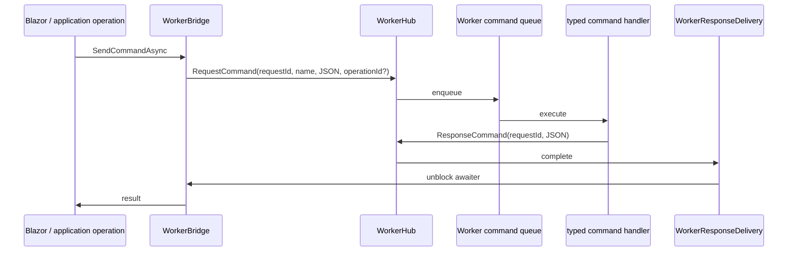
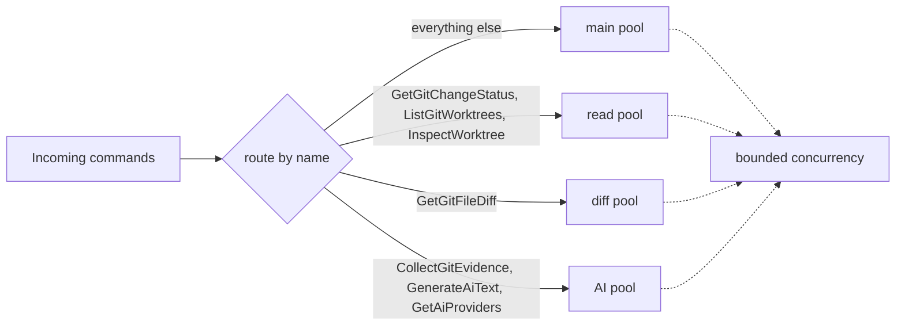
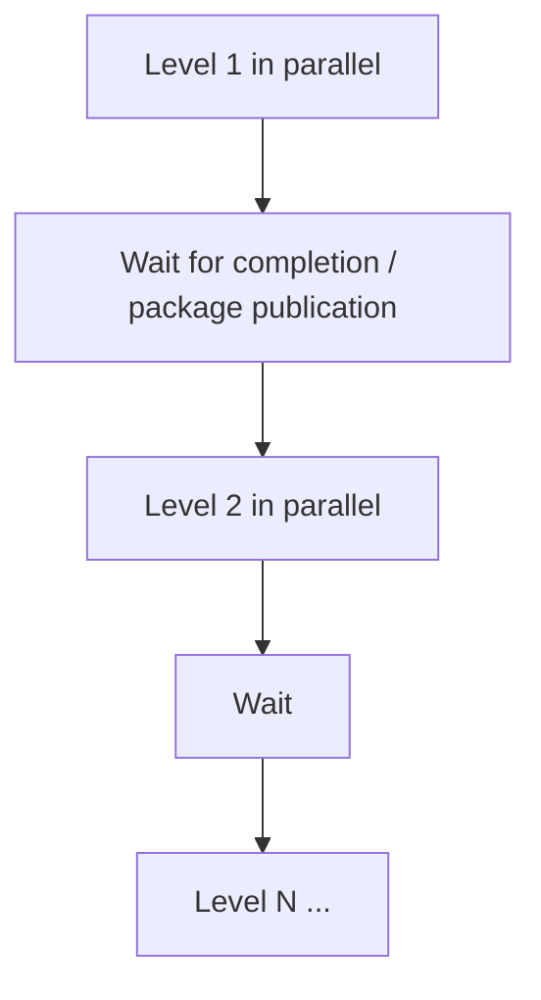
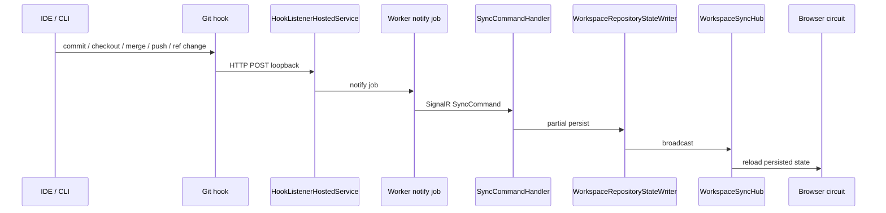
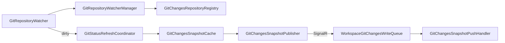
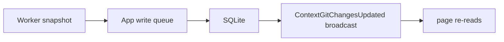

# 04 - Runtime Communication and Concurrency

## 1. App to Worker request flow

The App sends local-work commands to the Worker through SignalR.

Conceptually:



A unique request ID correlates response and caller.

`WorkerResponseDelivery.WaitAsync` adds the pending entry before it registers the cancellation callback, so a token that is already cancelled removes the entry at once and the wait ends cancelled; nothing stays pending. Each entry records the Worker connection the command was sent to. When a Worker connection drops, `WorkerHub.OnDisconnectedAsync` fails only that connection's pending requests (`FailForConnection`); everything is failed (`FailAll`) only when no connection is left (section 18). The failure text is `WorkerHub.DisconnectedReason` ("Worker disconnected before responding; the command may have completed."): the Worker may have finished the work and only the answer was lost, and nothing is retried. On the Worker side an answer that cannot be delivered is never kept for a later connection (a reconnect has a new connection id and the old waiter is gone): a job result that cannot be sent is logged at error by `JobBackgroundService`, and a response the intake produced while the hub is not connected is logged at warning by `SignalRConnectionHostedService.SendIntakeResponseAsync` (test: `IntakeResponseSendTests`).

Command terminal output is streamed separately so long-running operations can show live progress.

`WorkerBridge.SendCommandAsync` refuses commands while the Worker runs a different product version (section 18).

App-initiated commands that need the Workspace profile carry `RepositoryOperationCapabilities` on `WorkspaceCommandRequest`. Hook-driven work has no App request, so the Worker resolves capabilities itself (section 7).

### 1A. AI generation commands

AI commit message and pull request text generation (`IWorkspaceAiGenerationOperations`, implemented by the scoped `WorkspaceAiGenerationOperations`) makes exactly one provider call per click:

```text
resolve provider + model (graymoon.json ai.providers, else the provider default) and check availability
Worker CollectGitEvidence   one request for all repositories, fan-out bounded by GitChangesOptions.MaxParallelRepositoryOperations
AiPromptBuilder (Common)    one prompt under a hard token budget
Worker GenerateAiText       one CLI process
AiGeneratedTextParser       strict JSON check; AiGenerationResult<T> is never partial
```

- The App never runs git or an AI CLI. The Worker runs both, because it runs as the signed-in user and in Docker mode it is the only process on the host. The Worker refreshes PATH from the user environment at start (`HostEnvironmentPath.RefreshProcessPath`).
- `CollectGitEvidence`, `GetAiProviders` and `GenerateAiText` (`WorkerHubMethods` constants) run on the dedicated Worker AI pool (`MaxConcurrentAiCommands`, default 4), not the main pool. The App reads CLI availability from `GetHostInfo` (main pool) and does not call `GetAiProviders`. The AI pool is untracked like the read and diff pools: it does not feed `ReportQueueStatus`, so the Worker badge activity frame does not animate for a generation (the AI control and the commit overlay show their own progress).
- Both `GitEvidenceCollector` and `AiCliRunner` launch processes through `BoundedProcessRunner` (Common: argument list, stdout cap, logs only executable, timing and sizes), wrapped in the Worker by `RepositoryAccessBoundedProcessRunner` (section 2A).
- `AiCliRunner`: availability probe `<exe> --version` with a 15 s timeout, cached 5 min in the Worker; answer cap 256 KiB, stderr cap 16 KiB; each run gets its own empty folder `%TEMP%\graymoon-ai\<guid>`, deleted afterwards.
- App side: `HostInfoCache` (singleton) holds the startup host check, including which AI CLIs are installed. Menus read that snapshot and do not probe. Generation timeout `AiGeneration:TimeoutSeconds` (default 120, clamped 10..600).
- Click-to-write runs are not circuit work: `AiTextGenerationRuns<TText>` (singleton; `WorkspaceGitChangesCommitGeneration` for Changes, `WorkspacePullRequestTextGeneration` for New Pull Request) keeps at most one run per Workspace and Feature context, runs it in a fresh DI scope through `IScopedServiceExecutor`, and outlives the page, the dialog and the circuit (F5 / Ctrl+F5). Only Cancel for that context stops it. When it finishes, a page still showing that context does the live scope check and applies the text itself; otherwise the run decides against that context's memory (`WorkspaceGitChangesCommitMessageMemory`, `WorkspacePullRequestDraftMemory`) and stores the text, a suggestion or the error there. All of it is in memory and lost on App restart.
- Commit generation runs inside the Git Changes commit job (overlay step label "ai", never the prompt); pull request generation runs without an overlay job.
- Generation takes no Workspace or context lock. The Git Changes AI control is disabled only while its own page's overlay job runs (`IsOwnPageJobRunning`), not by `IsJobRunning`, so Push Updated or another operation on the Workspace does not block it. Evidence is read with `git --no-optional-locks` and never waits for `GitProcessRunner.RepoLocks`, so it can overlap a write. A result produced while the Workspace was mutation-busy (at the click or when the run finished, carried by `Outcome.MutationOverlap`) is always offered as a suggestion with `AiTextApplyPolicy.MutationOverlapReason`, never applied silently. The New Pull Request dialog keeps its own busy gate.

### 1B. Log correlation (App ↔ Worker)

Two Serilog LogContext properties join App and Worker file logs for diagnosis. Names live in `GrayMoonLogProperties` (`GrayMoon.Abstractions`):

| Property | Meaning | Lifetime |
|---|---|---|
| `GrayMoonRequestId` | Hub `requestId` | One `SendCommandAsync` / one Worker command job |
| `GrayMoonOperationId` | Parent user/system mutation | One workspace overlay job (and Push/Update `RunId`) |

`WorkerBridge` pushes both into LogContext for the send/wait. The Worker pushes `GrayMoonRequestId` (and `GrayMoonOperationId` when the optional 4th `RequestCommand` argument is set) for the execute scope. File sinks under `%ProgramData%\GrayMoon\Logs\` append `req={GrayMoonRequestId} op={GrayMoonOperationId}` so nested lines stay greppable. Desktop native-bridge request ids are a separate channel and are not `GrayMoonRequestId`.

Typical support workflow:

```text
1. Grep graymoon-app-*.log for GrayMoonOperationId / [PushOrchestrator {RunId}]
2. Within that window, collect GrayMoonRequestId values from WorkerBridge lines
3. Grep graymoon-worker-*.log for those request ids (or the same operation id when on the wire)
```

Happy-path success stays at Debug on the App; failures, timeouts and Worker completion stay the loud signals. Do not invent a third hop Guid beside `requestId`.

---

## 2. Worker job pools

The Worker uses separate bounded queues for different command categories.

Current architecture:



Routing is by command name in `WorkerCommandPoolRouter` (called from `SignalRConnectionHostedService`): `ReadOnlyCommands` = `GetGitChangeStatus`, `EnsureGitChangesWatchers`, `ListGitWorktrees`, `InspectWorktree`; `DiffCommands` = `GetGitFileDiff`; `AiCommands` = `CollectGitEvidence`, `GenerateAiText`, `GetAiProviders`; everything else goes to the main pool. Each pool is a bounded `Channel<JobEnvelope>` drained by its own hosted service (`MainJobBackgroundService`, `ReadJobBackgroundService`, `DiffJobBackgroundService`, `AiJobBackgroundService`, all derived from `JobBackgroundService`).

Sizes (`WorkerOptions`):

```text
MaxConcurrentCommands       main pool   default Environment.ProcessorCount * 2
MaxConcurrentReadCommands   read pool   default 8
MaxConcurrentDiffCommands   diff pool   default 4
MaxConcurrentAiCommands     AI pool     default 4
```

The main pool also carries Sync, push, restore, worktree create/remove (`CreateGitWorktree`, `RemoveGitWorktree`), Feature folder cleanup, the CodeGraph commands and every hook notify job. Its queue (`TrackedJobQueue`) holds commands and hook notify jobs apart and its workers always take a command first: the App waits for a command, nobody waits for a hook sync. A hook sync that is already running is not interrupted, so a command waits at most for one worker to finish its current job (`TrackedJobQueueTests`).

Intake and cancellation (`CommandRequestIntake`, in `SignalRConnectionHostedService.cs`):

- The .NET SignalR client runs one handler at a time, so the `RequestCommand` handler never waits. It registers the request in `CommandJobCancellationRegistry`, starts the queue write and returns. When the pool's queue is full the write waits for room in the background, in arrival order; nothing is rejected.
- `CancelCommand` is therefore delivered at once whatever the queues hold. It ends a wait for room (the caller gets `Command cancelled.`), makes a queued job skip, and cancels a running job through its linked token. Stopping the Worker ends every wait for room the same way.
- A `CancelCommand` for a request that is not registered (it finished already, or its `RequestCommand` has not arrived yet) is remembered so a late `RequestCommand` is answered `Command cancelled.` without running. At most `MaxPendingCancellations` = 256 are remembered; the oldest is dropped first.
- Push and undo-push send their follow-up `SyncCommand` (commit counts, version, projects) before the command returns, with the job's cancellation token. The scan holds the job's pool slot and counts as pending work; cancelling the job ends the scan and the push or reset keeps its own result.
- A closed connection starts the reconnect loop only while the Worker is running; the loop observes the shutdown token that `StopAsync` cancels.
- `StartAsync` builds the connection and returns; the first connect loop (retry every 5 seconds) runs in the background and ends on the same shutdown token. The host starts hosted services one after another, so the hook listener and the job pools start whether or not the App is reachable.

This isolation matters.

A long push, restore, or repository sync should not force a user to wait behind the same queue for a diff or Git status scan.

Do not collapse these pools into one queue without a deliberate performance redesign.

---

## 2A. Repository access broker

`IRepositoryAccess` / `RepositoryAccess` (`GrayMoon.Worker/Abstractions/IRepositoryAccess.cs`, Worker singleton) is the single Worker owner of "who may touch this folder". It exists so the Worker's own handles (git processes, LibGit2Sharp repositories, file watchers, file walks) never block deleting a worktree or a Feature folder. It never touches programs the Worker did not start.

Shared leases:

- `TryAcquireShared(path, RepositoryAccessKind.ReadOnly | Mutating, forceTerminate, owner)` is taken for every git process, every LibGit2Sharp open and every long file walk. It returns null while the path equals or lies beneath an exclusive claim; callers then throw `PathUnderRemovalException`. `owner` lets the remover itself work inside its own claim.
- A lease exposes a `Yield` token. Holders must honour it; the process guard cancels the process when it fires and reports `PathUnderRemovalException`.

Exclusive claims (`AcquireExclusiveAsync(paths)`), used only by `GitWorktreeService.RemoveWorktreeAsync` and `FeatureFolderCleaner`:

```text
publish the claim (new leases beneath it are refused)
notify ancestor observers (ClaimBeneathStarted) and Release() registered IReleasable holders beneath it
cancel ReadOnly leases at once (Yield)
wait MutatingGrace 5 s for Mutating leases to finish, then cancel them
wait for zero leases up to Ceiling 15 s in total
force-terminate the processes the Worker started (forceTerminate), wait ForceSettle 1 s
else throw RepositoryAccessException (a defect; the claim is withdrawn)
```

Timings are `RepositoryAccessTimings.Default` (5 s, 15 s, 1 s).

Choke points (registered in `Cli/Handlers/RunCommandHandler.cs`):

- `RepositoryAccessCommandLineService` wraps `ICommandLineService` and `RepositoryAccessBoundedProcessRunner` wraps `IBoundedProcessRunner`; both use `RepositoryAccessGuard` on the process working directory (a process with no working directory takes no lease).
- `GitAccessClassifier` picks the lease kind from the git subcommand: known read-only subcommands (`status`, `diff`, `log`, `rev-parse`, `for-each-ref`, `ls-files`, `ls-remote`, `check-ignore`, ...; `branch`/`config`/`tag`/`remote`/`stash`/`worktree` only in their listing forms) are ReadOnly. Anything else, and every non-git executable, is Mutating.
- LibGit2Sharp openers take their own leases: `LibGit2SharpLocalGitSnapshotReader`, `LibGit2SharpGitIgnoreService` (the session holds its lease for its whole life), `LibGit2SharpConfigReader`, `GitVersionInputFingerprint` (all ReadOnly) and `RepositoryConfigurationInitializer` (Mutating, because it writes config).
- `GitRepositoryWatcher` implements `IReleasable` (Release disposes both `FileSystemWatcher`s; it cannot restart in `OnError`) and `IRepositoryAccessObserver` (an ancestor watcher pauses while a claim beneath it is active). `GitRepositoryWatcherManager.Acquire` refuses covered paths. Released watchers are not recreated automatically; the next `Acquire` (`GetGitChangeStatus`) or `Touch` recreates them (see "Watcher lifecycle").

App side:

- A `GetGitChangeStatus` result with `ErrorCode = "PathUnderRemoval"` is expected, not an error (`GitStatusRefreshCoordinator`, `WorkspaceFeatureOperations`).
- `IWorkspaceGitChangesMonitoringPause` (section 9A) only avoids pointless scans; the Worker broker is authoritative.

---

## 3. App-side operation locking

`WorkspaceOperationRunner` is the process-wide mutation coordinator. It implements both `IWorkspaceOperationRunner` and the hierarchical `IWorkspaceOperationLock`.

The lock has two levels:

```text
structural (TryStartStructural)   whole Workspace; refused while any context mutation or another structural one runs
context    (TryStartContext)      one per WorkspaceFeatureContextId; refused while a structural one runs
```

Mutations in different contexts (the special Workspace and Feature A, or Feature A and Feature B) can run concurrently. A second mutation in the same context does not start; the caller attaches to the running one.

Structural operation kinds:

```text
create-feature               WorkspaceFeatureOperations.CreateFeatureAsync
repair-feature               WorkspaceFeatureOperations (Feature Status Retry)
rollback-feature             WorkspaceFeatureOperations (Feature Status Roll back)
remove-external-worktree     WorkspaceExternalWorktreeOperations
refresh-workspace            WorkspaceCheckoutRefresh (waits for a free slot)
enable-workspace-repository  WorkspaceRepositoryOperations
reference-mode               WorkspaceReferenceOperations (read only on / off for one or all repositories, and the default)
legacy TryStart              treated as structural; also REST WorkspaceCommandHttp.RunExclusiveAsync
```

Remove Feature is not structural and takes no Workspace lock (section 3A).

`BackgroundJobService` picks the level from the job key: keys shaped `/workspaces/{id}/ctx/{contextId}/...` (`WorkspaceJobKeys.ContextOverlayKey`) take a context lock; other `/workspaces/{id}...` keys take the legacy (structural) lock.

This protects multi-step orchestration from overlapping writes and Git operations.

`BackgroundJobService` is not the lock itself. It attaches UI/circuit job handles and overlays to process-wide operations.

`IWorkspaceLockedOperation.RunBackgroundableAsync(work)` marks a phase of a locked operation as backgroundable: while it runs the overlay shows Background instead of Abort, and Background cancels only that phase's token (section 5F).

### Read only mode changes

A change of the read only state is structural, so it and any other operation of the Workspace exclude each other: the change is refused while an operation holds the lock of any context, and no operation starts while the change runs. An operation that is already running keeps the eligibility it loaded; it is not retargeted.

`WorkspaceReferenceOperations.ChangeAsync` runs: the activation check (`ReferenceActivationChecker`: the Workspace checkout and every Feature worktree of each repository, repositories in parallel up to `WorkspaceOptions.MaxParallelOperations`, the checkouts of one repository one after the other), then the database write, then the definition file, then the recorded branch and commit. A blocked repository refuses the whole change before anything is written. Without a Worker, turning read only on is refused. The Worker's git output of the check reaches the operation's terminal like any other operation's.

A pull of a read only repository is sent with `pullOnly` (`CommitSyncRepositoryRequest`): the Worker runs `git pull --ff-only`, refuses a branch with local commits before pulling, reports `localChangesBlockPull` when local changes are in the way, never pushes, and returns the commit it arrived at.

A pull runs with hooks off, so no merge hook reports what it brought in. `CommitSyncRepository` therefore carries the Workspace capabilities and, after a successful pull in a Workspace that discovers projects, returns the scanned projects in its state snapshot (a refused or failed pull scans none; a failed scan is "not probed", never an empty list). `WorkspaceCommitSyncHandler` ends every pull job with one `CompletePullAsync`: the single pull stores its projects with the state write; the bulk pull, whose repositories run at the same time, writes each row with `RepositoryStateWriteOptions.DeferProjects` and then stores all the projects as one projection (`WorkspaceRepositoryStateWriter.ApplyProjectsAsync`). After that it runs one recompute of the context (version-file check and dependency stats, shared with hook syncs through `SyncRecomputeCoalescer`) and broadcasts `ContextSynced`. A failure in that step does not fail the pull: it is logged and shown as a page error, and the next Sync recomputes the same state. A cancelled bulk pull skips the step.

`ArchivedRepositoryVerifier` is not an operation and takes no lock: for repositories marked archived it asks the provider once per opened Repositories page and before a push plan or a push, and clears the mark when the provider says the repository is no longer archived.

### 3A. Lock-free Feature background work

These run without any Workspace or context lock, so Sync and every other operation keep working:

- **Remove Feature.** Confirming the dialog enqueues into `FeatureRemovalQueue` (hosted `BackgroundService`, unbounded channel, `IFeatureRemovalQueue.MaxConcurrentRemovals` = 4 concurrent removals, the rest FIFO, one pending entry per context). `RemoveFeatureAsync` takes no Workspace lock and does not refresh the Workspace; the departing page starts `IWorkspaceCheckoutRefresh` itself and does not wait. The outcome is raised through `IFeatureRemovalQueue.Completed`; `Toast.razor` in every open tab turns it into a toast (the queue is a singleton and cannot hold the per-circuit `IToastService`).
- **Feature reconciliation** (`WorkspaceFeatureReconciler`, section 5E). Skips every Workspace that `IsWorkspaceStructurallyBusy`.
- **Pending-delete sweep** (`FeatureFolderCleanupService`, section 5D). Skips while `IsWorkspaceStructurallyBusy`; a background removal does not stop it, because the sweep excludes Features that still exist.

### 3B. Update and Push: locks, approvals and outcomes

- **Lock key per surface.** The notification popup starts its job under the whole-Workspace key `/workspaces/{id}` (structural lock); the Repositories page of a Feature uses the context key. The runner refuses each while the other is held. A REST call runs inside `WorkspaceCommandHttp.RunExclusiveAsync` on the special Workspace context and returns 409 "A workspace operation is already running." when the lock is busy.
- **`StartJob` can start nothing.** When the lock is already held, `BackgroundJobService.StartJob` does not run the new body and returns a handle for the other job with `WasStarted == false` (section 4). The "Continue with normal push?" callbacks therefore wait in memory, up to 10 seconds, for no job to be running before they start the continuation.
- **Pending approvals** (`UpdateAndPushApprovalStore`) live in memory in a singleton: single use, 30 minutes, bound to the Workspace and context, never persisted. The continuation re-plans and pushes only repositories that are still pending and were approved.
- **One outcome per run.** The combined run gets one `RunId`; `WorkspaceOperationOutcomeStore.Begin(workspace, context, operation, runId)` joins the existing entry when the RunId matches, so the nested update and push facades do not replace it. An update failure therefore stays visible after the push phase.
- **Cost of the default-branch re-check.** One read of the stored repository snapshots when the run starts; no Worker call and nothing per level.

---

## 4. Page jobs and cancellation

A long operation may continue after the user navigates away from the page that started it.

Therefore:

- page code must not capture disposable page state inside long-running background callbacks unless safely marshaled;
- cancellation must flow through application/Worker boundaries;
- the operation result is persisted independently from the initiating page;
- a later page can re-read the resulting persisted state.

`BackgroundJobService.StartJob` can refuse to start: a job for the key is already running, or the Workspace or context lock is held by another operation. The new work is then dropped, the refusal is logged, the tab that asked gets a warning toast ("Another operation is still running, so this one was not started. Try again when it finishes."), and the returned `BackgroundJobHandle` has `WasStarted == false`: it only shows the job that is running (state, message, terminal, Abort) and ignores `ReportProgress` from the refused caller. A caller that reports an outcome for its own work checks `IsRunning` first or `WasStarted` afterwards.

A job body runs on the thread pool while the dispatcher may be rendering the page, so the Repositories, Actions and Git Changes pages follow three rules:

- **Load off-thread, apply on the dispatcher.** The Repositories grid reload (`RefreshFromSync`, also reached through `ReloadWorkspaceDataFromFreshScopeAsync`) is a load step (`LoadWorkspaceReloadSnapshotAsync`: header, index and header state into a `WorkspaceReloadSnapshot`, no page field assigned) followed by an apply step (`ApplyWorkspaceReloadSnapshotAsync`) that always runs inside `InvokeAsync`. The apply step first asks `PageStateApplyGuard.ShouldApply` and drops the snapshot when the page is disposed or the Feature context changed since the load started. Per-repository callbacks from a running job (sync status, repository errors) go through `SafeInvoke` for the same reason. The reload can be awaited from any thread.
- **A job uses the context it was queued with.** Each action reads `RequireSelectedContextId()` once into a local before `StartJob` / `StartPageJob` and passes that value into the job, including the helper methods the job calls (push, restore, Return to Default). Changing `?context=` while a job runs does not retarget it; the commit-then-push job on Git Changes pushes in the context it committed in. The same holds for an event handler that awaits without a job: the custom-dependency save, the push badge's dependency lookup and the dependency tooltip load read the context before their first `await`, and the tooltip load drops its result when the context changed while it ran.
- **The sync hub attaches after the load, not on the first render.** The first render can happen while the page is still loading, so the Repositories and Actions pages check `PageRealtimeGate.ShouldAttachHub` on every render until the connection exists. The Actions on-open background refresh starts the same way, once, when the rows are loaded.

---

## 5. Workspace parallelism

Many batch operations use `Workspace:MaxParallelOperations` (`WorkspaceOptions.MaxParallelOperations`, default 16).

This controls bounded fanout such as:

```text
repository sync
branch fetch
return-to-default batches
push batches
project refresh
Feature worktree create / remove / rollback Source rows
```

Parallelism is deliberate and bounded.

Sync must always run in parallel, including when repositories are cloned for the first time (a new Workspace, or repositories just added to one). The clone happens inside the same per-repository `SyncRepository` command, so first-time clones fan out like fetches do. A clone must never take the per-repository git write lock (`GitProcessRunner.RepoLocks`): its working directory is the Workspace folder shared by every clone, so locking on it would serialize them one after another. `GitProcessRunner.RunRemoteAsync` therefore runs `GitRemoteOperation.Clone` with `GitLockIntent.Read`. Do not add any other Workspace-wide or process-wide gate around clone.

Do not replace it with unrestricted `Task.WhenAll` across arbitrarily large Workspaces.

`WorkspaceGitService.SyncAsync` fans out `SyncRepository` with `SemaphoreSlim(MaxParallelOperations)`, then persists sequentially through one DbContext. It logs the Information line `SyncRepository fan-out settled ... MaxActive ... Stage=fan-out` (Debug lines for dispatch/response and `Sync persist settled`). After the sync, Git Changes is rescanned once: a full sync calls `ScanWorkspaceAsync`, a subset sync calls `ScanRepositoriesAsync` with all ids (`WorkspaceSyncHandler`).

Bulk merge then return uses `ReturnToDefaultUnattendedBatchAsync`: dedupe ids in first-seen order; refresh branches in parallel (a fetch failure is attributed to its repository); one PR refresh; classify each repository from a fresh snapshot; return eligible repositories in parallel on new DI scopes; run `RecomputeAndBroadcastWorkspaceSyncedAsync` once, only if at least one returned (a recompute failure is reported separately and does not undo returns). Unattended policy: delete the remote branch only when there is an upstream, force-delete the local branch, never close PRs. Single-repository callers keep `ReturnToDefaultUnattendedAsync` (abort-all).

### 5A. Sync repository pipeline

`SyncRepositoryCommand.ExecuteAsync` (Worker) per repository:

```text
1 clone            only when the path has no Git metadata and is not the Workspace root
2 suppress         using IGitChangesRefreshSuppressor.BeginExternalRepositoryMutation(repoPath) (section 9A), up to the response
                   AddSafeDirectoryAsync, then EnsureWindowsLongPaths (section 16A)
3 fetch            git fetch origin --prune --tags (skipHooks); failure returns at once: no GitVersion, reads or scan
4 tag pin          checkout of the pinned tag if clonedNow && ApplyRepositoryTagPin
5 overlap          Task.WhenAll of
                     GitVersion (/nofetch; holds the repository write lock)
                     read lane: write the divergence-base file, then the LibGit2Sharp snapshot in Task.Run (no lock)
                     project scan, only if ShouldDiscoverProjects, else null (never [])
6 branch           the GitVersion branch wins, else snapshot.CurrentBranch; a tag checkout reports "-"
7 origin/HEAD      if unresolved: RepairOriginHeadAsync (ls-remote --symref origin HEAD, then git remote set-head origin <branch>), then a fresh snapshot
8 tail             WriteSyncHooksAsync (on a branch or tag) plus commit counts
```

Clone rules: Windows clones run `git clone -c core.longpaths=true` (`GitService.CloneLongPathsOption`), which writes the setting into the new repository's own config before the checkout, so a fresh clone keeps long paths without waiting for `RepositoryConfigurationInitializer`. A failure, or a success without `.git`, returns `NotCloned = true, Success = false` with `FailureKind` and the SSO fields; a folder that holds only `.git` (or nothing) created by the clone is deleted, any other content is left and the message tells the user to move it aside. A missing clone URL returns a NotCloned message. There is never a fabricated success.

Snapshot fallback rules (read lane):

- no `.git` of its own at the path: refs left unread with a Warning, no fallback (never answer for an enclosing repository);
- `GIT_DIR` set in the Worker environment: CLI lane (libgit2 ignores `GIT_DIR`);
- `LocalGitReadException`: Warning, then the CLI read lane (`IGitRepositoryReader`).

Counts: snapshot counts are used when the final branch equals `CountsBranch`; any other branch uses CLI `ProbeCommitCountsAsync`. The Debug `SyncRepository timings` line names the lane source `[Snapshot|GitCli|None]` and the counts source.

origin/HEAD repair is throttled per repository in memory (`GitService.OriginHeadRepairRetryMs` = 15 min); the attempt is recorded before the remote call and a repair never fails the sync. A remote default switched to an already existing branch is not detected.

Snapshot parity with the CLI reader: branch names are the full names below `refs/heads/` and `refs/remotes/origin/` (the CLI uses `%(refname:strip=2|3)`, never `:short`); comparison refs resolve by full ref name; tags are ordered `-creatordate` with ties in ordinal name order; the default ref uses `OriginDefaultRef.Pick` (origin/HEAD, then origin/main, then origin/master); the divergence-base file is `<gitdir>/graymoon-divergence-base` (`GitDirectoryLocator`). Do not parallelize the snapshot internally.

Process budget of a quiet sync: fetch, plus the hooks `rev-parse` (0 once cached, section 16C), plus GitVersion (0 on a cache hit). `GitServiceFewerProcessesTests` pins it; refactors must not add `git.exe` launches.

Only `SyncRepositoryCommand` uses `ILocalGitSnapshotReader`; hook-sync commands, `GetCommitCounts`, branch refresh and Git Changes status still read through the CLI.

### 5B. Bounded parallel per-repository work and what stays sequential

Recipe for fanning out per-repository work:

1. fan out only Worker calls, HTTP calls, or work with its own scope or `IDbContextFactory` context;
2. bound with `SemaphoreSlim(Math.Max(1, MaxParallelOperations))` (Git Changes: `GitChangesOptions.MaxParallelRepositoryOperations`), never a constant;
3. collect results per item and merge them in input order;
4. per-item try/catch, letting `OperationCanceledException` through;
5. persist once afterwards (never `SaveChanges` in a loop, never share an `AppDbContext` across tasks).

Bounded fan-out already in place (besides Sync and the batches above): GitHub Actions latest runs and workflow metadata, `GitHubActionsPushRunWatch` discovery and feed polling, `WorkspaceFileVersionService` (groups per file concurrently, items in a group sequentially), connector repository fetch, Feature rollback Source rows, batch `GetSnapshotsAsync` / `GetRepositoryPathsAsync`, `FetchAfterRejectionsAsync`, `TokenHealthBackgroundService` connector checks.

Must stay sequential:

```text
dependency-level loops                       DependencyUpdateOrchestrator, WorkspacePushService (section 6)
writes through a shared scoped AppDbContext
WorkspaceFeatureReconciler apply phase
Git Changes audits and line-stats passes (each scan is already bounded)
single-reader queues                         WorkspaceGitChangesWriteQueue, WorkerSyncNotificationQueue
sync barrier                                 IWorkerSyncNotificationBarrier (implemented by WorkerSyncNotificationQueue): DependencyUpdateOrchestrator.RunAsync awaits it before reading stored state, so hook syncs already received are applied before a run plans or selects push levels
pending hook syncs shown in the UI           AppBackgroundWorkStateService (singleton, in memory): WorkerSyncNotificationQueue counts an item from Enqueue until the recompute that covers it returned (also on failure), per Workspace and in total. Display only: WorkerStatusBadge (activity frame, tooltip), the Repositories header line "Applying N repository updates" (the Worker's line wins; no button is disabled by it), and the remaining count in the barrier wait message (PendingSyncNotificationWait). An item that waited plus applied for more than 2 s is logged as a warning
stale hook snapshot guard                    RepositoryStateFreshness (singleton, in memory): see "Stale hook snapshots" under the hook flow
FeatureRemovalQueue                          fixed at MaxConcurrentRemovals = 4 workers, FIFO
Worker DotnetRestoreCommand                  shared obj/ and NuGet cache
```

`SyncBackgroundService` (the REST per-repository sync request queue behind `SyncEndpoints`, deduplicated per repository and Workspace) runs at most `DefaultMaxConcurrency` = 4 requests at once (`Sync:MaxConcurrency` overrides it) to bound SQLite writers. `SyncRecomputeCoalescer` (singleton, key `"{workspaceId}:{contextId}"`) lets a burst of hook syncs share the recompute that follows their state writes: at most one `WorkspaceStateRecomputeScope.RecomputeAsync` runs per key, a caller that arrives during a run waits for the next run (which starts after its own write), so a burst of N costs two runs and nothing written is left out. `WorkspaceFileVersionService.CheckAndPersistFileVersionStatusAsync` gates the file-version check the same way with a private instance (the recompute above runs that check under the same key, so sharing the singleton would deadlock): checks of one context never overlap, and no caller goes on with a check that read the files or versions before its own writes. Two-lane Update and Push depends on this, because the push lane's and the post-push syncs' checks run while the update is still rewriting and committing the next level.

### 5C. Feature create pipeline

`CreateFeatureAsync` runs entirely inside `TryStartStructural(workspaceId, "create-feature")` on the Repositories overlay:

```text
PreFlight         name validation, duplicate name (case-insensitive), EnsureManagedFeatureStorageRootAsync,
                  CleanupFeatureFolder onlyIfMarked (a still-marked folder fails with FeatureFolderPendingDeletion)
HeadSnapshot      one GetHeadCommits command for all repositories; every HEAD validated and branch collisions
                  checked before any row is written
IntentTransaction Feature Creating + context + one Pending WorkspaceFeatureRepository per repository, one transaction (C1)
RootWorktree      the Workspace-role repository alone and first (D10); its worktree path is the Feature root
SourceWorktrees   only when the root succeeded; SemaphoreSlim(MaxParallelOperations); each row Ready/NeedsRepair
                  saved in its own AppDbContext; Sources live inside the root
SeedProjections   SeedInitialFeatureProjectionsAsync (idempotent), then Feature Ready
EffectiveVersions the effective versions of the new context (EffectiveVersionResolver, own scope): every repository is on its
                  branch point, so this is where the Worker and the registry are asked. A failure is logged and Create
                  still succeeds; the recompute after the next state write resolves again
CodeGraph         when Create asked for an index: InitializeCodeGraphAsync (the definition switch is not required), then the watch (section 5F)
```

- Worktree paths are built from the persisted `ManagedFeatureStorageRoot` with `WorkerPath.Combine`. Do not call the path resolver inside the intent transaction: it opens a second `AppDbContext` and deadlocks SQLite against this write and against `WorkspaceGitChangesWriteQueue`.
- Any failure after the intent commit lands in `NeedsRepair`; the failure write uses `CancellationToken.None`, so Abort still persists it.
- `GetHeadCommits` (Worker) runs with an internal `SemaphoreSlim` of `DefaultMaxConcurrent` = 8 (a constant, not `MaxParallelOperations`).
- Per worktree (`GitWorktreeService.CreateWorktreeAsync`): `git worktree list --porcelain` pre-check; idempotent success if the path already hosts the expected branch (or is detached at the base SHA) and the worktree is finished; else `WorktreePathConflict` / `BranchOccupied` / `PathExists` (an existing empty folder is allowed); `EnsureWindowsLongPaths`; `git worktree add --no-checkout -b <name> -- <path> <sha>` or `--no-checkout --detach -- <path> <sha>`, never `--force`; then `git checkout --progress --force` in the new worktree writes the files; verify list, `VerifyFailed` if not listed.
- Worktree checkout and its heartbeat: `git worktree add` writes the files without any output when it is not on a terminal, so it ran silently under the 60 s default tier and was killed for repositories whose checkout takes longer. The add now only registers the worktree, and the separate `checkout --progress` reports `Updating files: n% (x/y)` throughout. `GitProcessRunner` gives `checkout --progress` the clone tier (`CloneTimeoutSeconds`, no total bound by default, and `CloneIdleTimeoutSeconds` = 180 s without any output), and every progress line streamed to the App restarts `WorkerBridge`'s own inactivity window (`CommandTimeoutSeconds` = 240 s) for the `CreateGitWorktree` command, the same way clone progress does.
- Unfinished worktrees: git writes a worktree's index only when its checkout completes, so a registered worktree with no index (`git rev-parse --git-path index`) was never finished - what a killed add leaves (with a stale `index.lock` and git's "initializing" lock) or an interrupted checkout. A checkout that fails or is cancelled removes its new worktree (`git worktree remove --force`) and the branch the add created (only while it still points at the base commit), and reports `CheckoutFailed`. An unfinished worktree found by the pre-check (an older Create, a Worker that stopped) is removed through `RemoveWorktreeAsync` (exclusive claim, unlock, force) with the same branch rule, then created again; if that removal fails, or the branch has moved, the result is `WorktreeUnfinished` and nothing more is deleted. From the on-disk checks until git returns it holds a Mutating lease on the worktree path: while a removal or a leftover-folder sweep (`FeatureFolderCleaner`) claims that folder or the Feature root above it the create fails with `PathUnderRemoval`, and a claim that starts during the add waits for it, so the sweep's re-check sees the new worktree and refuses to delete.
- `CreateGitWorktreeCommand` first rewrites the main checkout's hooks (so the new worktree's `post-checkout` is attributed by path), then wraps `git worktree add` in `IWorktreeCreateHookDeferral.BeginCreate(worktreePath)` and `BeginExternalRepositoryMutation(mainPath)`.
- Hook deferral (`WorktreeCreateHookDeferral`): a `Checkout` notify job for a worktree being created is held (one per path, re-created with `FreshWorktree = true`) and re-enqueued once no create has been active for `QuietPeriod` = 500 ms, so held syncs do not occupy main-pool slots the remaining creates need. A fresh-worktree `CheckoutHookSyncCommand` skips the token lookup and network fetch, projects, commit counts and remote branches, but still runs GitVersion; `SyncCommandHandler` skips PR reconciliation for it.
- Finalization barrier (`FeatureFinalizationCoordinator`, App singleton): `Arm(contextId)` before the first worktree of Create or Repair, disposed when the Create or Repair core returns, which in Create is after the seed, the lifecycle change, the `EffectiveVersions` stage and the CodeGraph start. A sync notification of a finalizing Feature context is not applied until then (bounded by `MaxBarrierWait` = 15 min, then applied anyway), so the deferred GitVersion lands after the seed and is never overwritten by it. The sync queue sets such notifications aside instead of waiting in its reader ("Hook sync batches"); `SyncCommandHandler.HandleAsync` waits in place. In memory only: a restart drops it and Repair's idempotent seed reconciles. `AcquireProjectionAsync(contextId)` serializes every writer of a context's `WorkspaceProjects` / `ProjectDependencies` (the seed and the project merges), so the unique (context, repository, name) index is never raced.
- Telemetry (Information): App `Feature Create timing` per stage, `Feature Create repository timing` (`GateWaitMs`, `PathMs`, `WorkerRoundTripMs`, `DbMs`, `TotalMs`); Worker `GetHeadCommits timing`, `CreateGitWorktree timing`, `Git worktree created ... PreListMs LongPathsMs AddMs CheckoutMs VerifyListMs`, `NotifySync completed ... hook=...`. See section 19 for `FeatureOperationLog`.

Repair (`repair-feature`) re-runs worktree create only for `Pending` / `NeedsRepair` rows, keeps `Ready` rows and re-seeds idempotently. Rollback (`rollback-feature`) refuses dirty repositories, removes Sources first and the root last, non-force. After the rows are deleted it sends `CleanupFeatureFolder` (`onlyIfMarked: false`) for the Feature root, so a folder that still holds non-worktree files (`codegraph.json`, `.codegraph`) is deleted or marked pending deletion and a later Create with the same name is not refused with "folder exists". A cleanup that cannot run does not fail the rollback.

### 5D. Feature removal internals and pending-delete cleanup

App side (`RemoveFeatureAsync`, from `FeatureRemovalQueue`, no lock): pauses the context's Git Changes renewal and audits (section 9A), marks the Feature and live rows `Removing` and saves, then runs `UninitCodeGraph`, removes Source worktrees concurrently (bounded by `MaxParallelOperations`), then the root worktree alone and only when every Source succeeded (D10). Each repository row becomes `Removed` in its own short-lived context right after its worktree is unregistered, so a crash can resume. Local branches are deleted afterwards (`-D` only when authorized) and, when requested, remote branches with a lease (`expectedSha`).

Re-check when the queued removal runs: "discard uncommitted" applies only to a repository the analyzed plan showed with uncommitted, staged or conflicted work (`RemovePlanShowedUncommittedWork`). Every other repository is re-probed with `InspectWorktree` and removed without `--force`. One that became dirty since the analysis is skipped with "changed since the check, run Remove again."; its row stays `Removing` with that error, the other repositories proceed, the root worktree is kept and the Feature becomes `NeedsRepair`. When the probe cannot answer, the non-force `git worktree remove` is still sent and git refuses a dirty worktree.

Shutdown and restart: the queue is in memory. A removal cut short by shutdown marks its Feature `NeedsRepair` ("Interrupted while removing") before the worker exits (own 5 s token), and removals still waiting are dropped with a Warning (their Features are unchanged). At startup, before the workers run, `RecoverInterruptedRemovalsAsync` marks every Feature still in `Removing` the same way, so recovery does not wait for a Worker connect. Repository rows keep their state, so Remove can be run again and continues.

Worker side (`RemoveGitWorktree` -> `GitWorktreeService.RemoveWorktreeAsync`):

```text
AcquireExclusiveAsync([worktree path])           section 2A; the Worker's own handles never block the delete
git worktree unlock                              only when unlock was authorized
git worktree remove [--force]                    --force only when discard was authorized
worktree list re-check                           regardless of exit code; GitFailed/VerifyFailed only when still registered
residue delete                                   only when ValidateResidueRemovalGuards passes (featureStorageRoot and featureRootPath
                                                 set, beneath the root, never a .git); clears read-only, deletes reparse points
                                                 without following; retries 200/400/800/1600/3200 ms within a 15 s budget
report residueRemaining / residueFileCount / residueSampleFiles; remove an empty Feature root
```

Pending-delete cleanup (`FeatureFolderCleaner.CleanupAsync`, Worker commands `CleanupFeatureFolder` and `SweepPendingFeatureFolders`):

- The unit is the whole Feature root `{ManagedFeatureStorageRoot}\<Feature>`.
- Path guards: both paths absolute, the storage root a GrayMoon `features` folder (not a drive root), the Feature folder beneath it. Tree guards: no reparse point at the storage root or Feature folder, no `.git` directory, a `.git` file only when its `gitdir:` target is gone (Git no longer knows the worktree). Never enters a reparse point.
- Outcomes `Removed | PendingDeletion | Refused | NotMarked`. When files remain in use the cleaner writes `GRAYMOON-PENDING-DELETE.md` (`PendingDeleteMarker`) in the root plus copies in leftover repository folders and returns `PendingDeletion`.
- The sweep walks grouping folders at most `MaxFeatureNameDepth` = 8 levels (Feature names may contain `/`), deletes only folders whose marker names that same folder, and excludes Features still in the database. Empty parents are removed up to, never including, the storage root.
- Legacy drive-root storage paths (`WorkerPath.IsLegacyWindowsDriveRootGraymoonPath`) are never marked or swept.

- The sweep also requires the marker's `workspace` (when recorded) to equal the sweeping Workspace and its `feature` (when recorded) to equal the folder's path below the root, and re-runs the tree guards after the Worker releases its own handles, immediately before deleting.

App `FeatureFolderCleanupService`: sweeps on Worker `Online` and on Workspace open (`RequestSweep`), at most once per Workspace per `MinInterval` = 15 min, skipped while `IsWorkspaceStructurallyBusy` or while `IWorkerBridge.GetUnavailableReason()` is set. Never throws.

Retry timer: there is no always-on timer. `ArmRetry(workspaceId)` starts a per-Workspace loop (one at most) that sweeps every `RetryInterval` = 30 min, ignoring the 15 min throttle. It is armed by `FeatureRemovalQueue` when a removal finishes with `RemoveFeaturePendingDeletionFolder` set, and by any sweep (Worker connect, Workspace open) that reports `StillPending > 0`, which also re-arms it after a restart. Each sweep returns a `SweepState`: `Clean` (ran, nothing pending) and `NotApplicable` (no storage root) stop the loop; `StillPending`, `Failed` and `Skipped` (busy, Worker unavailable, throttled) keep it running. `StopAsync` cancels every loop. The loops are in memory only.

### 5E. Feature reconciliation

`WorkspaceFeatureReconciler` (hosted) runs on every Worker `Online` transition, at most once per 60 s, single-flight, with at most 4 concurrent Worker calls. It never deletes worktrees and takes no lock; Workspaces that are structurally busy are skipped. A Feature whose removal is still held by `FeatureRemovalQueue` (`IFeatureRemovalQueue.IsPending`) is skipped too, both for the stuck-state check and for row reconciliation, because a queued removal takes no structural lock.

```text
Feature stuck Creating / Removing                          -> NeedsRepair ("Interrupted while creating" / "Interrupted while removing")
Ready row not registered, confirmed missing by InspectWorktree -> row and Feature NeedsRepair ("Worktree is missing")
Pending / NeedsRepair row registered at its path           -> Ready
untracked worktree under the managed storage root          -> owning Feature NeedsRepair, else a Warning log (never adopted)
```

It compares paths only, so a drifted branch stays Ready. Any Worker failure (`ListGitWorktrees`, `InspectWorktree`) leaves the rows alone. It logs `Feature Reconcile finished` with the counts.

### 5F. CodeGraph background build

Optional (`FeatureCodeGraphService`). `"codegraph": true` in the Workspace definition is the workspace-wide switch for maintaining `codegraph.json` and the managed `.gitignore` entry, and for Repair. Create follows the New Feature checkbox instead.

- At the end of Create Feature, only when the dialog asked for an index, `InitCodeGraph` makes the Worker's `CodeGraphCli` start `codegraph init -v` in the Feature root in the background (its own full build; up to 1 h). The build outlives the App's command timeout. The same init runs at the end of Repair Feature only when the switch is on.
- The operation then watches it with repeated `WatchCodeGraphInit` calls, each following the build for at most 60 s (`CodeGraphCli.WatchWait`) and replaying the buffered output from a line offset into the overlay terminal. The watch runs inside `IWorkspaceLockedOperation.RunBackgroundableAsync`, so the overlay shows Background instead of Abort; Background stops only the watch, the build continues and the operation (and its structural lock) completes. Create watches only when it asked for the index, and that watch does not require the switch.
- At the start of Remove / Roll back Feature, before any worktree goes, `UninitCodeGraph` always runs: it stops a running build and the CodeGraph processes named in `.codegraph` pid files (only while still a `node` process started before its pid file), runs `codegraph uninit`, and deletes `.codegraph` when that fails. Both delete the whole folder, so afterwards the Worker puts back the files of `.codegraph` that Git tracks there (`CodeGraphCli.RestoreTrackedIndexFilesAsync`: `git ls-files -- .codegraph`, then `git checkout -- .codegraph`; a Workspace repository can have `.codegraph/.gitignore` committed). The checkout is then as Git has it, and the re-check before the root worktree is removed does not find a repository that "changed since the check". When the files cannot be put back the outcome is still `Removed`, with a message the App logs as a warning. A Feature with no index returns `NotInitialized`.
- Every CodeGraph failure is logged only and never fails the Feature operation.

---

## 6. Dependency-ordered operations

Some operations cannot simply fan out across all repositories.

Synchronized push and dependency update work by dependency level.

Pattern:



Dependency ordering is a business rule, not a performance detail.

**Two-lane Update and Push: when the push lane stops.** `UpdateAndPushOrchestrator` runs the update lane on the caller's scope and the push lane on a task of its own, joined by a channel of finished levels. The push lane stops on a failed repository push, a level error (package-wait timeout, no registry, restore exception) or an exception. The update lane checks this at every level hand-off: once the lane task has ended or a level error was reported, the level just committed is not handed over and the update stops there, at a level boundary, instead of committing the remaining levels. Nothing is rolled back. The push result (`BuildPushResult`) then carries one message on the failed level: the reason, the levels that are committed locally but not pushed, and the level the update stopped after. A push-lane exception becomes that failed result (level = the last level the lane took) and is no longer rethrown after the update; cancellation still propagates. The update result of a deliberately stopped run is successful with no synced repositories, so the closing message is the push failure.

**Package wait: a failed probe is "not yet".** In `WorkspacePushService.PushLevelAsync` a registry lookup (or registry matching) that fails in transit - `HttpRequestException`, `IOException`, `SocketException`, `TimeoutException`, or a request cancelled while the wait's own token is still live - is recorded as an observation and asked again on the next poll. It does not fail the level. Only the deadline does, and then the timeout message ends with "Last registry error: <connector>: <message>". Cancellation by the user and non-transport exceptions behave as before.

**Restore after a pushed level reports its outcome.** The App reads the `DotnetRestore` response (`PackageRestoreOutcome`). `success: false`, or a command that failed in transit, is a warning "Package restore failed for <repo>: <reason>": it is logged, written to the job terminal and reported on the repository, and the level still completes so the next level starts. An exception thrown by the restore call still fails the level. `WorkspaceGitService.RestoreDependenciesAsync` (Update path and the manual restore actions) returns the outcome per repository and shows failures as progress text. `OperationResult` has no warning channel, so a run whose only problem is a failed restore ends as "Push finished, but package restore failed in N repositories." rather than as a clean success.

---

## 7. Hook-driven synchronization

GrayMoon installs Git hooks into managed repositories.

Hooks report local Git events even when changes were initiated outside GrayMoon.

End-to-end:



Hook notification failure must not break the Git operation that triggered the hook: the script posts with `curl -s --connect-timeout 1 --max-time 2 ... || true`. The payload is `repositoryId`, `workspaceId`, `repositoryPath`.

Hook scripts are context-agnostic and never embed capabilities. Hook-driven Worker commands resolve the Workspace profile through `IWorkspaceCapabilityProvider`: a per-Workspace cache warmed by inbound App commands, then `GET /workspaces/{workspaceId}/capabilities` with the Worker secret, else full enrichment (that fallback is never cached and hook sync never fails for it). A profile save does not invalidate the cache; the next App command re-warms it.

GrayMoon's own commits and pulls run with `skipHooks` (`-c core.hooksPath=` empty), so they bypass team pre-commit hooks deliberately.

Remove Feature and Feature rollback send `skipHooks` on `DeleteBranch` (local `git branch -d` / `-D` and the remote lease push). Those deletes run in the main checkouts and the App removes the persisted branch rows itself; with hooks on, every delete queued a sync notification for a checkout it had not changed. A branch delete from Switch Branch still runs with hooks. The fetch that precedes a lease delete is not covered by `skipHooks`.

### Hook removal and detaching repositories

`GitSyncHooks` (Worker) is the single owner of the sync hooks: marker text, the five hook names, the scripts, install (`InstallAsync`) and removal. `HookRepositoryPathPolicy` reads the marker and names from it. Install and removal of one hooks folder take the same per-folder gate.

Removal for one repository (`ResolveRemovalTargetAsync`, then `Remove`):

```text
1  folder missing -> NotFound; no .git -> NotARepository            (both successes)
2  git rev-parse --git-common-dir --git-path hooks, never cached     failure -> Failed (GitFailed)
3  candidate folders: <common>/hooks, plus the resolved hooks folder when it is inside the common directory
   (hooks written before core.hooksPath was set are still in the first); never a folder outside the common directory
4  per hook name: not GrayMoon's (no marker) -> left alone; GrayMoon's -> deleted, then the newest
   <name>.replaced-by-graymoon[-yyyyMMddHHmmss] is renamed back and older ones are reported
5  verify no GrayMoon hook is left; drop the hooks location cache entry
```

The App never asks for hook removal alone. `WorkspaceRepositoryDetacher` (App) sends one `DetachRepositories` (main pool) for the repositories that leave a Workspace, and every path that deletes a Workspace link row calls it first (05, "Deleting a Workspace"). The Worker does it in one command so nothing can start watching a folder again in between:

```text
1  resolve each repository path (WorkerRepositoryPaths.Resolve) and ask git where its hooks are   (before the claim)
2  paths = those folders, plus, when workspaceRemoved, every folder IGitChangesMonitoring reports for the Workspace
3  IRepositoryAccess.AcquireExclusiveAsync(paths): file watchers on or under them are released (and the status
   tracker, snapshot cache and registry pruned), the Worker's own readers are cancelled, writers get the grace period;
   while the claim is held Acquire and Touch answer UnderRemoval
4  inside the claim: a folder still watched -> Failed (WorkerBusy); otherwise remove the hooks (file work only)
5  lift the claim; when workspaceRemoved and nothing failed, drop the Workspace's capability cache entry
```

The claim is the mechanism Remove Feature uses; here it deletes nothing. A repository that fails does not stop the others, so a retry finishes the job. `IGitChangesMonitoring.GetMonitored(workspaceId)` (implemented by `GitRepositoryWatcherManager` with `GitChangesRepositoryRegistry`) is the answer to "which folders does the Worker watch, for which Workspace"; the read-only command `GetGitChangesMonitoring` exposes it. On the App side the detacher pauses Git Changes monitoring for every context of the Workspace (`IWorkspaceGitChangesMonitoringPause`) from before the command until the caller's row delete has run, so `GitChangesWatcherKeeper` cannot renew a watcher that was just released; on failure the pause is lifted and the next tick puts the watchers back. A Workspace repository's watcher is recursive from the Workspace folder and stays when one Source leaves; it does not keep that Source's folder locked (`DetachRepositoriesCommandTests`).

A hook of a Workspace that no longer exists is dropped before any work: `IWorkspaceCapabilityProvider.IsWorkspaceGoneAsync` is true only for an HTTP 404 from `GET /workspaces/{id}/capabilities` (never for an unreachable App, a 401 or a 5xx, and never cached), and `HookSyncDispatcher` then logs one Information line and runs no git, GitVersion or project scan. The hook file stays: the Worker deletes a hook only as part of an operation the user started.

### Hook sync batches

`WorkerSyncNotificationQueue` has one reader and applies notifications in arrival order. A notification is handled in two steps (`ISyncNotificationHandler`, implemented by `SyncCommandHandler`):

```text
ApplyAsync      per notification, in a scope of its own: attribute the path to a context, ask the observer
                whether to go on (a Feature that is still being created is not ready), drop the groups a later
                operation superseded, write the repository's state, tags and remote branch prune, the context
                "in sync" flag, RepositoryError, the definition drift check
CompleteAsync   once per batch: WorkspaceStateRecomputeScope.RecomputeAsync (effective versions, the file-version
                check, dependency stats) when any item needs it, then ContextRepositorySynced per repository and
                ContextSynced once (plus RepositorySynced / WorkspaceSynced for the special Workspace)
```

A batch is the run of consecutive notifications of one (Workspace, context) whose state is stored. It is completed when the channel is empty, when a notification of another context is about to be stored, at `MaxBatchSize` = 64 notifications, and it is released without a recompute on stop. There is no timer. The recompute is a full rebuild from the stored rows, so one run after N state writes gives the same result as N runs.

Rules the queue keeps:

- A notification stays pending for `IWorkerSyncNotificationBarrier` and the UI count until the completion that covers it has returned or thrown. A notification that wrote nothing (unknown repository or path, superseded, failed before its state write) is released at once.
- The reader never waits for a Feature. While a Feature is being created or repaired (`FeatureFinalizationCoordinator`), `ApplyAsync` hands the wait to its observer (`ISyncApplyObserver.ContextResolvedAsync`, parameter `finalization`). The queue sets the notification aside and goes on with the other contexts; it stays pending. Every later notification of that context is set aside behind it, also when the Feature has finished meanwhile, so arrival order is kept. When the Feature has finished, an entry in the channel makes the reader apply them in order; a Feature that is being repaired again by then takes them back. When the wait ran out (15 minutes) they are applied anyway. On stop they are released. `HandleAsync` (one notification on its own) waits in place. The time a notification was set aside does not count for the `Slow sync notification` warning.
- Each notification is released exactly once. One failing notification does not cancel the batch, and one whose state write succeeded before it failed is still recomputed.
- Refs-only notifications (branch lists only) never cause a recompute; a batch of only those still broadcasts.
- The broadcasts are sent also when the recompute throws: the state rows changed and the grid has no other trigger.
- Only shutdown ends the reader. Any other `OperationCanceledException` (the hook's file check joined a check a user job started, and that job was aborted) is a failed item or a failed completion, logged, and the reader goes on.

`SyncCommandHandler.HandleAsync` is "apply, then complete" for one notification; tests and direct callers use it.

### Stale hook snapshots

`WorkerSyncNotificationQueue` is serial, so a burst of hooks can hold a snapshot while earlier notifications are applied and recomputed. Nothing in the snapshot says when it was captured. The App therefore compares two readings of its own monotonic clock (`RepositoryStateFreshness.Now`):

- the queue stamps each notification when it arrives (`Enqueue`);
- Pull (`WorkspaceCommitSyncHandler`), Sync (`WorkspaceGitService.SyncAsync`, the fan-out start), the single-repository version refresh, Return to Default (`ReturnToDefaultDirectAsync`, also the batch after Merge), Switch branch and tag checkout, New Branch and Create Branches pass the time read before their Worker command was sent as `RepositoryStateWriteOptions.OperationStartedAt`. After the write, `WorkspaceRepositoryStateWriter` records that time per context, repository and probed group.

A notification that arrived before such an operation began was captured before the operation read the checkout, so `SyncCommandHandler` removes the groups the operation wrote (`WithoutSupersededGroups`). A superseded identity takes version, commit counts, upstream and projects with it, because they describe the checkout; branch lists are judged on their own. When nothing is left the notification is dropped: no write, no recompute, no broadcast, one Information log line. A notification that arrived after the operation began is always applied.

Limits: the record is in memory (the queue does not survive a restart either); operations that do not pass `OperationStartedAt` are not protected; a snapshot the Worker captured before a pull but delivered after the pull began is still applied.

### Context attribution

Feature worktrees share the hooks directory of the main checkout, so the hook script also sends `repositoryPath` (`git rev-parse --show-toplevel`). `WorkspaceHookContextAttributor` matches that path against the special Workspace checkout and the Feature worktree paths:

```text
matches the Workspace checkout   -> special Workspace context
matches one Feature worktree     -> that Feature context
unknown or ambiguous path        -> notification skipped (never defaulted to the Workspace)
no path                          -> special Workspace context
```

`CreateGitWorktree` rewrites the hooks of the main checkout before `git worktree add`, so the `post-checkout` hook fired by the new worktree is attributed correctly.

### 7A. Hook install policy

`GitService.WriteSyncHooksAsync` (Sync tail, `CreateGitWorktree`) never throws; failures are Warnings.

- The folder is resolved with one `git rev-parse --git-common-dir --git-path hooks` (honours `core.hooksPath`; for a linked worktree it is the common Git directory's `hooks`), cached by `GitHooksLocationCache` (section 16C).
- If `core.hooksPath` resolves outside the common Git directory (husky, lefthook, a shared folder), nothing is written and one Warning is logged per Sync. Only the read of the setting's text for that Warning is in-process (`LibGit2SharpConfigReader`).
- A GrayMoon hook is recognised by its first comment line after the shebang (`# Created by GrayMoon.Agent`). It is rewritten only when the content other than that marker line differs.
- A foreign hook is renamed to `<hook>.replaced-by-graymoon` (a UTC-timestamped suffix when that name is taken) and a Warning is logged; the renamed hook no longer runs. If the rename fails, the foreign hook is left and that hook is skipped. A directory at the hook path is skipped.
- Hooks are never removed when a repository leaves a Workspace.

---

## 8. Hook types

Installed hooks and their listener routes:

```text
post-commit            /hook/commit
post-checkout          /hook/checkout   branch checkouts only ($3 = 1)
post-merge             /hook/merge
pre-push               /hook/push
reference-transaction  /hook/refs       git 2.28+; filtered in the script to created or deleted refs/heads/* and refs/remotes/* (not */HEAD)
```

Different hooks may gather different state.

For example, pre-push is intentionally not a general-purpose fetch operation.

`reference-transaction` reports a branch made or deleted outside GrayMoon: `RefsHookSyncCommand` debounces per repository (`RepositoryPassCoalescer`, 250 ms) and sends a branch-lists-only snapshot (`RepositoryStateSnapshot.IsBranchRefsOnly`). `SyncCommandHandler` applies it without deriving sync status, reconciling pull requests or recomputing dependencies, and without touching tags or the checked-out state.

The listener queues a job only for a request that passes its checks (JSON content type, 64 KB body cap, a `repositoryPath` GrayMoon manages; 02 section 11). A rejected request gets 400 or 413 and no job; the hook scripts ignore the status, so the Git command is never affected.

Notify jobs (`NotifySyncJob`) run on the Worker main pool, after any command that is queued there. `Checkout` jobs for worktrees being created are deferred (section 5C).

The state writer's partial/probed-group semantics are therefore essential.

---

## 9. Git Changes watcher architecture

Git Changes uses filesystem watchers on the Worker.

Important components include:



### Watcher lifecycle

A `GetGitChangeStatus` request acquires a lease on a repository path; `GitRepositoryWatcherManager.Touch` renews the watcher without a lease or a git scan. Both create the entry when it is missing. An entry has a deadline (`ExpiresAt`, idle grace `WatcherIdleGraceMinutes`, default 10) that every `Acquire`, `Touch` and release of the last lease pushes out. One sweeper (every 30 s) removes entries that hold no lease and are past their deadline, and prunes the matching tracker, snapshot cache and registry entries. Create, renew, release and expiry run under one lock, so an expiry and a renewal are ordered; watchers are disposed outside it. A lease captures its entry: releasing a lease whose entry was removed or replaced is a no-op and cannot decrement a newer entry.

`Touch` returns `Renewed`, `Created`, `Recovered`, `Degraded` or `UnderRemoval`. `Created` and `Recovered` queue a refresh through `MarkDirty`, because changes made while nothing watched the folder are otherwise unseen.

Health is real: `GitRepositoryWatcher.IsHealthy` is true only while the work-tree watcher and, when the repository has a readable git metadata directory, the metadata watcher are both running. `ActiveWatcherCount` counts entries; `HealthyWatcherCount` counts healthy ones. A failed start or restart leaves the entry `Degraded` (never half-started), and a later `Acquire` or `Touch` restarts it, at most once per 30 s; a successful recovery raises the overflow signal so the snapshot is treated as stale and re-scanned.

A linked worktree (every Feature checkout) has a `.git` file instead of a directory. The watcher reads its `gitdir:` line and watches that per-worktree directory (index, HEAD, merge and rebase markers) with the same relevance filter, so `git add` and `git commit` inside a Feature invalidate its status. Both watchers use a 64 KB buffer.

A failed, cancelled or timed-out watcher-driven scan is retried with backoff (`WatcherScanRetryDelaysSeconds`, default 5, 30 and 120 s) through the tracker's debounce, then stops until the next event or App scan. Manual refresh semantics and suppression are unchanged. `PathUnderRemoval` and `RepositoryDisposed` are never retried.

Removals are logged with a reason (`IdleExpired`, `ExplicitRemoval` for a removal claim, `WorkerShutdown`). A removal claim (section 2A) releases watchers beneath it; they come back with the next `Acquire` or `Touch`.

`EnsureGitChangesWatchers` (read pool, no git) is the Git-free renewal: one batch per workspace context, with paths resolved from workspace root, folder name and repository names exactly as `GetGitChangeStatus` does (names that are rooted or contain a separator are `Invalid`). It returns the Worker process id, the idle grace and one status per repository (`Renewed`, `Created`, `Recovered`, `Degraded`, `UnderRemoval`, `Missing`, `Invalid`); a folder listed twice is renewed once and a batch is capped at 500. The App resolves targets through `GitChangesMonitorTargets` (shared with the scanner); a Feature repository whose worktree a removal has already deleted (state `Removed`, left behind by a Remove Feature that failed part-way) is not a target. The keeper sends it (below) and logs each outcome with `[GCDiag] ensure watchers`.

The App keeps the watchers alive and verified with two independent loops. Neither waits for the other, and neither depends on a page being rendered.

**Presence.** A workspace is active while a circuit holds a lease (`WorkspaceGitChangesActivityBinder`, an interactive island in `MainLayout`, so the lease lives as long as the circuit) plus `WorkspaceActivityGraceMinutes` (default 8) after the last circuit leaves. `MainLayout` is rendered statically; a binder that was not an island gained and released its lease within one HTTP request and an open page never held it. Nothing is renewed or audited for an inactive workspace, so its Worker watchers idle out after `WatcherIdleGraceMinutes`.

**Keeper (`GitChangesWatcherKeeper`, no git).** Ticks every `WatcherRenewalIntervalMinutes` (default 3, clamped below the idle grace) and sends one `EnsureGitChangesWatchers` batch per context for every context of every active workspace. It runs at most `WatcherKeeperMaxParallelContexts` contexts at once, gives each call its own timeout (`WatcherEnsureTimeoutSeconds`, never more than half the interval), isolates failures per context, skips a context paused for removal, and warns once when the cadence would leave fewer than two attempts inside the Worker idle grace. Lateness is measured per tick against a re-anchored schedule, so one long suspend (sleep and resume) is reported once. Skipped quietly: `Missing` and `UnderRemoval` repositories. `Created` and `Recovered` need nothing from the App because the Worker queues its own refresh; `Degraded` is logged at Information. The tick does nothing while the Worker is not `Online`.

**Audit (`GitChangesAuditScheduler`, a real status scan).** One scan per context through the existing scanner and write queue, single-flight and coalesced per context (a request while an audit that started within 5 s is running, or right after one started, is answered by it; a later request queues exactly one more run), at most `WatcherAuditMaxParallelContexts` (default 2) at a time across the App, each under `WatcherAuditTimeoutSeconds` (default 900). It runs:

- every `WatcherAuditIntervalMinutes` (default 5), contexts staggered by 2 s, for active workspaces and unpaused contexts only;
- after a Worker reconnect: the keeper renews first, then requests the audit. Repeated `Online` reports (an `Online` after an `Online`, or within 5 s of a reconnect run) produce one renewal pass and one audit per context;
- when an Ensure response carries a different Worker instance id than the last one seen for that context (a Worker restart that raised no `Online` event);
- on cold activation of a workspace, for its Feature contexts. The special Workspace context is scanned by the page warm-up (`WorkspaceGitChangesActivation`, with line stats and the overlay), so it is not scanned twice.

Audits skip a context that is paused, a workspace that is no longer active, and a Worker that is not `Online`. A change a watcher missed is therefore repaired within the audit interval (about 5 minutes), not within the old 3 minute polling.

Logs (`[GCDiag]`): `ensure watchers` (per context, Information when something was created, recovered or degraded, otherwise Debug), `keeper tick late`, `audit start` / `audit end` / `audit timed out`, `Worker instance changed`, `Worker connection state changed`.

### Known gaps

- **Repair time is the audit interval.** A silently missed change (a watcher that was dead, overflowed or evicted) is repaired within about 5 minutes. A faster cadence would hide lifecycle defects, so it was not chosen. The interval is configurable.
- **No audit on return from Idle or Hidden.** The activity-state signal (`AppActivityTracker`) is mounted in the static `MainLayout`, so its `OnAfterRenderAsync` never runs and `idleActivity.js` never starts. Enabling it would also turn on the idle tiers of Actions and PR polling, a user-visible change that needs its own decision. The periodic audit covers the gap.
- **Presence follows the circuit.** A crashed or undisposed circuit keeps a workspace active for `WorkspaceActivityGraceMinutes`. A workspace nobody has open is neither renewed nor audited, and its watchers are evicted; the first view then audits its Feature contexts and the page warm-up scans the special Workspace context.
- **Ensure is capped at 500 repositories per batch.** The rest are answered with partial results and a warning, and are renewed by the audit scans only.
- **An audit is a full scan.** On a large workspace (for example 39 repositories) it costs one status scan per repository every 5 minutes per active context, bounded by `WatcherAuditMaxParallelContexts` and `MaxParallelRepositoryOperations`. Before and after load measurements were not collected.
- **Worker restart detection relies on the instance id returned by Ensure** (or the `Online` event). A restart that happens and completes between two keeper ticks without an `Online` report is detected at the next tick, not immediately.
- **Watcher scan retries stop after the last delay** (5, 30, 120 s); after that only the next event, a manual refresh or an audit repairs the view.
- **Linked-worktree metadata** is watched only when the `gitdir:` target resolves to a readable directory; otherwise only the work tree is watched (the entry still reports healthy) and `git add` / `commit` in that Feature are seen by the audit only.


### Watcher event

Filesystem activity does not immediately run unlimited Git status processes.

It marks the repository dirty.

`GitStatusRefreshCoordinator` debounces and coalesces events, then performs a bounded scan. While a refresh suppression scope is open for the repository, it only records the event (section 9A).

### Snapshot push

The Worker can push a fresh snapshot without waiting for an explicit page request.

The App validates version ordering and persists through the single write queue.

The queue's reader (`WorkspaceGitChangesWriteQueue.ExecuteAsync`) ends only when the host stopping token is cancelled. An `OperationCanceledException` from anything else while one snapshot is handled (a timeout inside the handler, for example) cancels that snapshot's `EnqueueAndWaitAsync` caller, is logged as a warning, and the reader goes on with the next snapshot.

After a snapshot commits, `GitChangesSnapshotPushHandler` publishes to `IWorkspaceGitChangesNotifier`, the in-process singleton fan-out for persisted snapshot changes, next to the `ContextGitChangesUpdated` SignalR broadcast. Unlinking repositories from a Workspace publishes too, with the all-contexts sentinel. Circuit-side consumers such as the Changes nav dot subscribe to it instead of opening their own hub connection.

### 9A. Refresh suppression and monitoring pause

Worker: `IGitChangesRefreshSuppressor.BeginExternalRepositoryMutation(repoPath)` returns an `IDisposable` scope. It is implemented by `GitStatusRefreshCoordinator` (same singleton) and opened by `SyncRepositoryCommand` (fetch to response) and `CreateGitWorktreeCommand` (on the main checkout).

- The open-scope count is per repository (`RepositoryRefreshTracker`). While it is above zero a watcher `MarkDirty` only sets a flag, and debounce timers armed earlier are neutralized.
- Closing the last scope schedules exactly one debounced refresh, and only if a watcher event was seen.
- Not suppressed: manual `RefreshNowAsync`, stage, unstage and commit.

App: `IWorkspaceGitChangesMonitoringPause` makes the keeper and the audit scheduler skip a Feature context while Remove Feature or Roll back deletes its worktrees. Ref-counted per context id; the special Workspace context is never paused.

---

## 10. Git Changes activity tracking

The App tracks whether a Workspace has recently needed Git Changes monitoring.

Opening relevant pages activates monitoring.

The keeper and the audit scheduler only serve active or recently active Workspaces instead of every repository forever.

This is a deliberate scalability choice.

---

## 11. Git Changes refresh

"Refresh" is not merely re-reading SQLite.

An explicit refresh ultimately requests a new Worker status scan (`GitChangesWorkspaceScanner` → `GetGitChangeStatus` per repository, bounded by `GitChangesOptions.MaxParallelRepositoryOperations`).

When the snapshot returns:



`GitChangesSnapshotPushHandler` resolves the context from the reported repository path, writes the context tables, and broadcasts `ContextGitChangesUpdated(workspaceId, contextId, repositoryId, contentDigest)`. When `GitChangesOptions.WriteLegacyGitChangesTables` is enabled (default off; the Merge dialog does not depend on it), the handler also writes the legacy tables and broadcasts `GitChangesUpdated(workspaceId, repositoryId)` for the special Workspace.

Each snapshot carries the **full** `GitChangeEntry` list for that repository over Worker↔App SignalR (`GitChangesSnapshotNotification`). The App's hub `MaximumReceiveMessageSize` is 10 MiB. The Changes page then re-reads the **entire** context projection into the circuit (`LoadAsync`), not only the updated repository's rows.

The UI remains projection-driven. Tree construction and circuit inventory details are in `07-git-changes-projection-and-tree.md`.

---

## 12. Git Changes mutation consistency

Stage, unstage, commit, and discard flows must converge back into the same authoritative snapshot model.

Do not maintain a permanent optimistic browser-only Git state after mutation.

Mutation result:

```text
perform Git command
obtain/refresh authoritative status
persist snapshot
notify page
```

---

## 13. Snapshot versioning

Worker snapshots carry versions.

This protects the App from persisting an older result after a newer result has already arrived.

Any new Git Changes path must preserve the monotonic/latest-wins semantics.

---

## 14. Browser activity and polling

Some pages adapt polling to browser activity.

`AppActivityTracker` (wires `idleActivity.js` to the per-circuit `AppActivityStateService`) is mounted in `MainLayout` with an interactive render mode. The layout itself is rendered statically, so a tracker without that render mode would never run its JS interop and the state would stay Active.

Actions, for example, uses faster polling when actively viewed and slower polling when idle/hidden.

Git Changes watcher lifetime is a separate concept from browser active/idle/hidden state.

Do not conflate:

```text
browser tab activity
Git watcher lease activity
Worker connection status
background job activity
```

They are independent mechanisms.

---

## 15. GitHub Actions refresh

The Actions page:

```text
loads persisted state
starts background refresh
polls at activity-dependent cadence
reacts to Workspace/Repository sync broadcasts
refreshes targeted repositories
```

Dispatch/rerun operations account for GitHub eventual consistency by retrying until the new run becomes visible or the attempt budget is exhausted.

---

## 16. Connector health and remote operations

Remote operations should verify connector health when appropriate.

Git operations that contact a remote receive authentication dynamically.

Failure categories such as protected branch, unauthorized, non-fast-forward, or unavailable remote should be handled as operation outcomes, not blindly retried forever.

### Git CLI versus in-process LibGit2Sharp

The Worker runs Git two ways. LibGit2Sharp (pinned exact version, referenced only by the Worker) is used in process; it is not read-only, because the config initializer writes.

```text
LibGit2Sharp (in process, one Repository per logical operation; these are the only new Repository(...) sites)
  sync's local repository snapshot  LibGit2SharpLocalGitSnapshotReader (ILocalGitSnapshotReader: refs, HEAD, tags, default branch, upstream, ahead/behind)
  ignore evaluation                 LibGit2SharpGitIgnoreService (IGitIgnoreService / IGitIgnoreSession, section 16B)
  raw config reads                  LibGit2SharpConfigReader (remote.origin.url, core.hooksPath; native fallback rules in 16A)
  core.longpaths write              RepositoryConfigurationInitializer (writes the repository-local config)
  GitVersion cache fingerprint      GitVersionInputFingerprint

Git CLI
  network and authentication        clone, fetch, pull, push, ls-remote
  mutations                         checkout, branch, merge, commit, reset, tag, ...
  worktree changes                  git worktree add/remove/unlock (IGitWorktreeService)
  repair operations                 origin/HEAD repair (remote set-head)
  hooks location (cached, 16C), safe.directory, GitVersion
  every other local read            IGitRepositoryReader / GitCliRepositoryReader (read lane, --no-optional-locks; also sync's snapshot fallback)
```

Rules:

- A LibGit2Sharp `Repository` is never cached, pooled or shared across threads, and is disposed before the operation returns (the ignore session holds its repository and lease for the session's life).
- Every open takes an `IRepositoryAccess` lease (ReadOnly, or Mutating for the config write), so a removal claim can evict it (section 2A).
- A native-library failure (`DllNotFoundException` / `TypeInitializationException`) becomes a CLI fallback in the snapshot reader and the fingerprint. The ignore session has no fallback, so project discovery fails. A failed type initializer poisons LibGit2Sharp for the rest of the Worker process; recovery needs a Worker restart. This is why the Worker install script verifies every archive entry before installing.
- Never expose LibGit2Sharp types outside the Worker services.

### 16A. Git configuration rules

- `core.longpaths=true` is applied on Windows only, by `RepositoryConfigurationInitializer.EnsureWindowsLongPaths`. It reads only the repository-local level and writes there when not true. For a linked worktree it opens the common Git directory (through `commondir`), because libgit2 gives a worktree its own empty repository-level config. Never global, system or `config.worktree`. A success is remembered per path together with the config file's last write time and counts only while that file is unchanged, so a repository deleted and cloned again at the same path (or a config edited since) is checked again in the same Worker process. The setting matters beyond git.exe: GitVersion uses libgit2, which refuses any path over 260 characters ("path too long", for example while counting uncommitted changes) unless the repository config has `core.longpaths=true`; a `\\?\` path does not help (GitVersion then cannot find the `.git` directory). A Feature worktree reads it from the main repository's common config.
- Call sites: `SyncRepositoryCommand`, `AttachWorkspaceRepositoryCommand` (after `git init`, before checkout), and `GitWorktreeService` create/remove. There is no "once ever" guarantee: successes are remembered per Worker process only (section 16C). GitVersion itself ignores the setting, so paths over 260 characters show an unresolved version.
- `LibGit2SharpConfigReader.TryGetString` returns the raw effective value (`insteadOf` is not expanded). It declines (native `git config --get` runs) for `GIT_CONFIG*` environment variables, linked worktrees (`commondir`), `config.worktree`, any `includeIf.*`, or a repository it cannot open.
- `AddSafeDirectoryAsync` runs `git config --global --add safe.directory` only when `CheckRepoSafeAsync` reports dubious ownership (exit 128 plus "dubious ownership" / "safe.directory"). Other failures log a Warning, change nothing and are probed again later. Successes are cached per process.

### 16B. Git ignore session

- One predicate, `IGitIgnoreSession.IsExcluded(path, GitPathKind)`: a file is excluded when untracked and `IsPathIgnored`; a directory when it has no tracked entries and `IsPathIgnored(path + "/")`. The tracked set comes from `repo.Index`, because libgit2 reports tracked paths as ignored, unlike `check-ignore`.
- Callers validate paths with `GitRepositoryPathValidator` (repository-relative, `/`); the session rejects anything else with `ArgumentException`.
- Consumers: `CsProjFileService` (sequential walk that skips `.git` and nested repositories, prunes excluded directories, sorts ordinally), `GitService.StageAndCommitAsync` and `GitCliRepositoryGitChangesService.StageAsync` (`SelectStageable`, then exactly one `git --literal-pathspecs add --pathspec-from-file`, never `-f`, no retry), and `WorkspaceFileSearchService`.
- No fallbacks: no `check-ignore` in production, no fail-open, no swallow-to-empty. A discovery failure throws `ProjectDiscoveryException`; Sync, `RepositoryStateProbe` and the post-push notification report projects as not probed, explicit refresh propagates the error, and persisted projects are never replaced with `[]`.

### 16C. Worker-side caches

All in memory, per Worker process; failures are never cached.

- `GitHooksLocationCache` (a field of `GitService`) replays the `rev-parse --git-common-dir --git-path hooks` answer under a SHA-256 fingerprint of the repository / git dir / commondir, the local, worktree, global, XDG and system config files, and the relevant environment (`HOME`, `USERPROFILE`, `XDG_CONFIG_HOME`, `GIT_WORK_TREE`, `PATH`, `GIT_CONFIG*`). Always native for `GIT_DIR` / `GIT_COMMON_DIR`, an unknown layout, an unreadable config, or any `[include` / `[includeIf`.
- `GitVersionResultCache` (singleton, `maxEntries` = 256, LRU) wraps `GitVersionRepositoryVersionProvider`, keyed by repository + NonNormalize + commit SHA + branch (`/b`), validated by `GitVersionInputFingerprint` (HEAD, HEAD identity, refs except `refs/stash` plus `shallow`, GitVersion config files at the root, the tool from `dotnet-tools.json` or PATH, invocation flags and `GITVERSION*` environment). Only successes are stored, the fingerprint is re-checked after the run, concurrent identical requests share one run (a cancelled leader does not fail waiters). Bypassed for an unborn HEAD, a bare or unreadable repository, the tool not on PATH, or a config containing `UncommittedChanges`. Working-tree edits are not an input.
- GitVersion with a branch (`RepositoryVersionOptions.BranchName`, used by `GetGitVersionAtBranchPoint` and `GetGitVersionAtDefaultTip`) runs `/b <branch> /c <sha> /nocache`: GitVersion's own disk cache ignores `/b` and `/c` and answers with the result for HEAD otherwise, and `/c` alone never changes the branch it versions (measured with GitVersion 5.12, `GitVersionAtBranchPointTests`). GitVersion does not fail when it cannot honor `/b`: without a local branch of that name it versions `origin/<branch>`, and when the commit is not in the local branch it versions the branch tip. Both commands therefore accept the answer only when its `BranchName` and `Sha` are the ones asked for (`GitVersionBranchPoint.DescribeMismatch`). The values go into GitVersion's argument string, so they are checked first (`GitVersionArguments`: a full hex SHA, a branch name of letters, digits and `/ . _ - +`).
- `RepositoryConfigurationInitializer`: a bounded success set (`MaxRemembered` = 1024, cleared on overflow) and 32 stripe locks. Lock order: access lease first, then the stripe.
- `AddSafeDirectoryAsync` successes and the origin/HEAD repair attempts (section 5A) are also remembered per process.

---

## 17. SignalR browser broadcasts

WorkspaceSyncHub events are invalidation signals.

A page connects to the hub through `WorkspaceSyncHubConnectionHelper`. `TryStartAsync` never throws and is not awaited by the Repositories, Actions and Git Changes pages. A failed first start is retried after 0.5 s, 2 s and 5 s (`StartRetryDelays`; automatic reconnect only covers a connection that was up once); the retries end when the page disposes the connection or cancels the token. One debug line records the outcome (`started`, `cancelled by dispose` or `failed`) with the attempt count and elapsed time. After the last failed attempt the page works without live updates until it is reloaded. Test anchor: `WorkspaceSyncHubStartTests`.

A browser handler generally:

```text
receives workspace/repository id
debounces
opens a fresh scope/query
reloads the persisted row(s)
updates UI
```

This avoids sending large domain graphs through browser broadcast events.

Current `WorkspaceSyncHub` events:

```text
ContextRepositorySynced(workspaceId, contextId, repositoryId)
ContextSynced(workspaceId, contextId)
ContextGitChangesUpdated(workspaceId, contextId, repositoryId, contentDigest)
RepositorySynced(workspaceId, repositoryId)       legacy
WorkspaceSynced(workspaceId)                      legacy
GitChangesUpdated(workspaceId, repositoryId)      legacy, special Workspace only
RepositoryError(workspaceId, repositoryId, message)
```

The hook path (`SyncCommandHandler.CompleteAsync`) sends `ContextRepositorySynced` once per repository of a batch and then `ContextSynced` once, after the recompute. It sends the legacy `RepositorySynced` / `WorkspaceSynced` only for the special Workspace context. The file-version check does not broadcast when it runs inside a recompute (`deferDependencyRecompute`); the caller broadcasts once the recompute is whole. The Repositories page reloads a Feature grid on `ContextSynced` of its own context (debounced) and the special Workspace grid on `WorkspaceSynced`. The notification panel refreshes on `ContextSynced` and `WorkspaceSynced` only, one refresh per Workspace at a time. The Actions page listens to `ContextSynced` and `ContextRepositorySynced` of its own Feature context (the legacy pair for the special Workspace), and runs one GitHub polling loop per repository at a time: a sync that arrives during a loop asks for one more loop after it (`KeyedRerunGuard`). Many mutation paths (for example `WorkspaceStateRecomputeScope.CompleteAsync` and branch operations) still send `WorkspaceSynced` regardless of context, so context-aware listeners must filter by the selected context and treat `WorkspaceSynced` as a coarse invalidation.

---

## 18. Worker connection state

The App tracks Worker connectivity in `WorkerConnectionTracker`: `Connecting`, `Online`, `Offline`, `VersionMismatch`.

Operations that require local filesystem/Git access must fail clearly when no Worker is connected.

Read-only persisted UI may remain available even when the Worker is offline.

The tracker is a singleton. A component that calls `OnStateChanged` keeps the delegate in a field, subscribes only when it is interactive (not during prerender) and calls `RemoveStateChanged` in `Dispose`; the statically rendered `MainLayout` does not subscribe at all.

Commands go to the connection that connected last (`GetWorkerConnectionId`). When a restarted Worker connects before its old connection has closed, new commands therefore reach the new Worker, and the old connection's disconnect fails only the requests that were sent to it.

App and Worker are version-locked:

- The comparison lives only in `WorkerVersionPolicy`: trim, drop a leading `v`, drop build metadata after `+`, compare ignoring case. The pre-release label counts.
- While the state is `VersionMismatch`, `WorkerBridge.SendCommandAsync` refuses every command except `SelfUpdate` and `GetHostInfo`. The `SelfUpdate` payload (`installUrl`) is frozen so the update keeps working against any Worker version.
- Damaged install: at connect the Worker runs `WorkerInstallProbe` (loads the LibGit2Sharp native library once). On failure it sends `ReportInstallDamage` after `ReportSemVer`. `WorkerConnectionTracker.InstallDamage` then holds the reason for that connection, and `WorkerBridge` refuses every command except `SelfUpdate` and `GetHostInfo` with one reinstall message (the state stays `Online`; there is no capability flag). It clears when that connection closes. A torn extract otherwise leaves a failed type initializer cached in the Worker process, so each repository call would fail on its own.
- Damaged install: at connect the Worker runs `WorkerInstallProbe` (loads LibGit2Sharp's native library once). On failure it sends `ReportInstallDamage` after `ReportSemVer`. `WorkerConnectionTracker.InstallDamage` then holds the reason for that connection, and `WorkerBridge` refuses every command except `SelfUpdate` and `GetHostInfo` with one reinstall message (the state stays `Online`; no capability flag). It clears when that connection closes. A torn extract otherwise leaves a failed type initializer cached in the Worker process, so each repository call would fail on its own.
- `IWorkerBridge.GetUnavailableReason()` lets an operation refuse before it mutates anything (Restore, Enable Workspace repository, the AI provider probe, `FeatureFolderCleanupService`).
- The self-update ends only when a Worker reports the same product version.
- A Worker counts as `Online` until it reports its version, which happens a moment after it connects.
- There are no per-feature Worker capability flags; a new Worker command ships with the matching App.

`Online` transitions trigger `WorkspaceFeatureReconciler` (section 5E), the pending-delete sweep (section 5D), and the Git Changes keeper's watcher renewal pass followed by an audit scan of every active context (section 9A).

---

## 19. Error handling model

Multi-repository operations frequently produce partial failures.

GrayMoon therefore preserves:

```text
page-level error
repository-level error
dependency-level error
operation result
```

A single repository failure should not erase successful state from other repositories.

Application `OperationResult` can carry repository and level error dictionaries.

Feature operations (Create, Remove, Repair, Rollback, Reconcile) log through `FeatureOperationLog`: one Information started line and one finished line with `WorkspaceId FeatureId ContextId FeatureName DurationMs Outcome Error`, stage lines (`FeatureStageFinished`), per-repository timing, and a Warning per failed repository.

---

## 20. Concurrency rules for contributors

When adding a new operation:

1. determine whether it is read-only or mutating;
2. decide whether Workspace mutation exclusivity is required (structural, context, or lock-free like section 3A);
3. define bounded concurrency (section 5B);
4. define dependency ordering if needed;
5. define cancellation propagation;
6. define persisted result/state;
7. define one batch recomputation boundary;
8. define browser invalidation;
9. avoid duplicate polling if hooks/watchers already provide a trigger.

SQLite writer rules:

- Every connection has `busy_timeout=5000`, `foreign_keys=ON` and `synchronous=NORMAL` (`SqliteConnectionPragmasInterceptor`); the connection string sets `Cache=Shared`, `Default Timeout=5`, `Foreign Keys=True`; startup sets WAL and `synchronous=NORMAL`.
- Keep Worker, git and HTTP work parallel, and give each parallel task its own factory context, or collect results and persist once. Never share an `AppDbContext` across tasks and never capture a circuit `AppDbContext` in `Task.Run`, `WorkspaceOperationRunner` or `BackgroundJobService` closures.
- Mutate, then one `SaveChanges`; never `SaveChanges` in a loop.

Worker rules:

- Any new Worker code that launches a process goes through `ICommandLineService` / `IBoundedProcessRunner` (already wrapped by the access broker). Any new LibGit2Sharp open or long-lived handle takes an `IRepositoryAccess` lease or registers an `IReleasable`, and honours `Yield`.
- Process-count tests (`GitServiceFewerProcessesTests`, `GitHooksLocationCacheTests`) are a contract.

---

## 21. Known gaps

- No dedicated Worker lane for worktree create/remove: they share the main pool with hook notify jobs, which are taken after them. `GetHeadCommits` concurrency is the constant 8, independent of `MaxParallelOperations`.
- Only `SyncRepositoryCommand` uses the LibGit2Sharp snapshot; hook syncs, commit counts, branch refresh and Git Changes status use the CLI. Linked-worktree config reads always go native.
- `FetchAsync` is always `fetch origin --prune --tags`; there is no narrower fetch policy for Sync.
- The watcher does not filter ignored build output; it drops only `.git` and nested repositories.
- The App has no single-flight for Worker install / `SelfUpdate`; the `Global\GrayMoonWorkerInstall` mutex in the install script is the guard.
- Update and Push does not re-check default-branch state per level (see `02-system-architecture.md` section 17); a connector token that goes bad between runs is only noticed when a call fails (plan: `docs/todo/ideas/connector-token-failure-handling.md`).
- A remote default branch switched to an already existing branch is not detected by origin/HEAD repair.
- Git Changes snapshots are full-list end-to-end on the Worker-to-App side: full porcelain status, full snapshot SignalR payloads (a 50K-path repository is about 8.9 MiB against the 10 MiB receive cap) and full SQLite replace. The circuit side is paged and virtualized. Details in `07-git-changes-projection-and-tree.md` section 9; follow-ups in `docs/todo/ideas/git-changes-large-changeset-scale.md`.
