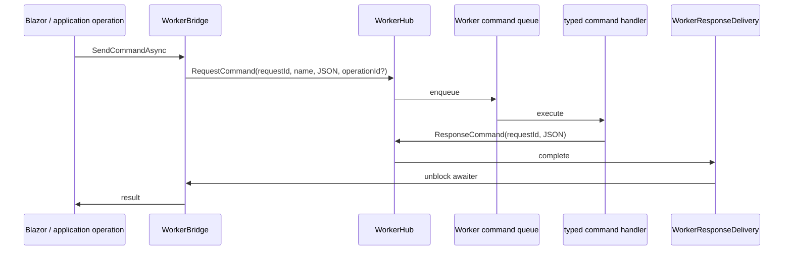
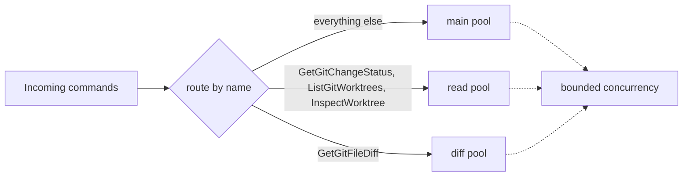
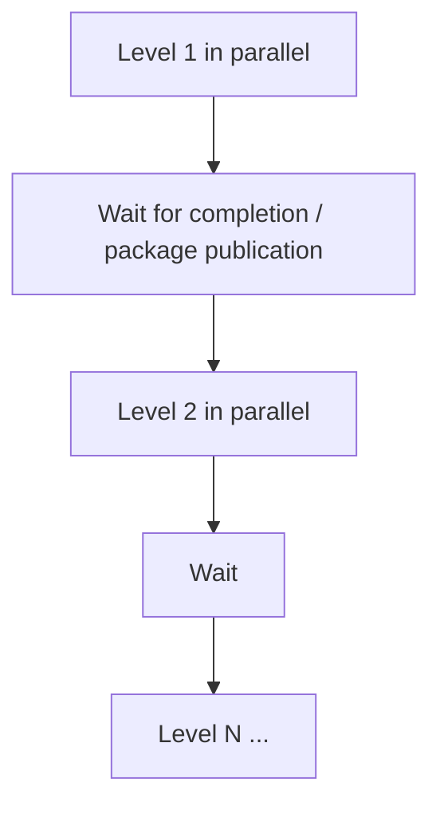
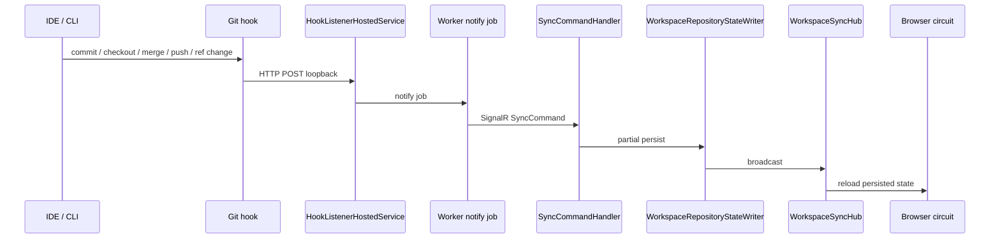
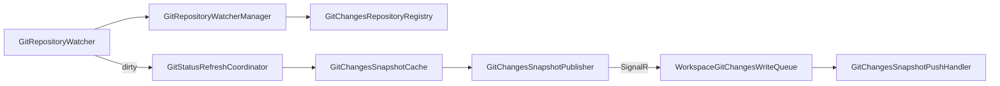
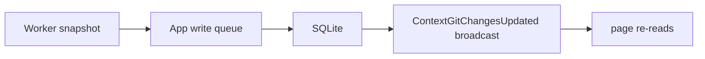

# 04 - Runtime Communication and Concurrency

## 1. App to Worker request flow

The App sends local-work commands to the Worker through SignalR.

Conceptually:



A unique request ID correlates response and caller.

Command terminal output is streamed separately so long-running operations can show live progress.

`WorkerBridge.SendCommandAsync` refuses commands while the Worker runs a different product version (section 18).

App-initiated commands that need the Workspace profile carry `RepositoryOperationCapabilities` on `WorkspaceCommandRequest`. Hook-driven work has no App request, so the Worker resolves capabilities itself (section 7).

### 1A. AI generation commands

AI commit message and pull request text generation (`IWorkspaceAiGenerationOperations`, implemented by the scoped `WorkspaceAiGenerationOperations`) makes exactly one provider call per click:

```text
resolve provider + model (graymoon.json ai.providers, else the provider default) and check availability
Worker CollectGitEvidence   one request for all repositories, fan-out bounded by GitChangesOptions.MaxParallelRepositoryOperations
AiPromptBuilder (Common)    one prompt under a hard token budget
Worker GenerateAiText       one CLI process
AiGeneratedTextParser       strict JSON check; AiGenerationResult<T> is never partial
```

- The App never runs git or an AI CLI. The Worker runs both, because it runs as the signed-in user and in Docker mode it is the only process on the host. The Worker refreshes PATH from the user environment at start (`HostEnvironmentPath.RefreshProcessPath`).
- `CollectGitEvidence`, `GetAiProviders` and `GenerateAiText` (`WorkerHubMethods` constants) run on the Worker main pool; there is no AI-specific queue. The App reads CLI availability from `GetHostInfo` and does not call `GetAiProviders`.
- Both `GitEvidenceCollector` and `AiCliRunner` launch processes through `BoundedProcessRunner` (Common: argument list, stdout cap, logs only executable, timing and sizes), wrapped in the Worker by `RepositoryAccessBoundedProcessRunner` (section 2A).
- `AiCliRunner`: availability probe `<exe> --version` with a 15 s timeout, cached 5 min in the Worker; answer cap 256 KiB, stderr cap 16 KiB; each run gets its own empty folder `%TEMP%\graymoon-ai\<guid>`, deleted afterwards.
- App side: `HostInfoCache` (singleton) holds the startup host check, including which AI CLIs are installed. Menus read that snapshot and do not probe. Generation timeout `AiGeneration:TimeoutSeconds` (default 120, clamped 10..600).
- Click-to-write runs are not circuit work: `AiTextGenerationRuns<TText>` (singleton; `WorkspaceGitChangesCommitGeneration` for Changes, `WorkspacePullRequestTextGeneration` for New Pull Request) keeps at most one run per Workspace and Feature context, runs it in a fresh DI scope through `IScopedServiceExecutor`, and outlives the page, the dialog and the circuit (F5 / Ctrl+F5). Only Cancel for that context stops it. When it finishes, a page still showing that context does the live scope check and applies the text itself; otherwise the run decides against that context's memory (`WorkspaceGitChangesCommitMessageMemory`, `WorkspacePullRequestDraftMemory`) and stores the text, a suggestion or the error there. All of it is in memory and lost on App restart.
- Commit generation runs inside the Git Changes commit job (overlay step label "ai", never the prompt); pull request generation runs without an overlay job.

### 1B. Log correlation (App ↔ Worker)

Two Serilog LogContext properties join App and Worker file logs for diagnosis. Names live in `GrayMoonLogProperties` (`GrayMoon.Abstractions`):

| Property | Meaning | Lifetime |
|---|---|---|
| `GrayMoonRequestId` | Hub `requestId` | One `SendCommandAsync` / one Worker command job |
| `GrayMoonOperationId` | Parent user/system mutation | One workspace overlay job (and Push/Update `RunId`) |

`WorkerBridge` pushes both into LogContext for the send/wait. The Worker pushes `GrayMoonRequestId` (and `GrayMoonOperationId` when the optional 4th `RequestCommand` argument is set) for the execute scope. File sinks under `%ProgramData%\GrayMoon\Logs\` append `req={GrayMoonRequestId} op={GrayMoonOperationId}` so nested lines stay greppable. Desktop native-bridge request ids are a separate channel and are not `GrayMoonRequestId`.

Typical support workflow:

```text
1. Grep graymoon-app-*.log for GrayMoonOperationId / [PushOrchestrator {RunId}]
2. Within that window, collect GrayMoonRequestId values from WorkerBridge lines
3. Grep graymoon-worker-*.log for those request ids (or the same operation id when on the wire)
```

Happy-path success stays at Debug on the App; failures, timeouts and Worker completion stay the loud signals. Do not invent a third hop Guid beside `requestId`.

---

## 2. Worker job pools

The Worker uses separate bounded queues for different command categories.

Current architecture:



Routing is by command name in `SignalRConnectionHostedService`: `ReadOnlyCommands` = `GetGitChangeStatus`, `ListGitWorktrees`, `InspectWorktree`; `DiffCommands` = `GetGitFileDiff`; everything else goes to the main pool. Each pool is a bounded `Channel<JobEnvelope>` drained by its own hosted service (`MainJobBackgroundService`, `ReadJobBackgroundService`, `DiffJobBackgroundService`, all derived from `JobBackgroundService`).

Sizes (`WorkerOptions`):

```text
MaxConcurrentCommands       main pool   default Environment.ProcessorCount * 2
MaxConcurrentReadCommands   read pool   default 8
MaxConcurrentDiffCommands   diff pool   default 4
```

The main pool also carries Sync, push, restore, worktree create/remove (`CreateGitWorktree`, `RemoveGitWorktree`), Feature folder cleanup, the CodeGraph commands, the AI commands and every hook notify job.

This isolation matters.

A long push, restore, or repository sync should not force a user to wait behind the same queue for a diff or Git status scan.

Do not collapse these pools into one queue without a deliberate performance redesign.

---

## 2A. Repository access broker

`IRepositoryAccess` / `RepositoryAccess` (`GrayMoon.Worker/Abstractions/IRepositoryAccess.cs`, Worker singleton) is the single Worker owner of "who may touch this folder". It exists so the Worker's own handles (git processes, LibGit2Sharp repositories, file watchers, file walks) never block deleting a worktree or a Feature folder. It never touches programs the Worker did not start.

Shared leases:

- `TryAcquireShared(path, RepositoryAccessKind.ReadOnly | Mutating, forceTerminate, owner)` is taken for every git process, every LibGit2Sharp open and every long file walk. It returns null while the path equals or lies beneath an exclusive claim; callers then throw `PathUnderRemovalException`. `owner` lets the remover itself work inside its own claim.
- A lease exposes a `Yield` token. Holders must honour it; the process guard cancels the process when it fires and reports `PathUnderRemovalException`.

Exclusive claims (`AcquireExclusiveAsync(paths)`), used only by `GitWorktreeService.RemoveWorktreeAsync` and `FeatureFolderCleaner`:

```text
publish the claim (new leases beneath it are refused)
notify ancestor observers (ClaimBeneathStarted) and Release() registered IReleasable holders beneath it
cancel ReadOnly leases at once (Yield)
wait MutatingGrace 5 s for Mutating leases to finish, then cancel them
wait for zero leases up to Ceiling 15 s in total
force-terminate the processes the Worker started (forceTerminate), wait ForceSettle 1 s
else throw RepositoryAccessException (a defect; the claim is withdrawn)
```

Timings are `RepositoryAccessTimings.Default` (5 s, 15 s, 1 s).

Choke points (registered in `Cli/Handlers/RunCommandHandler.cs`):

- `RepositoryAccessCommandLineService` wraps `ICommandLineService` and `RepositoryAccessBoundedProcessRunner` wraps `IBoundedProcessRunner`; both use `RepositoryAccessGuard` on the process working directory (a process with no working directory takes no lease).
- `GitAccessClassifier` picks the lease kind from the git subcommand: known read-only subcommands (`status`, `diff`, `log`, `rev-parse`, `for-each-ref`, `ls-files`, `ls-remote`, `check-ignore`, ...; `branch`/`config`/`tag`/`remote`/`stash`/`worktree` only in their listing forms) are ReadOnly. Anything else, and every non-git executable, is Mutating.
- LibGit2Sharp openers take their own leases: `LibGit2SharpLocalGitSnapshotReader`, `LibGit2SharpGitIgnoreService` (the session holds its lease for its whole life), `LibGit2SharpConfigReader`, `GitVersionInputFingerprint` (all ReadOnly) and `RepositoryConfigurationInitializer` (Mutating, because it writes config).
- `GitRepositoryWatcher` implements `IReleasable` (Release disposes both `FileSystemWatcher`s; it cannot restart in `OnError`) and `IRepositoryAccessObserver` (an ancestor watcher pauses while a claim beneath it is active). `GitRepositoryWatcherManager.Acquire` refuses covered paths. Released watchers are not recreated automatically; the next App lease renewal (`GetGitChangeStatus`) recreates them.

App side:

- A `GetGitChangeStatus` result with `ErrorCode = "PathUnderRemoval"` is expected, not an error (`GitStatusRefreshCoordinator`, `WorkspaceFeatureOperations`).
- `IWorkspaceGitChangesMonitoringPause` (section 9A) only avoids pointless scans; the Worker broker is authoritative.

---

## 3. App-side operation locking

`WorkspaceOperationRunner` is the process-wide mutation coordinator. It implements both `IWorkspaceOperationRunner` and the hierarchical `IWorkspaceOperationLock`.

The lock has two levels:

```text
structural (TryStartStructural)   whole Workspace; refused while any context mutation or another structural one runs
context    (TryStartContext)      one per WorkspaceFeatureContextId; refused while a structural one runs
```

Mutations in different contexts (the special Workspace and Feature A, or Feature A and Feature B) can run concurrently. A second mutation in the same context does not start; the caller attaches to the running one.

Structural operation kinds:

```text
create-feature               WorkspaceFeatureOperations.CreateFeatureAsync
repair-feature               WorkspaceFeatureOperations (Feature Status Retry)
rollback-feature             WorkspaceFeatureOperations (Feature Status Roll back)
remove-external-worktree     WorkspaceExternalWorktreeOperations
refresh-workspace            WorkspaceCheckoutRefresh (waits for a free slot)
enable-workspace-repository  WorkspaceRepositoryOperations
legacy TryStart              treated as structural; also REST WorkspaceCommandHttp.RunExclusiveAsync
```

Remove Feature is not structural and takes no Workspace lock (section 3A).

`BackgroundJobService` picks the level from the job key: keys shaped `/workspaces/{id}/ctx/{contextId}/...` (`WorkspaceJobKeys.ContextOverlayKey`) take a context lock; other `/workspaces/{id}...` keys take the legacy (structural) lock.

This protects multi-step orchestration from overlapping writes and Git operations.

`BackgroundJobService` is not the lock itself. It attaches UI/circuit job handles and overlays to process-wide operations.

`IWorkspaceLockedOperation.RunBackgroundableAsync(work)` marks a phase of a locked operation as backgroundable: while it runs the overlay shows Background instead of Abort, and Background cancels only that phase's token (section 5F).

### 3A. Lock-free Feature background work

These run without any Workspace or context lock, so Sync and every other operation keep working:

- **Remove Feature.** Confirming the dialog enqueues into `FeatureRemovalQueue` (hosted `BackgroundService`, unbounded channel, `IFeatureRemovalQueue.MaxConcurrentRemovals` = 4 concurrent removals, the rest FIFO, one pending entry per context). `RemoveFeatureAsync` takes no Workspace lock and does not refresh the Workspace; the departing page starts `IWorkspaceCheckoutRefresh` itself and does not wait. The outcome is a toast on whatever page is open.
- **Feature reconciliation** (`WorkspaceFeatureReconciler`, section 5E). Skips every Workspace that `IsWorkspaceStructurallyBusy`.
- **Pending-delete sweep** (`FeatureFolderCleanupService`, section 5D). Skips while `IsWorkspaceStructurallyBusy`; a background removal does not stop it, because the sweep excludes Features that still exist.

### 3B. Update and Push: locks, approvals and outcomes

- **Lock key per surface.** The notification popup starts its job under the whole-Workspace key `/workspaces/{id}` (structural lock); the Repositories page of a Feature uses the context key. The runner refuses each while the other is held. A REST call runs inside `WorkspaceCommandHttp.RunExclusiveAsync` on the special Workspace context and returns 409 "A workspace operation is already running." when the lock is busy.
- **`StartJob` can start nothing.** When the lock is already held, `BackgroundJobService.StartJob` returns the other job's handle and does not run the new body. The "Continue with normal push?" callbacks therefore wait in memory, up to 10 seconds, for no job to be running before they start the continuation.
- **Pending approvals** (`UpdateAndPushApprovalStore`) live in memory in a singleton: single use, 30 minutes, bound to the Workspace and context, never persisted. The continuation re-plans and pushes only repositories that are still pending and were approved.
- **One outcome per run.** The combined run gets one `RunId`; `WorkspaceOperationOutcomeStore.Begin(workspace, context, operation, runId)` joins the existing entry when the RunId matches, so the nested update and push facades do not replace it. An update failure therefore stays visible after the push phase.
- **Cost of the default-branch re-check.** One read of the stored repository snapshots when the run starts; no Worker call and nothing per level.

---

## 4. Page jobs and cancellation

A long operation may continue after the user navigates away from the page that started it.

Therefore:

- page code must not capture disposable page state inside long-running background callbacks unless safely marshaled;
- cancellation must flow through application/Worker boundaries;
- the operation result is persisted independently from the initiating page;
- a later page can re-read the resulting persisted state.

---

## 5. Workspace parallelism

Many batch operations use `Workspace:MaxParallelOperations` (`WorkspaceOptions.MaxParallelOperations`, default 16).

This controls bounded fanout such as:

```text
repository sync
branch fetch
return-to-default batches
push batches
project refresh
Feature worktree create / remove / rollback Source rows
```

Parallelism is deliberate and bounded.

Sync must always run in parallel, including when repositories are cloned for the first time (a new Workspace, or repositories just added to one). The clone happens inside the same per-repository `SyncRepository` command, so first-time clones fan out like fetches do. A clone must never take the per-repository git write lock (`GitProcessRunner.RepoLocks`): its working directory is the Workspace folder shared by every clone, so locking on it would serialize them one after another. `GitProcessRunner.RunRemoteAsync` therefore runs `GitRemoteOperation.Clone` with `GitLockIntent.Read`. Do not add any other Workspace-wide or process-wide gate around clone.

Do not replace it with unrestricted `Task.WhenAll` across arbitrarily large Workspaces.

`WorkspaceGitService.SyncAsync` fans out `SyncRepository` with `SemaphoreSlim(MaxParallelOperations)`, then persists sequentially through one DbContext. It logs the Information line `SyncRepository fan-out settled ... MaxActive ... Stage=fan-out` (Debug lines for dispatch/response and `Sync persist settled`). After the sync, Git Changes is rescanned once: a full sync calls `ScanWorkspaceAsync`, a subset sync calls `ScanRepositoriesAsync` with all ids (`WorkspaceSyncHandler`).

Bulk merge then return uses `ReturnToDefaultUnattendedBatchAsync`: dedupe ids in first-seen order; refresh branches in parallel (a fetch failure is attributed to its repository); one PR refresh; classify each repository from a fresh snapshot; return eligible repositories in parallel on new DI scopes; run `RecomputeAndBroadcastWorkspaceSyncedAsync` once, only if at least one returned (a recompute failure is reported separately and does not undo returns). Unattended policy: delete the remote branch only when there is an upstream, force-delete the local branch, never close PRs. Single-repository callers keep `ReturnToDefaultUnattendedAsync` (abort-all).

### 5A. Sync repository pipeline

`SyncRepositoryCommand.ExecuteAsync` (Worker) per repository:

```text
1 clone            only when the path has no Git metadata and is not the Workspace root
2 suppress         using IGitChangesRefreshSuppressor.BeginExternalRepositoryMutation(repoPath) (section 9A), up to the response
                   AddSafeDirectoryAsync, then EnsureWindowsLongPaths (section 16A)
3 fetch            git fetch origin --prune --tags (skipHooks); failure returns at once: no GitVersion, reads or scan
4 tag pin          checkout of the pinned tag if clonedNow && ApplyRepositoryTagPin
5 overlap          Task.WhenAll of
                     GitVersion (/nofetch; holds the repository write lock)
                     read lane: write the divergence-base file, then the LibGit2Sharp snapshot in Task.Run (no lock)
                     project scan, only if ShouldDiscoverProjects, else null (never [])
6 branch           the GitVersion branch wins, else snapshot.CurrentBranch; a tag checkout reports "-"
7 origin/HEAD      if unresolved: RepairOriginHeadAsync (ls-remote --symref origin HEAD, then git remote set-head origin <branch>), then a fresh snapshot
8 tail             WriteSyncHooksAsync (on a branch or tag) plus commit counts
```

Clone rules: Windows clones use `-c core.longpaths=true` (`GitService.CloneLongPathsPrefix`). A failure, or a success without `.git`, returns `NotCloned = true, Success = false` with `FailureKind` and the SSO fields; a folder that holds only `.git` (or nothing) created by the clone is deleted, any other content is left and the message tells the user to move it aside. A missing clone URL returns a NotCloned message. There is never a fabricated success.

Snapshot fallback rules (read lane):

- no `.git` of its own at the path: refs left unread with a Warning, no fallback (never answer for an enclosing repository);
- `GIT_DIR` set in the Worker environment: CLI lane (libgit2 ignores `GIT_DIR`);
- `LocalGitReadException`: Warning, then the CLI read lane (`IGitRepositoryReader`).

Counts: snapshot counts are used when the final branch equals `CountsBranch`; any other branch uses CLI `ProbeCommitCountsAsync`. The Debug `SyncRepository timings` line names the lane source `[Snapshot|GitCli|None]` and the counts source.

origin/HEAD repair is throttled per repository in memory (`GitService.OriginHeadRepairRetryMs` = 15 min); the attempt is recorded before the remote call and a repair never fails the sync. A remote default switched to an already existing branch is not detected.

Snapshot parity with the CLI reader: branch names are the full names below `refs/heads/` and `refs/remotes/origin/` (the CLI uses `%(refname:strip=2|3)`, never `:short`); comparison refs resolve by full ref name; tags are ordered `-creatordate` with ties in ordinal name order; the default ref uses `OriginDefaultRef.Pick` (origin/HEAD, then origin/main, then origin/master); the divergence-base file is `<gitdir>/graymoon-divergence-base` (`GitDirectoryLocator`). Do not parallelize the snapshot internally.

Process budget of a quiet sync: fetch, plus the hooks `rev-parse` (0 once cached, section 16C), plus GitVersion (0 on a cache hit). `GitServiceFewerProcessesTests` pins it; refactors must not add `git.exe` launches.

Only `SyncRepositoryCommand` uses `ILocalGitSnapshotReader`; hook-sync commands, `GetCommitCounts`, branch refresh and Git Changes status still read through the CLI.

### 5B. Bounded parallel per-repository work and what stays sequential

Recipe for fanning out per-repository work:

1. fan out only Worker calls, HTTP calls, or work with its own scope or `IDbContextFactory` context;
2. bound with `SemaphoreSlim(Math.Max(1, MaxParallelOperations))` (Git Changes: `GitChangesOptions.MaxParallelRepositoryOperations`), never a constant;
3. collect results per item and merge them in input order;
4. per-item try/catch, letting `OperationCanceledException` through;
5. persist once afterwards (never `SaveChanges` in a loop, never share an `AppDbContext` across tasks).

Bounded fan-out already in place (besides Sync and the batches above): GitHub Actions latest runs and workflow metadata, `GitHubActionsPushRunWatch` discovery and feed polling, `WorkspaceFileVersionService` (groups per file concurrently, items in a group sequentially), connector repository fetch, Feature rollback Source rows, batch `GetSnapshotsAsync` / `GetRepositoryPathsAsync`, `FetchAfterRejectionsAsync`, `TokenHealthBackgroundService` connector checks.

Must stay sequential:

```text
dependency-level loops                       DependencyUpdateOrchestrator, WorkspacePushService (section 6)
writes through a shared scoped AppDbContext
WorkspaceFeatureReconciler apply phase
Git Changes monitoring and line-stats sweeps (each scan is already bounded)
single-reader queues                         WorkspaceGitChangesWriteQueue, WorkerSyncNotificationQueue
sync barrier                                 IWorkerSyncNotificationBarrier (implemented by WorkerSyncNotificationQueue): DependencyUpdateOrchestrator.RunAsync awaits it before reading stored state, so hook syncs already received are applied before a run plans or selects push levels
FeatureRemovalQueue                          fixed at MaxConcurrentRemovals = 4 workers, FIFO
Worker DotnetRestoreCommand                  shared obj/ and NuGet cache
```

`SyncBackgroundService` (the REST per-repository sync request queue behind `SyncEndpoints`, deduplicated per repository and Workspace) runs at most `DefaultMaxConcurrency` = 4 requests at once (`Sync:MaxConcurrency` overrides it) to bound SQLite writers. `SyncRecomputeCoalescer` (singleton, key `"{workspaceId}:{contextId}"`) lets a burst of hook syncs share the recompute that follows their state writes: at most one `WorkspaceStateRecomputeScope.RecomputeAsync` runs per key, a caller that arrives during a run waits for the next run (which starts after its own write), so a burst of N costs two runs and nothing written is left out. `WorkspaceFileVersionService.CheckAndPersistFileVersionStatusAsync` gates the file-version check the same way with a private instance (the recompute above runs that check under the same key, so sharing the singleton would deadlock): checks of one context never overlap, and no caller goes on with a check that read the files or versions before its own writes. Two-lane Update and Push depends on this, because the push lane's and the post-push syncs' checks run while the update is still rewriting and committing the next level.

### 5C. Feature create pipeline

`CreateFeatureAsync` runs entirely inside `TryStartStructural(workspaceId, "create-feature")` on the Repositories overlay:

```text
PreFlight         name validation, duplicate name (case-insensitive), EnsureManagedFeatureStorageRootAsync,
                  CleanupFeatureFolder onlyIfMarked (a still-marked folder fails with FeatureFolderPendingDeletion)
HeadSnapshot      one GetHeadCommits command for all repositories; every HEAD validated and branch collisions
                  checked before any row is written
IntentTransaction Feature Creating + context + one Pending WorkspaceFeatureRepository per repository, one transaction (C1)
RootWorktree      the Workspace-role repository alone and first (D10); its worktree path is the Feature root
SourceWorktrees   only when the root succeeded; SemaphoreSlim(MaxParallelOperations); each row Ready/NeedsRepair
                  saved in its own AppDbContext; Sources live inside the root
SeedProjections   SeedInitialFeatureProjectionsAsync (idempotent), then Feature Ready
CodeGraph         when Create asked for an index: InitializeCodeGraphAsync (the definition switch is not required), then the watch (section 5F)
```

- Worktree paths are built from the persisted `ManagedFeatureStorageRoot` with `WorkerPath.Combine`. Do not call the path resolver inside the intent transaction: it opens a second `AppDbContext` and deadlocks SQLite against this write and against `WorkspaceGitChangesWriteQueue`.
- Any failure after the intent commit lands in `NeedsRepair`; the failure write uses `CancellationToken.None`, so Abort still persists it.
- `GetHeadCommits` (Worker) runs with an internal `SemaphoreSlim` of `DefaultMaxConcurrent` = 8 (a constant, not `MaxParallelOperations`).
- Per worktree (`GitWorktreeService.CreateWorktreeAsync`): `git worktree list --porcelain` pre-check; idempotent success if the path already hosts the expected branch (or is detached at the base SHA); else `WorktreePathConflict` / `BranchOccupied` / `PathExists` (an existing empty folder is allowed); `EnsureWindowsLongPaths`; `git worktree add -b <name> <path> <sha>` or `--detach <path> <sha>`, never `--force`; verify list, `VerifyFailed` if not listed.
- `CreateGitWorktreeCommand` first rewrites the main checkout's hooks (so the new worktree's `post-checkout` is attributed by path), then wraps `git worktree add` in `IWorktreeCreateHookDeferral.BeginCreate(worktreePath)` and `BeginExternalRepositoryMutation(mainPath)`.
- Hook deferral (`WorktreeCreateHookDeferral`): a `Checkout` notify job for a worktree being created is held (one per path, re-created with `FreshWorktree = true`) and re-enqueued once no create has been active for `QuietPeriod` = 500 ms, so held syncs do not occupy main-pool slots the remaining creates need. A fresh-worktree `CheckoutHookSyncCommand` skips the token lookup and network fetch, projects, commit counts and remote branches, but still runs GitVersion; `SyncCommandHandler` skips PR reconciliation for it.
- Finalization barrier (`FeatureFinalizationCoordinator`, App singleton): `Arm(contextId)` before the first worktree of Create or Repair, disposed in a `finally` after the seed and lifecycle change. `SyncCommandHandler` waits on `WaitForFinalizationAsync` for a finalizing Feature context (bounded by `MaxBarrierWait` = 15 min, then applies anyway), so the deferred GitVersion lands after the seed and is never overwritten by it. In memory only: a restart drops it and Repair's idempotent seed reconciles. `AcquireProjectionAsync(contextId)` serializes every writer of a context's `WorkspaceProjects` / `ProjectDependencies` (the seed and the project merges), so the unique (context, repository, name) index is never raced.
- Telemetry (Information): App `Feature Create timing` per stage, `Feature Create repository timing` (`GateWaitMs`, `PathMs`, `WorkerRoundTripMs`, `DbMs`, `TotalMs`); Worker `GetHeadCommits timing`, `CreateGitWorktree timing`, `Git worktree created ... PreListMs LongPathsMs AddMs VerifyListMs`, `NotifySync completed ... hook=...`. See section 19 for `FeatureOperationLog`.

Repair (`repair-feature`) re-runs worktree create only for `Pending` / `NeedsRepair` rows, keeps `Ready` rows and re-seeds idempotently. Rollback (`rollback-feature`) refuses dirty repositories, removes Sources first and the root last, non-force.

### 5D. Feature removal internals and pending-delete cleanup

App side (`RemoveFeatureAsync`, from `FeatureRemovalQueue`, no lock): pauses the context's Git Changes sweep (section 9A), runs `UninitCodeGraph` first, marks the Feature and live rows `Removing`, removes Source worktrees concurrently (bounded by `MaxParallelOperations`), then the root worktree alone and only when every Source succeeded (D10). Each repository row becomes `Removed` in its own short-lived context right after its worktree is unregistered, so a crash can resume. Local branches are deleted afterwards (`-D` only when authorized) and, when requested, remote branches with a lease (`expectedSha`).

Worker side (`RemoveGitWorktree` -> `GitWorktreeService.RemoveWorktreeAsync`):

```text
AcquireExclusiveAsync([worktree path])           section 2A; the Worker's own handles never block the delete
git worktree unlock                              only when unlock was authorized
git worktree remove [--force]                    --force only when discard was authorized
worktree list re-check                           regardless of exit code; GitFailed/VerifyFailed only when still registered
residue delete                                   only when ValidateResidueRemovalGuards passes (featureStorageRoot and featureRootPath
                                                 set, beneath the root, never a .git); clears read-only, deletes reparse points
                                                 without following; retries 200/400/800/1600/3200 ms within a 15 s budget
report residueRemaining / residueFileCount / residueSampleFiles; remove an empty Feature root
```

Pending-delete cleanup (`FeatureFolderCleaner.CleanupAsync`, Worker commands `CleanupFeatureFolder` and `SweepPendingFeatureFolders`):

- The unit is the whole Feature root `{ManagedFeatureStorageRoot}\<Feature>`.
- Path guards: both paths absolute, the storage root a GrayMoon `features` folder (not a drive root), the Feature folder beneath it. Tree guards: no reparse point at the storage root or Feature folder, no `.git` directory, a `.git` file only when its `gitdir:` target is gone (Git no longer knows the worktree). Never enters a reparse point.
- Outcomes `Removed | PendingDeletion | Refused | NotMarked`. When files remain in use the cleaner writes `GRAYMOON-PENDING-DELETE.md` (`PendingDeleteMarker`) in the root plus copies in leftover repository folders and returns `PendingDeletion`.
- The sweep walks grouping folders at most `MaxFeatureNameDepth` = 8 levels (Feature names may contain `/`), deletes only folders whose marker names that same folder, and excludes Features still in the database. Empty parents are removed up to, never including, the storage root.
- Legacy drive-root storage paths (`WorkerPath.IsLegacyWindowsDriveRootGraymoonPath`) are never marked or swept.

App `FeatureFolderCleanupService`: sweeps on Worker `Online` and on Workspace open (`RequestSweep`), at most once per Workspace per `MinInterval` = 15 min, skipped while `IsWorkspaceStructurallyBusy` or while `IWorkerBridge.GetUnavailableReason()` is set. Never throws.

### 5E. Feature reconciliation

`WorkspaceFeatureReconciler` (hosted) runs on every Worker `Online` transition, at most once per 60 s, single-flight, with at most 4 concurrent Worker calls. It never deletes worktrees and takes no lock; Workspaces that are structurally busy are skipped.

```text
Feature stuck Creating / Removing                          -> NeedsRepair ("Interrupted while creating" / "Interrupted while removing")
Ready row not registered, confirmed missing by InspectWorktree -> row and Feature NeedsRepair ("Worktree is missing")
Pending / NeedsRepair row registered at its path           -> Ready
untracked worktree under the managed storage root          -> owning Feature NeedsRepair, else a Warning log (never adopted)
```

It compares paths only, so a drifted branch stays Ready. Any Worker failure (`ListGitWorktrees`, `InspectWorktree`) leaves the rows alone. It logs `Feature Reconcile finished` with the counts.

### 5F. CodeGraph background build

Optional (`FeatureCodeGraphService`). `"codegraph": true` in the Workspace definition is the workspace-wide switch for maintaining `codegraph.json` and the managed `.gitignore` entry, and for Repair. Create follows the New Feature checkbox instead.

- At the end of Create Feature, only when the dialog asked for an index, `InitCodeGraph` makes the Worker's `CodeGraphCli` start `codegraph init -v` in the Feature root in the background (its own full build; up to 1 h). The build outlives the App's command timeout. The same init runs at the end of Repair Feature only when the switch is on.
- The operation then watches it with repeated `WatchCodeGraphInit` calls, each following the build for at most 60 s (`CodeGraphCli.WatchWait`) and replaying the buffered output from a line offset into the overlay terminal. The watch runs inside `IWorkspaceLockedOperation.RunBackgroundableAsync`, so the overlay shows Background instead of Abort; Background stops only the watch, the build continues and the operation (and its structural lock) completes. Create watches only when it asked for the index, and that watch does not require the switch.
- At the start of Remove / Roll back Feature, before any worktree goes, `UninitCodeGraph` always runs: it stops a running build and the CodeGraph processes named in `.codegraph` pid files (only while still a `node` process started before its pid file), runs `codegraph uninit`, and deletes `.codegraph` when that fails. A Feature with no index returns `NotInitialized`.
- Every CodeGraph failure is logged only and never fails the Feature operation.

---

## 6. Dependency-ordered operations

Some operations cannot simply fan out across all repositories.

Synchronized push and dependency update work by dependency level.

Pattern:



Dependency ordering is a business rule, not a performance detail.

---

## 7. Hook-driven synchronization

GrayMoon installs Git hooks into managed repositories.

Hooks report local Git events even when changes were initiated outside GrayMoon.

End-to-end:



Hook notification failure must not break the Git operation that triggered the hook: the script posts with `curl -s --connect-timeout 1 --max-time 2 ... || true`. The payload is `repositoryId`, `workspaceId`, `repositoryPath`.

Hook scripts are context-agnostic and never embed capabilities. Hook-driven Worker commands resolve the Workspace profile through `IWorkspaceCapabilityProvider`: a per-Workspace cache warmed by inbound App commands, then `GET /workspaces/{workspaceId}/capabilities` with the Worker secret, else full enrichment (that fallback is never cached and hook sync never fails for it). A profile save does not invalidate the cache; the next App command re-warms it.

GrayMoon's own commits and pulls run with `skipHooks` (`-c core.hooksPath=` empty), so they bypass team pre-commit hooks deliberately.

### Context attribution

Feature worktrees share the hooks directory of the main checkout, so the hook script also sends `repositoryPath` (`git rev-parse --show-toplevel`). `WorkspaceHookContextAttributor` matches that path against the special Workspace checkout and the Feature worktree paths:

```text
matches the Workspace checkout   -> special Workspace context
matches one Feature worktree     -> that Feature context
unknown or ambiguous path        -> notification skipped (never defaulted to the Workspace)
no path                          -> special Workspace context
```

`CreateGitWorktree` rewrites the hooks of the main checkout before `git worktree add`, so the `post-checkout` hook fired by the new worktree is attributed correctly.

### 7A. Hook install policy

`GitService.WriteSyncHooksAsync` (Sync tail, `CreateGitWorktree`) never throws; failures are Warnings.

- The folder is resolved with one `git rev-parse --git-common-dir --git-path hooks` (honours `core.hooksPath`; for a linked worktree it is the common Git directory's `hooks`), cached by `GitHooksLocationCache` (section 16C).
- If `core.hooksPath` resolves outside the common Git directory (husky, lefthook, a shared folder), nothing is written and one Warning is logged per Sync. Only the read of the setting's text for that Warning is in-process (`LibGit2SharpConfigReader`).
- A GrayMoon hook is recognised by its first comment line after the shebang (`# Created by GrayMoon.Agent`). It is rewritten only when the content other than that marker line differs.
- A foreign hook is renamed to `<hook>.replaced-by-graymoon` (a UTC-timestamped suffix when that name is taken) and a Warning is logged; the renamed hook no longer runs. If the rename fails, the foreign hook is left and that hook is skipped. A directory at the hook path is skipped.
- Hooks are never removed when a repository leaves a Workspace.

---

## 8. Hook types

Installed hooks and their listener routes:

```text
post-commit            /hook/commit
post-checkout          /hook/checkout   branch checkouts only ($3 = 1)
post-merge             /hook/merge
pre-push               /hook/push
reference-transaction  /hook/refs       git 2.28+; filtered in the script to created or deleted refs/heads/* and refs/remotes/* (not */HEAD)
```

Different hooks may gather different state.

For example, pre-push is intentionally not a general-purpose fetch operation.

`reference-transaction` reports a branch made or deleted outside GrayMoon: `RefsHookSyncCommand` debounces per repository (`RepositoryPassCoalescer`, 250 ms) and sends a branch-lists-only snapshot (`RepositoryStateSnapshot.IsBranchRefsOnly`). `SyncCommandHandler` applies it without deriving sync status, reconciling pull requests or recomputing dependencies, and without touching tags or the checked-out state.

Notify jobs (`NotifySyncJob`) run on the Worker main pool. `Checkout` jobs for worktrees being created are deferred (section 5C).

The state writer's partial/probed-group semantics are therefore essential.

---

## 9. Git Changes watcher architecture

Git Changes uses filesystem watchers on the Worker.

Important components include:



### Watcher lifecycle

A `GetGitChangeStatus` request establishes or renews a watcher lease for a repository path.

The watcher is not permanent forever.

Leases expire after an idle grace period when the Workspace/page is no longer active.

A removal claim (section 2A) releases watchers beneath it; they come back with the next lease renewal.

### Watcher event

Filesystem activity does not immediately run unlimited Git status processes.

It marks the repository dirty.

`GitStatusRefreshCoordinator` debounces and coalesces events, then performs a bounded scan. While a refresh suppression scope is open for the repository, it only records the event (section 9A).

### Snapshot push

The Worker can push a fresh snapshot without waiting for an explicit page request.

The App validates version ordering and persists through the single write queue.

After a snapshot commits, `GitChangesSnapshotPushHandler` publishes to `IWorkspaceGitChangesNotifier`, the in-process singleton fan-out for persisted snapshot changes, next to the `ContextGitChangesUpdated` SignalR broadcast. Unlinking repositories from a Workspace publishes too, with the all-contexts sentinel. Circuit-side consumers such as the Changes nav dot subscribe to it instead of opening their own hub connection.

### 9A. Refresh suppression and monitoring pause

Worker: `IGitChangesRefreshSuppressor.BeginExternalRepositoryMutation(repoPath)` returns an `IDisposable` scope. It is implemented by `GitStatusRefreshCoordinator` (same singleton) and opened by `SyncRepositoryCommand` (fetch to response) and `CreateGitWorktreeCommand` (on the main checkout).

- The open-scope count is per repository (`RepositoryRefreshTracker`). While it is above zero a watcher `MarkDirty` only sets a flag, and debounce timers armed earlier are neutralized.
- Closing the last scope schedules exactly one debounced refresh, and only if a watcher event was seen.
- Not suppressed: manual `RefreshNowAsync`, stage, unstage and commit.

App: `IWorkspaceGitChangesMonitoringPause` makes the periodic monitoring sweep skip a Feature context while Remove Feature or Roll back deletes its worktrees. Ref-counted per context id; the special Workspace context is never paused.

---

## 10. Git Changes activity tracking

The App tracks whether a Workspace has recently needed Git Changes monitoring.

Opening relevant pages activates monitoring.

The background service only refreshes active/recent Workspaces instead of scanning every repository forever.

This is a deliberate scalability choice.

---

## 11. Git Changes refresh

"Refresh" is not merely re-reading SQLite.

An explicit refresh ultimately requests a new Worker status scan (`GitChangesWorkspaceScanner` → `GetGitChangeStatus` per repository, bounded by `GitChangesOptions.MaxParallelRepositoryOperations`).

When the snapshot returns:



`GitChangesSnapshotPushHandler` resolves the context from the reported repository path, writes the context tables, and broadcasts `ContextGitChangesUpdated(workspaceId, contextId, repositoryId)`. Legacy dual-write (`GitChangesOptions.WriteLegacyGitChangesTables`) also writes the legacy tables and broadcasts `GitChangesUpdated(workspaceId, repositoryId)` for the special Workspace.

Each snapshot carries the **full** `GitChangeEntry` list for that repository over Worker↔App SignalR (`GitChangesSnapshotNotification`). The App's hub `MaximumReceiveMessageSize` is 10 MiB. The Changes page then re-reads the **entire** context projection into the circuit (`LoadAsync`), not only the updated repository's rows.

The UI remains projection-driven. Tree construction and circuit inventory details are in `07-git-changes-projection-and-tree.md`.

---

## 12. Git Changes mutation consistency

Stage, unstage, commit, and discard flows must converge back into the same authoritative snapshot model.

Do not maintain a permanent optimistic browser-only Git state after mutation.

Mutation result:

```text
perform Git command
obtain/refresh authoritative status
persist snapshot
notify page
```

---

## 13. Snapshot versioning

Worker snapshots carry versions.

This protects the App from persisting an older result after a newer result has already arrived.

Any new Git Changes path must preserve the monotonic/latest-wins semantics.

---

## 14. Browser activity and polling

Some pages adapt polling to browser activity.

Actions, for example, uses faster polling when actively viewed and slower polling when idle/hidden.

Git Changes watcher lifetime is a separate concept from browser active/idle/hidden state.

Do not conflate:

```text
browser tab activity
Git watcher lease activity
Worker connection status
background job activity
```

They are independent mechanisms.

---

## 15. GitHub Actions refresh

The Actions page:

```text
loads persisted state
starts background refresh
polls at activity-dependent cadence
reacts to Workspace/Repository sync broadcasts
refreshes targeted repositories
```

Dispatch/rerun operations account for GitHub eventual consistency by retrying until the new run becomes visible or the attempt budget is exhausted.

---

## 16. Connector health and remote operations

Remote operations should verify connector health when appropriate.

Git operations that contact a remote receive authentication dynamically.

Failure categories such as protected branch, unauthorized, non-fast-forward, or unavailable remote should be handled as operation outcomes, not blindly retried forever.

### Git CLI versus in-process LibGit2Sharp

The Worker runs Git two ways. LibGit2Sharp (pinned exact version, referenced only by the Worker) is used in process; it is not read-only, because the config initializer writes.

```text
LibGit2Sharp (in process, one Repository per logical operation; these are the only new Repository(...) sites)
  sync's local repository snapshot  LibGit2SharpLocalGitSnapshotReader (ILocalGitSnapshotReader: refs, HEAD, tags, default branch, upstream, ahead/behind)
  ignore evaluation                 LibGit2SharpGitIgnoreService (IGitIgnoreService / IGitIgnoreSession, section 16B)
  raw config reads                  LibGit2SharpConfigReader (remote.origin.url, core.hooksPath; native fallback rules in 16A)
  core.longpaths write              RepositoryConfigurationInitializer (writes the repository-local config)
  GitVersion cache fingerprint      GitVersionInputFingerprint

Git CLI
  network and authentication        clone, fetch, pull, push, ls-remote
  mutations                         checkout, branch, merge, commit, reset, tag, ...
  worktree changes                  git worktree add/remove/unlock (IGitWorktreeService)
  repair operations                 origin/HEAD repair (remote set-head)
  hooks location (cached, 16C), safe.directory, GitVersion
  every other local read            IGitRepositoryReader / GitCliRepositoryReader (read lane, --no-optional-locks; also sync's snapshot fallback)
```

Rules:

- A LibGit2Sharp `Repository` is never cached, pooled or shared across threads, and is disposed before the operation returns (the ignore session holds its repository and lease for the session's life).
- Every open takes an `IRepositoryAccess` lease (ReadOnly, or Mutating for the config write), so a removal claim can evict it (section 2A).
- A native-library failure (`DllNotFoundException` / `TypeInitializationException`) becomes a CLI fallback in the snapshot reader and the fingerprint. The ignore session has no fallback, so project discovery fails. A failed type initializer poisons LibGit2Sharp for the rest of the Worker process; recovery needs a Worker restart. This is why the Worker install script verifies every archive entry before installing.
- Never expose LibGit2Sharp types outside the Worker services.

### 16A. Git configuration rules

- `core.longpaths=true` is applied on Windows only, by `RepositoryConfigurationInitializer.EnsureWindowsLongPaths`. It reads only the repository-local level and writes there when not true. For a linked worktree it opens the common Git directory (through `commondir`), because libgit2 gives a worktree its own empty repository-level config. Never global, system or `config.worktree`.
- Call sites: `SyncRepositoryCommand`, `AttachWorkspaceRepositoryCommand` (after `git init`, before checkout), and `GitWorktreeService` create/remove. There is no "once ever" guarantee: successes are remembered per Worker process only (section 16C). GitVersion itself ignores the setting, so paths over 260 characters show an unresolved version.
- `LibGit2SharpConfigReader.TryGetString` returns the raw effective value (`insteadOf` is not expanded). It declines (native `git config --get` runs) for `GIT_CONFIG*` environment variables, linked worktrees (`commondir`), `config.worktree`, any `includeIf.*`, or a repository it cannot open.
- `AddSafeDirectoryAsync` runs `git config --global --add safe.directory` only when `CheckRepoSafeAsync` reports dubious ownership (exit 128 plus "dubious ownership" / "safe.directory"). Other failures log a Warning, change nothing and are probed again later. Successes are cached per process.

### 16B. Git ignore session

- One predicate, `IGitIgnoreSession.IsExcluded(path, GitPathKind)`: a file is excluded when untracked and `IsPathIgnored`; a directory when it has no tracked entries and `IsPathIgnored(path + "/")`. The tracked set comes from `repo.Index`, because libgit2 reports tracked paths as ignored, unlike `check-ignore`.
- Callers validate paths with `GitRepositoryPathValidator` (repository-relative, `/`); the session rejects anything else with `ArgumentException`.
- Consumers: `CsProjFileService` (sequential walk that skips `.git` and nested repositories, prunes excluded directories, sorts ordinally), `GitService.StageAndCommitAsync` and `GitCliRepositoryGitChangesService.StageAsync` (`SelectStageable`, then exactly one `git --literal-pathspecs add --pathspec-from-file`, never `-f`, no retry), and `WorkspaceFileSearchService`.
- No fallbacks: no `check-ignore` in production, no fail-open, no swallow-to-empty. A discovery failure throws `ProjectDiscoveryException`; Sync, `RepositoryStateProbe` and the post-push notification report projects as not probed, explicit refresh propagates the error, and persisted projects are never replaced with `[]`.

### 16C. Worker-side caches

All in memory, per Worker process; failures are never cached.

- `GitHooksLocationCache` (a field of `GitService`) replays the `rev-parse --git-common-dir --git-path hooks` answer under a SHA-256 fingerprint of the repository / git dir / commondir, the local, worktree, global, XDG and system config files, and the relevant environment (`HOME`, `USERPROFILE`, `XDG_CONFIG_HOME`, `GIT_WORK_TREE`, `PATH`, `GIT_CONFIG*`). Always native for `GIT_DIR` / `GIT_COMMON_DIR`, an unknown layout, an unreadable config, or any `[include` / `[includeIf`.
- `GitVersionResultCache` (singleton, `maxEntries` = 256, LRU) wraps `GitVersionRepositoryVersionProvider`, keyed by repository + NonNormalize + commit SHA, validated by `GitVersionInputFingerprint` (HEAD, HEAD identity, refs except `refs/stash` plus `shallow`, GitVersion config files at the root, the tool from `dotnet-tools.json` or PATH, invocation flags and `GITVERSION*` environment). Only successes are stored, the fingerprint is re-checked after the run, concurrent identical requests share one run (a cancelled leader does not fail waiters). Bypassed for an unborn HEAD, a bare or unreadable repository, the tool not on PATH, or a config containing `UncommittedChanges`. Working-tree edits are not an input.
- `RepositoryConfigurationInitializer`: a bounded success set (`MaxRemembered` = 1024, cleared on overflow) and 32 stripe locks. Lock order: access lease first, then the stripe.
- `AddSafeDirectoryAsync` successes and the origin/HEAD repair attempts (section 5A) are also remembered per process.

---

## 17. SignalR browser broadcasts

WorkspaceSyncHub events are invalidation signals.

A browser handler generally:

```text
receives workspace/repository id
debounces
opens a fresh scope/query
reloads the persisted row(s)
updates UI
```

This avoids sending large domain graphs through browser broadcast events.

Current `WorkspaceSyncHub` events:

```text
ContextRepositorySynced(workspaceId, contextId, repositoryId)
ContextSynced(workspaceId, contextId)
ContextGitChangesUpdated(workspaceId, contextId, repositoryId)
RepositorySynced(workspaceId, repositoryId)       legacy
WorkspaceSynced(workspaceId)                      legacy
GitChangesUpdated(workspaceId, repositoryId)      legacy, special Workspace only
RepositoryError(workspaceId, repositoryId, message)
```

The hook path (`SyncCommandHandler`) sends the legacy `RepositorySynced` / `WorkspaceSynced` only for the special Workspace context. Many mutation paths (for example `WorkspaceStateRecomputeScope.CompleteAsync` and branch operations) still send `WorkspaceSynced` regardless of context, so context-aware listeners must filter by the selected context and treat `WorkspaceSynced` as a coarse invalidation.

---

## 18. Worker connection state

The App tracks Worker connectivity in `WorkerConnectionTracker`: `Connecting`, `Online`, `Offline`, `VersionMismatch`.

Operations that require local filesystem/Git access must fail clearly when no Worker is connected.

Read-only persisted UI may remain available even when the Worker is offline.

App and Worker are version-locked:

- The comparison lives only in `WorkerVersionPolicy`: trim, drop a leading `v`, drop build metadata after `+`, compare ignoring case. The pre-release label counts.
- While the state is `VersionMismatch`, `WorkerBridge.SendCommandAsync` refuses every command except `SelfUpdate` and `GetHostInfo`. The `SelfUpdate` payload (`installUrl`) is frozen so the update keeps working against any Worker version.
- `IWorkerBridge.GetUnavailableReason()` lets an operation refuse before it mutates anything (Restore, Enable Workspace repository, the AI provider probe, `FeatureFolderCleanupService`).
- The self-update ends only when a Worker reports the same product version.
- A Worker counts as `Online` until it reports its version, which happens a moment after it connects.
- There are no per-feature Worker capability flags; a new Worker command ships with the matching App.

`Online` transitions trigger `WorkspaceFeatureReconciler` (section 5E) and the pending-delete sweep (section 5D).

---

## 19. Error handling model

Multi-repository operations frequently produce partial failures.

GrayMoon therefore preserves:

```text
page-level error
repository-level error
dependency-level error
operation result
```

A single repository failure should not erase successful state from other repositories.

Application `OperationResult` can carry repository and level error dictionaries.

Feature operations (Create, Remove, Repair, Rollback, Reconcile) log through `FeatureOperationLog`: one Information started line and one finished line with `WorkspaceId FeatureId ContextId FeatureName DurationMs Outcome Error`, stage lines (`FeatureStageFinished`), per-repository timing, and a Warning per failed repository.

---

## 20. Concurrency rules for contributors

When adding a new operation:

1. determine whether it is read-only or mutating;
2. decide whether Workspace mutation exclusivity is required (structural, context, or lock-free like section 3A);
3. define bounded concurrency (section 5B);
4. define dependency ordering if needed;
5. define cancellation propagation;
6. define persisted result/state;
7. define one batch recomputation boundary;
8. define browser invalidation;
9. avoid duplicate polling if hooks/watchers already provide a trigger.

SQLite writer rules:

- Every connection has `busy_timeout=5000` and `foreign_keys=ON` (`SqliteConnectionPragmasInterceptor`); the connection string sets `Cache=Shared`, `Default Timeout=5`, `Foreign Keys=True`; startup sets WAL and `synchronous=NORMAL`.
- Keep Worker, git and HTTP work parallel, and give each parallel task its own factory context, or collect results and persist once. Never share an `AppDbContext` across tasks and never capture a circuit `AppDbContext` in `Task.Run`, `WorkspaceOperationRunner` or `BackgroundJobService` closures.
- Mutate, then one `SaveChanges`; never `SaveChanges` in a loop.

Worker rules:

- Any new Worker code that launches a process goes through `ICommandLineService` / `IBoundedProcessRunner` (already wrapped by the access broker). Any new LibGit2Sharp open or long-lived handle takes an `IRepositoryAccess` lease or registers an `IReleasable`, and honours `Yield`.
- Process-count tests (`GitServiceFewerProcessesTests`, `GitHooksLocationCacheTests`) are a contract.

---

## 21. Known gaps

- No dedicated Worker lane for worktree create/remove: they share the main pool with hook notify jobs. `GetHeadCommits` concurrency is the constant 8, independent of `MaxParallelOperations`.
- Only `SyncRepositoryCommand` uses the LibGit2Sharp snapshot; hook syncs, commit counts, branch refresh and Git Changes status use the CLI. Linked-worktree config reads always go native.
- `FetchAsync` is always `fetch origin --prune --tags`; there is no narrower fetch policy for Sync.
- The watcher does not filter ignored build output; it drops only `.git` and nested repositories.
- The App has no single-flight for Worker install / `SelfUpdate`; the `Global\GrayMoonWorkerInstall` mutex in the install script is the guard.
- Update and Push does not re-check default-branch state per level (see `02-system-architecture.md` section 17); a connector token that goes bad between runs is only noticed when a call fails (plan: `docs/todo/connector-token-failure-handling.md`).
- A remote default branch switched to an already existing branch is not detected by origin/HEAD repair.
- Git Changes snapshots are full-list end-to-end on the Worker-to-App side: full porcelain status, full snapshot SignalR payloads (a 50K-path repository is about 8.9 MiB against the 10 MiB receive cap) and full SQLite replace. The circuit side is paged and virtualized. Details in `07-git-changes-projection-and-tree.md` section 9; follow-ups in `docs/todo/git-changes-large-changeset-scale.md`.
