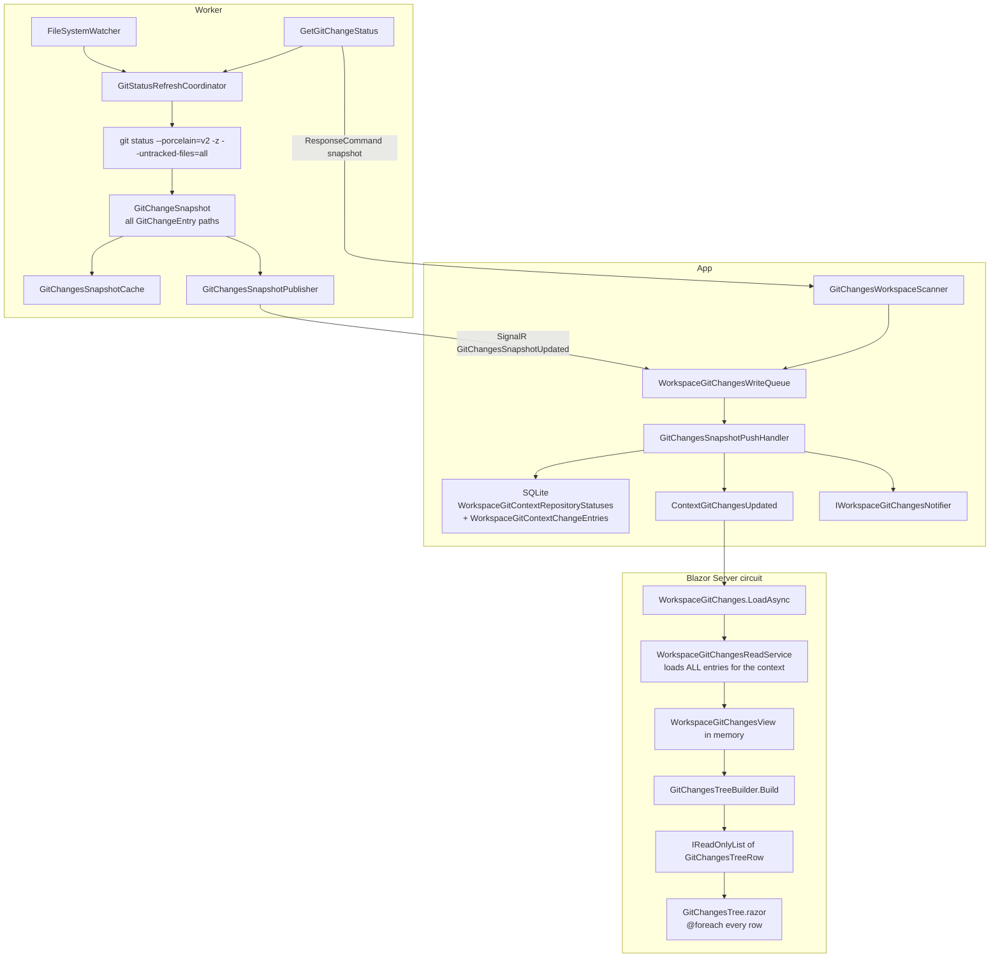

# 07 - Git Changes Projection and File Tree

**State documented:** current Git Changes end-to-end path (Worker scan → App persistence → Blazor tree)  
**Scope:** how changed files are collected, stored, loaded into the circuit, and rendered. Design for large change sets lives in `docs/todo/git-changes-large-changeset-scale.md`.

This document is the precise current-state reference for the Changes page inventory and tree. Product-facing workflow text is in `01-product-model-and-user-workflows.md` (section 18). Watcher leases, pools and mutation consistency are in `04-runtime-communication-and-concurrency.md` (sections 9-13). Page capabilities are in `05-user-capability-reference.md` (sections 21-22). Persisted tables are in `03-data-model-and-persistence.md` (section 13).

## 1. End-to-end data flow



GrayMoon never runs git from the App. The Changes page never calls the Worker to paint the tree: it reads SQLite only. Worker scans happen on lease renewal, watcher debounce, monitoring sweeps, manual Refresh, post-mutation snapshots, and post-sync rescans.

## 2. How changed files are collected (Worker)

### Command and pool

| Piece | Location |
|---|---|
| Request | `GrayMoon.Worker/Jobs/Requests/GetGitChangeStatusRequest.cs` |
| Response | `GrayMoon.Worker/Jobs/Response/GetGitChangeStatusResponse.cs` (`Snapshot: GitChangeSnapshot?`) |
| Handler | `GetGitChangeStatusCommand` |
| Pool | Worker **read** pool (`ReadOnlyCommands`: `GetGitChangeStatus`, `ListGitWorktrees`, `InspectWorktree`) |
| Scan implementation | `GitCliRepositoryGitChangesService.GetStatusAsync` |
| Coalescing | `GitStatusRefreshCoordinator.RefreshNowAsync` |
| Watchers | `GitRepositoryWatcher` / `GitRepositoryWatcherManager` |

`GetGitChangeStatusCommand` registers the path in `GitChangesRepositoryRegistry`, acquires a watcher lease, then refreshes through the coordinator (so concurrent requests coalesce into one scan).

### Authoritative scan

`GitCliRepositoryGitChangesService.GetStatusAsync` runs:

```text
git --no-optional-locks status --porcelain=v2 -z --branch --untracked-files=all
```

Optional (user-visible scans with `includeLineStats: true` only):

```text
git --no-optional-locks diff --numstat
git --no-optional-locks diff --cached --numstat
```

plus line counts for untracked text files under a soft 5 MiB per-file cap (`SoftSizeLimitBytes`). Watcher and background sweeps leave `includeLineStats` false; the App's `GitChangesLineStatsRefresh` later requests a stats-bearing scan when counts are missing.

`GitPorcelainV2Parser.Parse` turns the porcelain output into `IReadOnlyList<GitChangeEntry>`. There is **no change-count cap**, **no path pagination**, and **no path truncation** on the Worker today. Nested ignored directories are not listed as individual files; an untracked nested git repository appears as one directory entry ending in `/` (`--untracked-files=all`).

### Snapshot model (`GrayMoon.Common.Git`)

```text
GitChangeSnapshot
  Version, BranchName, HeadCommit, detached/unborn/merge/rebase/cherry-pick flags
  Changes: IReadOnlyList<GitChangeEntry>   // every path
  ScannedAt
  Insertions / Deletions / StagedInsertions / StagedDeletions  // nullable

GitChangeEntry
  Path, OriginalPath
  IndexChange, WorktreeChange
  IsTracked, IsConflicted, IsSubmodule
```

`GitChangesSnapshotCache` (Worker singleton) holds the latest snapshot per watched repository and issues monotonic versions (seeded from `DateTime.UtcNow.Ticks` so a Worker restart is not rejected as stale). `StampAfterMutation` re-versions mutation results so a mid-mutation watcher scan cannot win over the correct post-mutation snapshot.

### Push vs request/response

Two ways a full snapshot reaches the App:

1. **Solicited:** App `GitChangesWorkspaceScanner` → `GetGitChangeStatus` → `ResponseCommand` → scanner builds `GitChangesSnapshotNotification` → write queue.
2. **Unsolicited:** watcher-driven coordinator scan → `GitChangesSnapshotPublisher` → SignalR `WorkerHubMethods.GitChangesSnapshotUpdated` → `WorkerHub.GitChangesSnapshotUpdated` → same write queue.

In both cases the payload includes the **entire** `Changes` list for that repository.

## 3. How the App persists snapshots

| Piece | Role |
|---|---|
| `WorkspaceGitChangesWriteQueue` | Single-reader channel; serializes SQLite writes |
| `GitChangesSnapshotPushHandler` | Version gate, replace entries, broadcast |
| Context tables | Always written: `WorkspaceGitContextRepositoryStatuses`, `WorkspaceGitContextChangeEntries` |
| Legacy tables | Only when `GitChangesOptions.WriteLegacyGitChangesTables` and the context is the special Workspace |

Per repository + context, the handler:

1. Rejects `snapshot.Version <=` persisted `SnapshotVersion`.
2. Updates status counts (`StagedCount` / `ChangedCount` / `ConflictCount` derived from the entry list; line stats when present).
3. `ExecuteDeleteAsync` all existing change entries for that context+repo.
4. `AddRange` every entry from `snapshot.Changes`.
5. Commits, then `IWorkspaceGitChangesNotifier.Publish` and SignalR `ContextGitChangesUpdated(workspaceId, contextId, repositoryId)` (plus legacy `GitChangesUpdated` when dual-write is on).

There is no incremental path-diff persist: every successful snapshot is a full replace of that repository's entry set.

`Path` / `OriginalPath` are `MaxLength(2000)` on `WorkspaceGitContextChangeEntry`.

## 4. How the UI loads and builds the tree

### Page open (no Worker)

`WorkspaceGitChanges.LoadAsync` (`Components/Pages/WorkspaceGitChanges.razor.cs`):

1. Loads the Workspace name for the header.
2. Calls `IWorkspaceGitChangesReadService.GetContextAsync` (or `GetWorkspaceAsync` for the special Workspace context).
3. `RebuildRows()` → `GitChangesTreeBuilder.Build(_view, _filterQuery, _collapsedKeys)`.
4. Optionally restores a remembered file selection (diff fetch is the only Worker call on open, and it does not gate the tree).

`WorkspaceGitChangesReadService.LoadContextAsync` loads **every** `WorkspaceGitContextChangeEntry` for **every** repository in the selected Feature context into `WorkspaceGitChangesView` / `WorkspaceGitChangesRepositoryView.Changes`. There is no server-side paging, folder scoping, or "summary only" mode.

### Live updates

`WorkspaceGitChanges.Realtime.cs` subscribes to `ContextGitChangesUpdated` / `GitChangesUpdated` and calls `LoadAsync` again. A single-repository watcher update therefore reloads the **full context inventory** from SQLite into the circuit, rebuilds the full flattened row list, and re-renders the tree.

Opening the page does not start a status scan. Scans are activated by workspace route activity (`WorkspaceGitChangesRouteActivity` → `WorkspaceGitChangesActivation`), monitoring (`GitChangesMonitoringBackgroundService`), line-stats fill-in, Sync post-hooks, and the Refresh button.

### Tree construction

`GitChangesTreeBuilder` (`App/Services/GitChanges/GitChangesTreeBuilder.cs`) is a pure function. Shape:

```text
Staged (section) → Repository → Folder* → File
Changed (section) → Repository → Folder* → File
```

Output is a **flattened** `IReadOnlyList<GitChangesTreeRow>` (kinds: `Section`, `Repository`, `Folder`, `File`). Collapsed keys omit descendants from the list (comment: "flatten only visible nodes"). Default `_collapsedKeys` is empty, so **sections, repositories and folders start expanded** - every file row is present on first paint when the inventory is large.

Filter (`WorkspaceGitChangeSearchMatcher`) runs **client-side** over every entry before the tree is built. Supported tokens: plain text, `repo:`, `status:`, `staged:`, `ext:` (via `FilterSearchExpression`).

Directory entries (`path` ending in `/`) become `IsDirectoryEntry` Folder rows: no diff, no Stage/Undo.

### Rendering

`GitChangesTree.razor` renders with `@foreach (var row in Rows)` - **no** `Virtualize`, **no** windowing, **no** lazy child fetch. Each row is a full Blazor element subtree (toggle, icon, label, status letter, action buttons). Diff content is separate (Monaco / markdown preview) and loads per selected file through `GetGitFileDiff` on the Worker **diff** pool.

## 5. What lives where (memory and serialization)

| Layer | What it holds for a large change set |
|---|---|
| Worker process | Full porcelain parse + `GitChangeSnapshot` in coordinator/cache for each watched repo |
| Worker → App SignalR | Full `GitChangesSnapshotNotification` JSON (all paths). App `MaximumReceiveMessageSize` = **10 MiB** (`Program.cs`) |
| App SQLite | One row per path per context+repo; full replace on each snapshot |
| App write path | Transient EF entities for the whole entry set of one repo |
| Blazor circuit | `_view` (all repos × all entries) + `_rows` (flattened visible tree) + multi-selection keys |
| Circuit → browser | Blazor Server render diffs for every tree DOM node that changed |

Approximate pressure at ~5,000 paths (order of magnitude): hundreds of KB to low single-digit MiB of JSON per heavy repository snapshot; multiple MiB of managed objects in the circuit after materializing views and rows; thousands of DOM nodes when the tree is expanded. At tens of thousands of paths the same pipeline stays O(N) at every hop with no batching of the tree itself.

There is **no** Changes-specific entry count limit in `GitChangesOptions`. That options type only tunes parallelism (default 8), watcher debounce/idle/renewal, and legacy dual-write.

## 6. Current limits, batching, pagination, virtualization

| Concern | Today |
|---|---|
| Change-count limit | None |
| Path pagination / lazy folder children | None |
| Tree virtualization | None |
| Client inventory | Full context on every `LoadAsync` |
| Filter | Full client scan of `_view` |
| Persist strategy | Full delete+insert per repo snapshot |
| Worker scan batching | Per-repo coalescing only; parallel across repos via `MaxParallelRepositoryOperations` |
| Diff | On demand, one file; soft size / binary / encoding states in `GitDiffDocument` |
| SignalR receive cap | 10 MiB (shared with Sync and other large commands) |

The tree builder's collapse-aware flatten is the only "visible nodes" optimization. It does not reduce SQLite load, SignalR snapshot size, or circuit `_view` size.

## 7. Why UX degrades around ~5K+ files

Observed pain follows directly from the architecture above:

1. **Full inventory in the circuit.** Opening Changes materializes every path for the context before the first paint of a complete expanded tree.
2. **Default expand.** Empty `_collapsedKeys` means ~N file rows (plus folder/repo/section rows) enter the DOM immediately.
3. **No virtualization.** Blazor Server must diff and sync thousands of elements; scroll and expand/collapse re-diff large ranges.
4. **Full reload on every live update.** Watcher churn (builds, IDE saves) retriggers `LoadAsync` for the whole context, not a surgical row patch.
5. **Full replace persist.** Large snapshots contend on the single-reader write queue and rewrite many SQLite rows.
6. **Client-side search.** Typing a filter walks every entry and rebuilds the tree in the circuit.
7. **Worker porcelain cost.** `--untracked-files=all` can itself be expensive before any UI work starts; that cost is then multiplied by App and circuit work.

Small workspaces (tens to low hundreds of paths) stay fast because each step is still O(N) with small N: SQLite read, in-memory build, and DOM size stay modest.

## 8. Related types and services (index)

```text
Common:     GitChangeEntry, GitChangeSnapshot, GitChangesSnapshotNotification, GitChangesOptions
Worker:     GetGitChangeStatusCommand, GitCliRepositoryGitChangesService, GitStatusRefreshCoordinator,
            GitChangesSnapshotCache, GitChangesSnapshotPublisher, GitRepositoryWatcher*
App read:   IWorkspaceGitChangesReadService / WorkspaceGitChangesReadService,
            WorkspaceGitChangesView (+ Repository / Entry views)
App write:  WorkspaceGitChangesWriteQueue, GitChangesSnapshotPushHandler,
            GitChangesWorkspaceScanner, GitChangesMonitoringBackgroundService,
            GitChangesLineStatsRefresh, WorkspaceGitChangesActivation
App UI:     WorkspaceGitChanges*.cs / .razor, GitChangesTree.razor, GitChangesTreeBuilder,
            WorkspaceGitChangeSearchMatcher, IWorkspaceGitChangesOperations, GitChangesWorkerClient
DB:         WorkspaceGitContextRepositoryStatuses, WorkspaceGitContextChangeEntries
            (+ legacy WorkspaceGitRepositoryStatuses / WorkspaceGitChangeEntries when dual-write on)
Hubs:       WorkerHub.GitChangesSnapshotUpdated; WorkspaceSyncHub ContextGitChangesUpdated
```

## 9. Known gap (scale)

Git Changes has no progressive tree loading, no virtualization, and no server-side folder aggregation for large inventories. Opening or refreshing Changes with many thousands of paths loads the full entry set into the Blazor circuit and renders the expanded flattened list. The inventory itself is already uncapped (Worker and SQLite store every path); the gap is client materialization and DOM cost, not a missing product limit.

Planned scale work must keep **every** changed path reachable (scroll / expand / search) and must not introduce inventory caps or "first N" truncation. Design: `docs/todo/git-changes-large-changeset-scale.md` (section 0).
