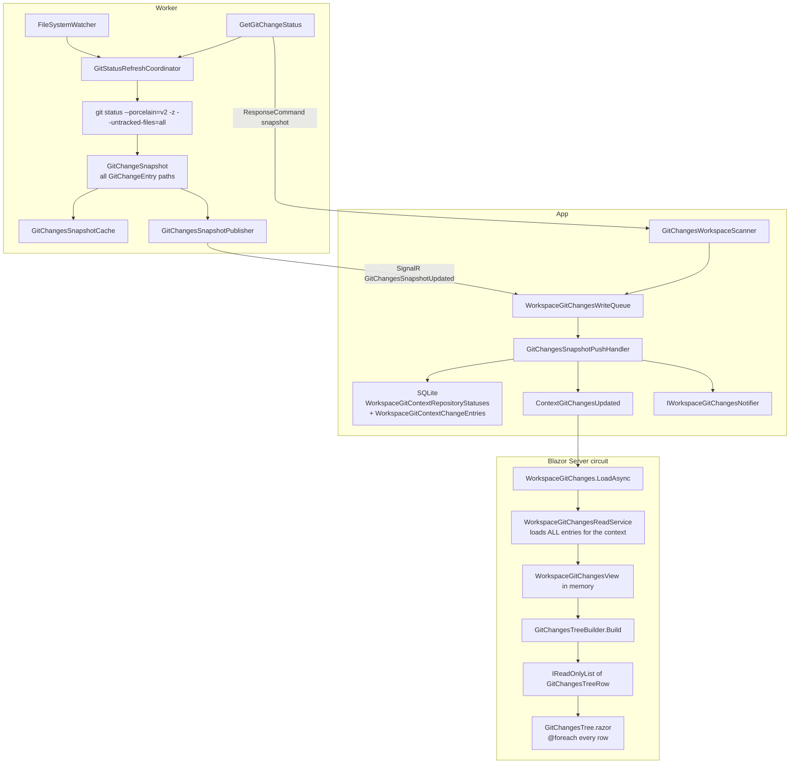

# 07 - Git Changes Projection and File Tree

**State documented:** current Git Changes end-to-end path (Worker scan → App persistence → Blazor tree)  
**Scope:** how changed files are collected, stored, loaded into the circuit, and rendered. Design for large change sets lives in `docs/todo/git-changes-large-changeset-scale.md`.

This document is the precise current-state reference for the Changes page inventory and tree. Product-facing workflow text is in `01-product-model-and-user-workflows.md` (section 18). Watcher leases, pools and mutation consistency are in `04-runtime-communication-and-concurrency.md` (sections 9-13). Page capabilities are in `05-user-capability-reference.md` (sections 21-22). Persisted tables are in `03-data-model-and-persistence.md` (section 13).

## 1. End-to-end data flow



GrayMoon never runs git from the App. The Changes page never calls the Worker to paint the tree: it reads SQLite only. Worker scans happen on lease renewal, watcher debounce, monitoring sweeps, manual Refresh, post-mutation snapshots, and post-sync rescans.

## 2. How changed files are collected (Worker)

### Command and pool

| Piece | Location |
|---|---|
| Request | `GrayMoon.Worker/Jobs/Requests/GetGitChangeStatusRequest.cs` |
| Response | `GrayMoon.Worker/Jobs/Response/GetGitChangeStatusResponse.cs` (`Snapshot: GitChangeSnapshot?`) |
| Handler | `GetGitChangeStatusCommand` |
| Pool | Worker **read** pool (`ReadOnlyCommands`: `GetGitChangeStatus`, `ListGitWorktrees`, `InspectWorktree`) |
| Scan implementation | `GitCliRepositoryGitChangesService.GetStatusAsync` |
| Coalescing | `GitStatusRefreshCoordinator.RefreshNowAsync` |
| Watchers | `GitRepositoryWatcher` / `GitRepositoryWatcherManager` |

`GetGitChangeStatusCommand` registers the path in `GitChangesRepositoryRegistry`, acquires a watcher lease, then refreshes through the coordinator (so concurrent requests coalesce into one scan).

### Authoritative scan

`GitCliRepositoryGitChangesService.GetStatusAsync` runs:

```text
git --no-optional-locks status --porcelain=v2 -z --branch --untracked-files=all
```

Optional (user-visible scans with `includeLineStats: true` only):

```text
git --no-optional-locks diff --numstat
git --no-optional-locks diff --cached --numstat
```

plus line counts for untracked text files under a soft 5 MiB per-file cap (`SoftSizeLimitBytes`). Watcher and background sweeps leave `includeLineStats` false; the App's `GitChangesLineStatsRefresh` later requests a stats-bearing scan when counts are missing.

`GitPorcelainV2Parser.Parse` turns the porcelain output into `IReadOnlyList<GitChangeEntry>`. There is **no change-count cap**, **no path pagination**, and **no path truncation** on the Worker today. Nested ignored directories are not listed as individual files; an untracked nested git repository appears as one directory entry ending in `/` (`--untracked-files=all`).

### Snapshot model (`GrayMoon.Common.Git`)

```text
GitChangeSnapshot
  Version, BranchName, HeadCommit, detached/unborn/merge/rebase/cherry-pick flags
  Changes: IReadOnlyList<GitChangeEntry>   // every path
  ScannedAt
  Insertions / Deletions / StagedInsertions / StagedDeletions  // nullable

GitChangeEntry
  Path, OriginalPath
  IndexChange, WorktreeChange
  IsTracked, IsConflicted, IsSubmodule
```

`GitChangesSnapshotCache` (Worker singleton) holds the latest snapshot per watched repository and issues monotonic versions (seeded from `DateTime.UtcNow.Ticks` so a Worker restart is not rejected as stale). `StampAfterMutation` re-versions mutation results so a mid-mutation watcher scan cannot win over the correct post-mutation snapshot.

### Push vs request/response

Two ways a full snapshot reaches the App:

1. **Solicited:** App `GitChangesWorkspaceScanner` → `GetGitChangeStatus` → `ResponseCommand` → scanner builds `GitChangesSnapshotNotification` → write queue.
2. **Unsolicited:** watcher-driven coordinator scan → `GitChangesSnapshotPublisher` → SignalR `WorkerHubMethods.GitChangesSnapshotUpdated` → `WorkerHub.GitChangesSnapshotUpdated` → same write queue.

In both cases the payload includes the **entire** `Changes` list for that repository.

## 3. How the App persists snapshots

| Piece | Role |
|---|---|
| `WorkspaceGitChangesWriteQueue` | Single-reader channel; serializes SQLite writes |
| `GitChangesSnapshotPushHandler` | Version gate, replace entries, broadcast |
| Context tables | Always written: `WorkspaceGitContextRepositoryStatuses`, `WorkspaceGitContextChangeEntries` |
| Legacy tables | Only when `GitChangesOptions.WriteLegacyGitChangesTables` and the context is the special Workspace |

Per repository + context, the handler:

1. Rejects `snapshot.Version <=` persisted `SnapshotVersion`.
2. Updates status counts (`StagedCount` / `ChangedCount` / `ConflictCount` derived from the entry list; line stats when present).
3. `ExecuteDeleteAsync` all existing change entries for that context+repo.
4. `AddRange` every entry from `snapshot.Changes`.
5. Commits, then `IWorkspaceGitChangesNotifier.Publish` and SignalR `ContextGitChangesUpdated(workspaceId, contextId, repositoryId)` (plus legacy `GitChangesUpdated` when dual-write is on).

There is no incremental path-diff persist: every successful snapshot is a full replace of that repository's entry set.

`Path` / `OriginalPath` are `MaxLength(2000)` on `WorkspaceGitContextChangeEntry`.

## 4. How the UI loads and builds the tree

### Page open (no Worker)

`WorkspaceGitChanges.LoadAsync` (`Components/Pages/WorkspaceGitChanges.razor.cs`):

1. Loads the Workspace name for the header.
2. Calls `GetContextSummariesAsync` first. When distinct path count is at or below `GitChangesOptions.FullHydrationMaxEntries` (default 1_500), or a filter is already active, hydrates with `GetContextAsync` (**Full** mode). Above the threshold with no filter, keeps summary-only repos (**Summary** mode) and seeds every repository as collapsed.
3. `RebuildRows()` → `GitChangesTreeBuilder.Build` (Full) or `BuildFromCache` + `GitChangesTreeNodeCache` (Summary).
4. Optionally restores a remembered file selection (diff fetch is the only Worker call on open, and it does not gate the tree). In Summary mode, restoring a selection expands ancestors and `GetEntryPageAsync`-hydrates those prefixes.

`GetContextAsync` / `LoadContextAsync` still load every entry for the context when Full mode is chosen. Summary mode leaves `Changes` empty until the user expands a repository or folder; children come from `GetEntryPageAsync`. Path indexes: `(context, repo, Path)` and `(context, Path)` (migration 13).

`GetEntryPageAsync` (unfiltered) groups and pages **in SQLite**: one raw-SQL CTE restricts to the section and a binary `Path` range on the `(context, repo, Path)` index, groups by next path segment, and returns `take + 1` rows after the keyset cursor (`f:name` / `p:name`), so only one page of rows is materialised. Order is folders and directory entries first, then files, each by `NOCASE` name with a binary tiebreak (identical to the builder's ordinal-ignore-case order for ASCII names; `GroupDirectChildren` / `OrderChildren` remain the in-memory reference and serve the filtered path). Summaries also carry per-repository changed-kind counts so the header chips work without entries. Bulk consumers (copy all paths, Undo confirmation) and selection checks use `GetEntryPathsAsync` and `EntryExistsAsync`, which read Layer B on demand and retain nothing.

### Live updates

`WorkspaceGitChanges.Realtime.cs` handles `ContextGitChangesUpdated(workspaceId, contextId, repositoryId)` by patching **that repository only**. Full mode re-reads that repository's entries (`GetRepositoryAsync`). Summary mode reads only its status row and kind counts (`GetRepositorySummaryAsync`), drops its node caches, and re-fetches the first page of each expanded prefix (Outcome `PatchedOnly`). Fetches in flight are tracked by cache object, so a fetch started before an invalidation is discarded and never blocks its replacement. If the patched counts cross `FullHydrationMaxEntries` (and no filter is active) the page reloads into the other mode. It does not reload sibling repositories. Legacy `GitChangesUpdated` is ignored when the context event is authoritative. Unrelated contexts stay `NoOp`.

Opening the page does not start a status scan. Scans are activated by workspace route activity (`WorkspaceGitChangesRouteActivity` → `WorkspaceGitChangesActivation`), monitoring (`GitChangesMonitoringBackgroundService`), line-stats fill-in, Sync post-hooks, and the Refresh button.

### Tree construction

`GitChangesTreeBuilder` (`App/Services/GitChanges/GitChangesTreeBuilder.cs`) is a pure function. Shape:

```text
Staged (section) → Repository → Folder* → File
Changed (section) → Repository → Folder* → File
```

Output is a flattened `List<GitChangesTreeRow>` (kinds: `Section`, `Repository`, `Folder`, `File`, `More`). Collapsed keys omit descendants from the list. **Full** mode: default `_collapsedKeys` empty (fully expanded). **Summary** mode: repositories start collapsed; expanding fetches the **first page** of that prefix (plus first pages of already-open child folders). A partially loaded level ends with a `More` sentinel row; when the virtualizer renders it, the next page is fetched, so the circuit only retains what was scrolled to and every file stays reachable. Caches of collapsed prefixes are evicted once retained children exceed `CircuitVisibleRowBudget` (never expanded ones); a failed fetch shows a toast and the next expand retries. Revealing a selected or walked file pages its ancestors until the file is cached.

Filter (`WorkspaceGitChangeSearchMatcher`) runs **client-side** over hydrated entries in Full mode. In Summary mode, applying a filter reloads into Full (debounced, latest load wins) until Phase 2 server-side search. Supported tokens: plain text, `repo:`, `status:`, `staged:`, `ext:` (via `FilterSearchExpression`).

Directory entries (`path` ending in `/`) become `IsDirectoryEntry` Folder rows: no diff, no Stage/Undo.

### Rendering

`GitChangesTree.razor` renders with Blazor `Virtualize` over the flattened row list (fixed 28px row height, `@key="row.Key"`). Only the viewport (+ overscan) is synced to the browser; lazy child fetch is Summary-mode expand via `GetEntryPageAsync`. Diff content is separate (Monaco / markdown preview) and loads per selected file through `GetGitFileDiff` on the Worker **diff** pool.

## 5. What lives where (memory and serialization)

| Layer | What it holds for a large change set |
|---|---|
| Worker process | Full porcelain parse + `GitChangeSnapshot` in coordinator/cache for each watched repo |
| Worker → App SignalR | Full `GitChangesSnapshotNotification` JSON (all paths). App `MaximumReceiveMessageSize` = **10 MiB** (`Program.cs`) |
| App SQLite | One row per path per context+repo; full replace on each snapshot |
| App write path | Transient EF entities for the whole entry set of one repo |
| Blazor circuit | Full mode: `_view` (all entries) + `_rows`. Summary mode: summaries + `TreeNodeCache` for expanded prefixes + virtualized `_rows` |
| Circuit → browser | Virtualized tree window (+ overscan); not every logical row |

Worker→App snapshots and SQLite replace are still O(paths) per repository (Phases 3–4). Circuit open and live update for large inventories are summary-first and per-repo.

`GitChangesOptions` also carries hydration knobs (`FullHydrationMaxEntries`, `TreePageSize`, …) in addition to parallelism, watcher debounce/idle/renewal, legacy dual-write, and benchmark floors. There is still **no** product inventory cap.

## 6. Current limits, batching, pagination, virtualization

| Concern | Today |
|---|---|
| Change-count limit | None (inventory uncapped; `FullHydrationMaxEntries` is an internal hydration switch only) |
| Path pagination / lazy folder children | `GetEntryPageAsync` + expand in Summary mode |
| Tree virtualization | `Virtualize` with fixed 28px rows |
| Client inventory | Full context on Full-mode open; Summary mode holds summaries + expanded prefix pages |
| Filter | Full client scan of `_view` in Full mode; Summary mode reloads to Full (Phase 2: server search) |
| Persist strategy | Full delete+insert per repo snapshot |
| Worker scan batching | Per-repo coalescing only; parallel across repos via `MaxParallelRepositoryOperations` |
| Diff | On demand, one file; soft size / binary / encoding states in `GitDiffDocument` |
| SignalR receive cap | 10 MiB (shared with Sync and other large commands) |

Phase 1 addresses circuit open, expand, virtualize, and live-update shape. SQLite replace and Worker→App payload size remain O(paths) until Phases 3–4 (`docs/todo/git-changes-large-changeset-scale.md`).

## 7. Why UX degrades around ~5K+ files

Phase 1 removes the worst circuit/DOM cliffs for large inventories (summary open, collapsed repos, virtualize, per-repo live patch). Remaining pain follows from hops that are still O(paths):

1. **Full replace persist.** Large snapshots contend on the single-writer write queue and rewrite many SQLite rows.
2. **Worker→App full snapshot JSON.** Near the 10 MiB hub receive cap at ~50K short paths (Phase 4 chunking).
3. **Client-side search on Full inventories.** Typing a filter walks every hydrated entry (Phase 2).
4. **Worker porcelain cost.** `--untracked-files=all` can itself be expensive before any UI work starts.

Small workspaces (at or below `FullHydrationMaxEntries`) keep the single-shot Full path: one SQLite read, default expand, no summary round trip.

## 8. Related types and services (index)

```text
Common:     GitChangeEntry, GitChangeSnapshot, GitChangesSnapshotNotification, GitChangesOptions
Worker:     GetGitChangeStatusCommand, GitCliRepositoryGitChangesService, GitStatusRefreshCoordinator,
            GitChangesSnapshotCache, GitChangesSnapshotPublisher, GitRepositoryWatcher*
App read:   IWorkspaceGitChangesReadService / WorkspaceGitChangesReadService,
            WorkspaceGitChangesView (+ Repository / Entry views)
App write:  WorkspaceGitChangesWriteQueue, GitChangesSnapshotPushHandler,
            GitChangesWorkspaceScanner, GitChangesMonitoringBackgroundService,
            GitChangesLineStatsRefresh, WorkspaceGitChangesActivation
App UI:     WorkspaceGitChanges*.cs / .razor, GitChangesTree.razor, GitChangesTreeBuilder,
            WorkspaceGitChangeSearchMatcher, IWorkspaceGitChangesOperations, GitChangesWorkerClient
DB:         WorkspaceGitContextRepositoryStatuses, WorkspaceGitContextChangeEntries
            (+ legacy WorkspaceGitRepositoryStatuses / WorkspaceGitChangeEntries when dual-write on)
Hubs:       WorkerHub.GitChangesSnapshotUpdated; WorkspaceSyncHub ContextGitChangesUpdated
```

## 9. Known gap (scale)

Git Changes has no progressive tree loading, no virtualization, and no server-side folder aggregation for large inventories. Opening or refreshing Changes with many thousands of paths loads the full entry set into the Blazor circuit and renders the expanded flattened list. The inventory itself is already uncapped (Worker and SQLite store every path); the gap is client materialization and DOM cost, not a missing product limit.

Planned scale work must keep **every** changed path reachable (scroll / expand / search) and must not introduce inventory caps or "first N" truncation. Design: `docs/todo/git-changes-large-changeset-scale.md` (section 0).
