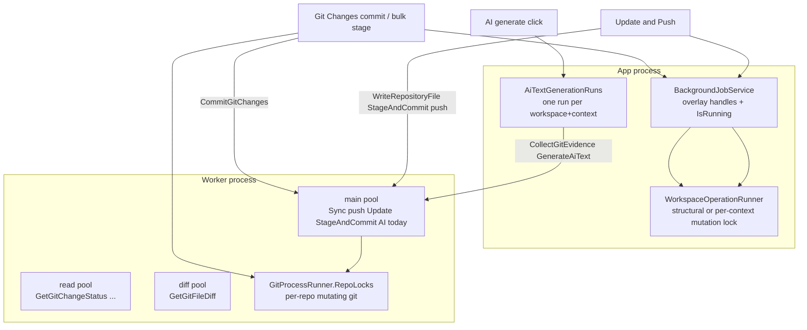
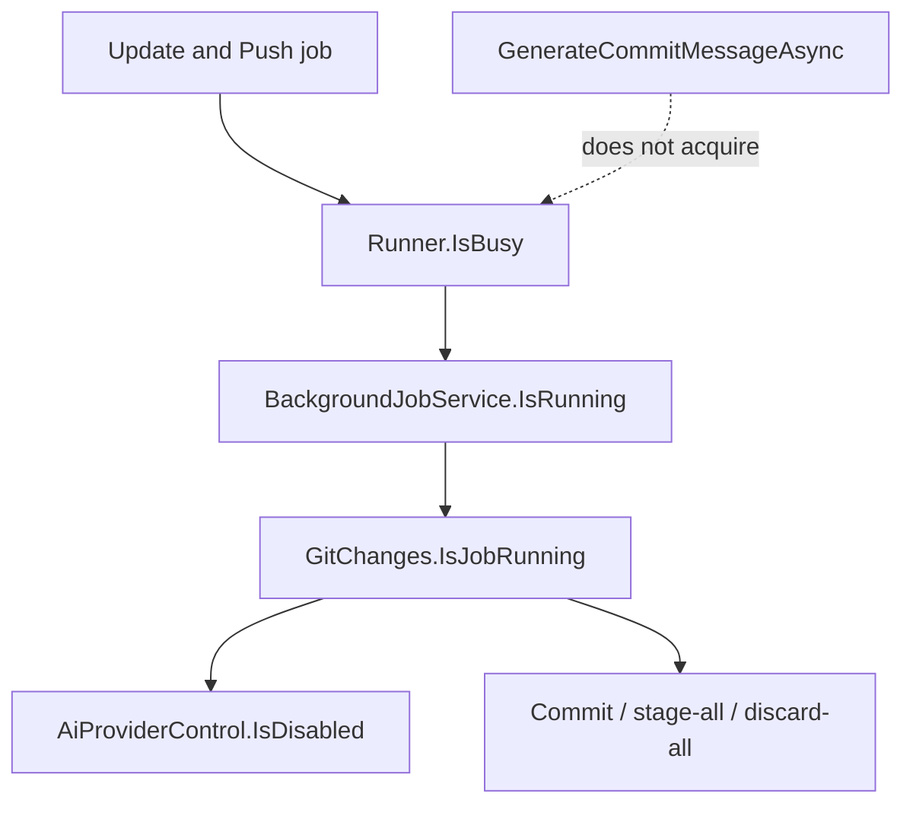

# AI generation vs mutation-lane decoupling

Status: **proposal, reviewed against the code on 2026-11-07.** The step-by-step build plan is `docs/todo/ai-generation-lane-decoupling-implementation-plan.md`. Nothing here is implemented yet. When built, update `04-runtime-communication-and-concurrency.md` (AI generation commands, Worker job pools), `06-developer-extension-guide.md` (pool table), `02-system-architecture.md` (hosted services) and `GrayMoon/CLAUDE.md` in the same change, then trim this file to what was not built.

## 1. Problem

On Git Changes, the AI provider control ("write the commit message") is disabled whenever any other operation on the same Workspace holds the App mutation lock, for example Update and Push (Push Updated) started on Repositories and still running after the user opened Changes. The user sees Push Updated blocking AI, although AI generation never stages, commits or pushes.

Commit and bulk stage/discard stay disabled for the same busy signal. Commit has a real reason to wait. AI does not; the UX reuses one coarse flag for both.

## 2. Three serialization layers (do not conflate)



| Layer | What it serializes | AI today |
|---|---|---|
| App `WorkspaceOperationRunner` | One structural mutation per Workspace, or one mutation per Feature context | Does **not** acquire |
| Worker command pools | Bounded concurrency by command name (main / read / diff) | `CollectGitEvidence`, `GenerateAiText` and `GetAiProviders` sit on **main** with Update/Push |
| Worker `GitProcessRunner.RepoLocks` | Mutating git (and gitversion) per repository path | **Not used by evidence.** `GitEvidenceCollector` runs `git --no-optional-locks` through `BoundedProcessRunner`, so it never waits for a write lock |

Update and Push's internal "two lanes" (`IDependencyUpdateLane` / `IPushLane` in `src/GrayMoon.App/Services/Orchestration/IUpdateAndPushLanes.cs`) are progress hand-off **inside one App-locked job**. They are not an AI lane and do not explain the disabled button.

## 3. Why AI appears blocked (call chain)

### 3A. Update and Push takes the App lock

- `WorkspaceRepositories.Update.cs`: `StartUpdateAndPushJob` calls `JobService.StartJob(PageJobKey, ...)` with `StartUpdateAndPush`.
- On `/workspaces/{id}` the key has no `/ctx/{id}`, so `BackgroundJobService.StartWorkspaceJob` calls `IWorkspaceOperationRunner.TryStart` (structural). A Feature Repositories URL with `/ctx/{id}` uses `TryStartContext`.
- REST uses `WorkspaceCommandHttp.RunExclusiveAsync` and the same structural `TryStart`; busy returns 409 `"A workspace operation is already running."`.

While that job runs, `WorkspaceOperationRunner.IsBusy(workspaceId)` is true (structural or any context mutation).

### 3B. `IsRunning` falls through to workspace-wide busy

```59:65:src/GrayMoon.App/Services/Jobs/BackgroundJobService.cs
    public bool IsRunning(string jobKey)
    {
        if (_jobs.TryGetValue(jobKey, out var handle) && handle.State == BackgroundJobState.Running)
            return true;

        return WorkspaceJobKeys.IsMutationKey(jobKey, out var workspaceId) && _runner.IsBusy(workspaceId);
    }
```

`IsRunning("/workspaces/{id}/changes")` is true while Update and Push holds the lock, even though Changes has no overlay job of its own. The overlay (full-page `LoadingOverlay`) appears only on the originating page path, so the user can navigate to Changes while the job continues, and that is exactly where AI is disabled.

### 3C. Git Changes binds AI to that coarse flag

`WorkspaceGitChanges.JobHelper.cs` documents `IsJobRunning` as "block starting another mutating action (commit buttons, stage-all, discard-all)" and says the Feature selector must not use it. The selector uses `IsOwnPageJobRunning` (only this page's own overlay job). The AI control does not follow that rule:

- `WorkspaceGitChanges.razor`: `AiProviderControl ... IsDisabled="@IsJobRunning"`.
- `AiProviderControl.razor`: main segment `disabled="@(IsDisabled || !pinned.IsAvailable)"`, chevron `disabled="@IsDisabled"`.



### 3D. Backend generation never takes the lock

`IWorkspaceAiGenerationOperations` states the contract: the provider only writes text; nothing stages, commits, pushes or fetches. Standalone generation on Changes goes `GenerateCommitMessageAsync` -> `CommitGeneration.TryStart` -> scoped `GenerateCommitMessageAsync`, with at most one run per workspace + context (`AiTextGenerationRuns`), and never calls `TryStart` / `TryStartContext`.

So the "shared lane" for AI is **UX over-coupling**, not an App-lock requirement.

### 3E. Reverse coupling on the Worker (found in review)

AI commands run on the **tracked** main queue (`TrackedJobQueue`). Every job there increments the global pending count reported to the App (`ReportQueueStatus`), which drives the Worker badge activity frame (`WorkerStatusBadge`). AI requests carry no `WorkspaceId`, so they do not enter the per-workspace count that disables Repositories header actions (`WorkerTasksPendingCount`). They do compete for main-pool slots with Sync, push, Update and every hook notify job.

## 4. Why commit must wait

Commit and whole-repository / bulk stage and discard start under `StartPageJob` and the same mutation lock path as Update and Push (`WorkspaceGitChanges.JobHelper.cs`, `WorkspaceGitChanges.MultiRepo.cs`). On Workspace-context Changes (`/workspaces/{id}/changes`) that is structural `TryStart`, so it cannot overlap Repositories Update and Push on the same Workspace.

That coupling is intentional:

1. **App lock** - one mutation gate so UI overlays and REST exclusivity stay coherent (`04-runtime-communication-and-concurrency.md`, App-side operation locking and Update and Push locks).
2. **Same worktrees** - Update writes version files and package references and runs `StageAndCommit`; UI commit runs `CommitGitChanges`. Concurrent writers race the index and the user's staged set.
3. **Worker per-repo write lock** - `GitProcessRunner.RepoLocks` and the commit critical section in `GitCliRepositoryGitChangesService` serialize mutating git on one path, but do not replace the App-level "one mutation story" for overlays and multi-repo jobs.

Keep commit, stage-all, discard-all and unstage-all gated on `IsJobRunning`. Do not decouple them from Update and Push.

Generate-on-commit (empty message box when Commit is pressed) runs **inside** the commit overlay job and already holds the mutation lock. Leave that path as is.

## 5. Why AI does not need the App lock

| Concern | Mutation (commit / Update and Push) | AI generation |
|---|---|---|
| Writes git index / HEAD | Yes | No |
| Writes working tree for deps | Update and Push yes | No |
| Needs exclusive overlay story | Yes | No (own run slot + field apply policy) |
| Needs fresh evidence | N/A | Yes - solved by the apply policy, not by disabling the button |
| Worker pool | Main pool | Main pool today; moves to its own pool |

Evidence collection is read-only and lock-free on the Worker (`--no-optional-locks`), so it can run while Update writes. It may read a half-updated tree, which is why the result must be offered as a suggestion when it overlapped a mutation.

## 6. Proposed design

Treat AI generation as **read evidence + write text**, with its existing per-context run slot, not as a workspace mutation.

### 6A. Split busy signals in the UI (primary fix)

| Control | Gate |
|---|---|
| Commit, stage-all, discard-all, unstage-all, line-level mutations | Keep `IsJobRunning` (any workspace mutation) |
| Feature selector | Keep `IsOwnPageJobRunning` |
| `AiProviderControl` on Changes | **`IsOwnPageJobRunning`** (this page's own overlay job, which may itself be writing the message). Not workspace-wide busy |
| `AiProviderControl` on New Pull Request | **Unchanged.** See 6E |

### 6B. Evidence freshness when mutations overlap

Reuse `AiTextApplyPolicy`. Direct apply stays "field empty at click, unchanged, scope unchanged". Add one more way to lose direct apply:

- `mutationOverlapped` is true when the Workspace was mutation-busy at click **or** is mutation-busy when the run finishes (page showing the context), carried to the no-page fallback through the run outcome.
- Overlapped (and not otherwise stale/edited) means the result is offered as a **suggestion** with a dedicated reason. It is never applied silently.
- The existing scope fingerprint (HEAD, staged/changed counts, Worker scan time) still catches mutations that started and finished inside the window.

Do not wait for Update and Push to finish before generating.

### 6C. Worker pool: dedicated AI pool

Today (`SignalRConnectionHostedService.cs`): `ReadOnlyCommands` -> read pool, `DiffCommands` -> diff pool, everything else -> main pool.

Add a fourth pool for `CollectGitEvidence`, `GenerateAiText` and `GetAiProviders`:

- Own bounded channel, own hosted service, `MaxConcurrentAiCommands` default **4** (not 2: today AI can use up to the whole main pool, and several contexts can generate at once, so 2 would be a regression).
- **Untracked** like the read and diff queues: it does not call `ReportQueueStatus`. Consequence: the Worker badge activity frame no longer animates for AI generation. The AI control has its own spinner and the commit overlay has its terminal, so nothing else depends on it.
- Not the read pool: a 120 s CLI run must not starve `GetGitChangeStatus`.

### 6D. Leave generate-on-commit alone

The in-job generation inside the commit overlay keeps its mutation lock. It also moves to the AI pool automatically because it sends the same Worker commands.

### 6E. Why the New Pull Request dialog is not changed

Review of `NewPullRequestModal.razor`: its `IsBusy` parameter (from `WorkspaceRepositories.razor`, bound to `IsJobRunning`) disables **every** control in the dialog, including Close, branch pickers, fields and both Create buttons. The dialog lives on Repositories, where the overlay already covers the page for any job started there or from the popup. Enabling only the AI button would let generated text rewrite fields while a Create job is running. The dialog's AI button therefore stays tied to `IsBusy`. The Worker pool change still helps it.

### 6F. Explicit non-goals

- Do not let commit/stage run concurrently with Update and Push on the same lock scope.
- Do not put Open-in tools under the workspace lock (already independent).
- Do not rename or overload Update-and-Push's update/push progress lanes as an AI lane.
- Do not make AI generation take `TryStart` / `TryStartContext` "for consistency".
- Do not change `IsJobRunning` semantics, `BackgroundJobService`, `WorkspaceOperationRunner` or `AiTextGenerationRuns` slot rules.

## 7. Acceptance criteria

- During Update and Push started elsewhere, the AI generate control on Changes is clickable when a provider is available and no generation runs for that context.
- Commit, bulk stage, discard and unstage stay disabled for the same busy signal as today.
- A result that overlapped a mutation is offered as a suggestion with a reason; it never overwrites user text.
- Generate-on-commit inside the commit job still runs under the mutation lock.
- `CollectGitEvidence`, `GenerateAiText` and `GetAiProviders` no longer share the main pool or its queue telemetry.
- New Pull Request behavior is unchanged.
- Architecture docs updated in the same change as the behavior.

## 8. Key file references

| Area | Path |
|---|---|
| Runner / locks | `src/GrayMoon.App/Services/Jobs/WorkspaceOperationRunner.cs` |
| Job and `IsRunning` | `src/GrayMoon.App/Services/Jobs/BackgroundJobService.cs` |
| Changes busy helpers | `src/GrayMoon.App/Components/Pages/WorkspaceGitChanges.JobHelper.cs` |
| Changes AI | `src/GrayMoon.App/Components/Pages/WorkspaceGitChanges.Ai.cs`, `WorkspaceGitChanges.razor` |
| AI control | `src/GrayMoon.App/Components/Ai/AiProviderControl.razor` |
| Apply policy / run slots | `src/GrayMoon.App/Services/Ai/AiTextApplyPolicy.cs`, `AiTextGenerationRuns.cs` |
| AI contract | `src/GrayMoon.Application/Ai/IWorkspaceAiGenerationOperations.cs` |
| Worker pools | `src/GrayMoon.Worker/Hosted/SignalRConnectionHostedService.cs`, `Queue/`, `Hosted/` |
| Worker evidence | `src/GrayMoon.Worker/Services/GitEvidence/GitEvidenceCollector.cs` |
| Queue telemetry | `src/GrayMoon.Worker/Queue/TrackedJobQueue.cs`, `src/GrayMoon.App/Services/Worker/WorkerQueueStateService.cs` |
